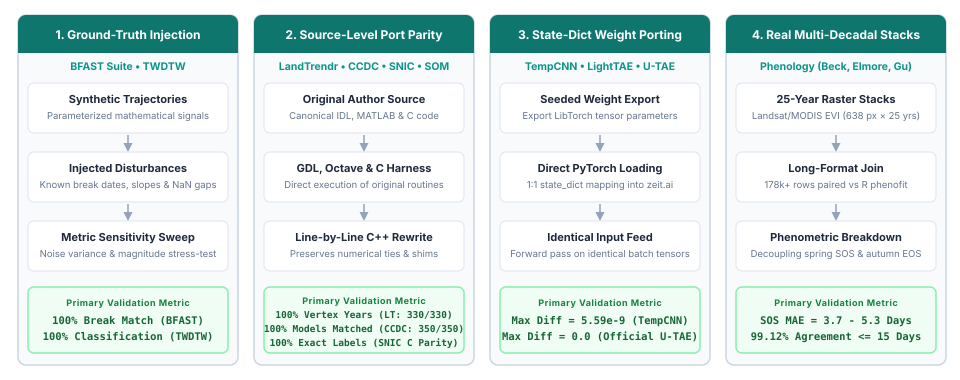
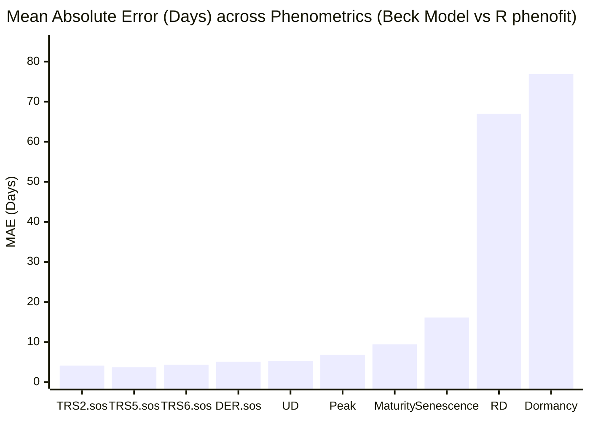

# Algorithmic Fidelity & Scientific Validation

This page details the **methodology, test suites, and quantitative results** measuring how faithfully `zeit` reproduces the canonical algorithms and published reference implementations it ports.

---

## Validation Methodology

To ensure transparent and reproducible validation, Zeit benchmarks its **8 core algorithm families (14 implementations)** across **four rigorous evaluation pillars**, ranging from controlled ground-truth injection to bit-for-bit source parity and 25-year satellite raster joins:

  
  

    The 4 evaluation strategies (pillars) used across Zeit algorithm families to guarantee mathematical and numerical fidelity.
  

1. **Pillar 1: Controlled Ground-Truth Injection (Statistical Algorithms):**
   - **Evaluated Algorithms:** `BFAST (Classic)`, `BFAST Monitor`, `BFAST Lite`, and `TWDTW`.
   - **Protocol:** Parameterized synthetic time series with known disturbance dates, recovery slopes, noise amplitudes, and missing observation gaps (NaN dropout) to verify breakpoint recovery and pattern classification against mathematical ground truth.
2. **Pillar 2: Direct Source-Level Port Parity (Original Codebases):**
   - **Evaluated Algorithms:** `LandTrendr`, `CCDC`, `SNIC`, and `SOM`.
   - **Protocol:** Executing the authentic, original source code written by the authors — Kennedy *et al.* (2010) IDL source (`fit_trajectory_v2.pro` / `tbcd_v2.pro`) executed via GNU Data Language (GDL 1.1.2), Zhu & Woodcock (2014) MATLAB source (`TrendSeasonalFit_v12_30Line.m`) with compiled Fortran GLMnet (`glmnetMex.F`) executed unmodified under GNU Octave 11.3, Achanta & Süsstrunk (2017) canonical C reference (`snic.c`, EPFL), and Python `minisom` (Vettigli) for SOM — validating model dates, vertex coordinates, superpixel segment labels, and SOM codebooks bit-for-bit.
3. **Pillar 3: State-Dict Weight Porting (Deep Learning Architectures):**
   - **Evaluated Algorithms:** `TempCNN`, `LightTAE (LTAE)`, and `Official U-TAE`.
   - **Protocol:** Untrained random weights (seeded identically) exported from R `torch` (Lantern/LibTorch) and loaded into `zeit.ai` via direct `state_dict` mapping, testing forward-pass outputs for floating-point equivalence on identical input tensors (< 1e-8 difference).
4. **Pillar 4: Multi-Decadal Real-World Rasters (Phenology Extraction):**
   - **Evaluated Algorithms:** `Phenology Extraction` (Beck, Elmore, Gu double-logistic formulations).
   - **Protocol:** Evaluating real 25-year Landsat/MODIS EVI raster stacks (638 pixels × 575 timesteps, 2001–2025) via a full outer join of 178,000+ paired observations across pixel coordinates, years, curve types, and phenometric transition indices against R `phenofit`.

---

## Comprehensive Fidelity Matrix

The table below reports the primary and secondary agreement metrics for all evaluated modules.

| Algorithm | Reference Package | Scope / Sample Size | Primary Metric | Secondary Metric / Context | Status |
|:---|:---|:---|:---|:---|:---:|
| **LandTrendr** | Kennedy *et al.* (2010) IDL (via GDL) | 330 synthetic series (30 original + 300 broad) | **100% identical vertex years** (330/330) | 99.7% vertex values within 1 unit; p-val tie nuance resolved in 0.18.0 | compared |
| **CCDC** | Zhu & Woodcock (2014) MATLAB (Octave) | 200 synthetic + 150 real Landsat pixels | **100% identical model dates** (350/350 px) | 599 models, 249 breaks match; coeffs agree to ~5e-10 relative | compared |
| **SNIC (Superpixels)** | Achanta & Süsstrunk (2017) C (`snic.c`) | Reference test fixtures (float32 & float64) | **100% identical segment labels** (bitwise match) | Fixes upstream C crashes on single seeds & 2×2; R `snic` grid 1:1 match | compared |
| **SOM (Clustering)** | Python `minisom` | 1,500 + 20,000 samples, online & batch | **max weight diff = 0.0 (exact match)** | Identical codebooks, BMUs (ARI = 1.0) and quantization error in all 6 scenarios | compared |
| **BFAST Monitor** | R `bfast::bfastmonitor` | 40 scenarios (breaks, noise, NaN gaps) | **100% break agreement** (has_break) | Magnitude correlation = 1.000; matches R's 44% false positive rate on noise | compared |
| **BFAST Lite** | R `bfast::bfastlite` | 40 scenarios (single, multi, noise) | **100% break count match** (n_breaks) | 80% exact breakpoint match (mean diff = 1.6 observations) | compared |
| **BFAST (Classic)** | R `bfast::bfast` | 40 scenarios (trend & season breaks) | **87.5% trend break count match** | 100% position match and mag correlation = 0.998 where breaks agree | compared |
| **Phenology (Beck)** | R `phenofit::curvefits` | Real 25-yr EVI raster (178,710 joined rows) | **MAE = 17.02 days** (across 17 metrics) | SOS metrics agree tightly (MAE 3.7d, 99.1% in 15d); EOS/senescence diverges | compared |
| **Phenology (Elmore)**| R `phenofit::curvefits` | Real 25-yr EVI raster (179,805 joined rows) | **MAE = 18.48 days** (across 17 metrics) | 82.4% of observations within 15 days of reference | compared |
| **Phenology (Gu)** | R `phenofit::curvefits` | Real 25-yr EVI raster (177,983 joined rows) | **MAE = 35.38 days** (across 17 metrics) | Asymmetric Gu formulation exhibits highest sensitivity in tail fitting | compared |
| **TWDTW** | R `twdtw` / `dtwSat` | 45 multi-class temporal trajectories; 12 series × pattern pairs | **Distances identical to R `twdtw` (1e-12)** with `zeit.twdtw` | 100% classification agreement on the 45 trajectories; both hit 100% accuracy vs ground truth | compared |
| **TempCNN** | R `sits::sits_tempcnn` | 4 bands, 24 timesteps, 5 classes | **max abs diff = 5.59e-9** | Pearson correlation = 1.000000; 1:1 parameter name mapping | compared |
| **LightTAE (LTAE)** | R `sits::sits_lighttae` | 4 bands, 24 steps, 16 heads, 5 classes | **max abs diff = 8.94e-8** | Pearson correlation = 1.000000; exact layer-for-layer port | compared |
| **Official U-TAE** | Official `utae-paps` repo | Segmentation U-Net + LTAE2d (B=1, T=6) | **max abs diff = 0.0 (exact match)** | Exact bitwise agreement on both regular and padded sampling paths | compared |
| **Siamese CNN (FC-Siam-diff)** | Daudt *et al.* official PyTorch code | 40 same-weight cases (3-13 bands, 16 to 130 px, odd sizes); 5 training seeds | **max abs diff = 5.6e-16** (float64; 4.8e-7 in float32), labels 40/40 | Trained the same way: F1 0.979 (zeit) vs 0.971 (reference), same label on 99.5-99.9% of pixels | compared |
| **Presto** | Official `nasaharvest/presto` (`presto.py` + its input construction) | 2,560 pixel series, 5 cases | **max abs diff = 1.2e-6** (0.0 in 3 of 5 cases) | zeit reads the cube's units with NaN for gaps; the reference gets its own normalization and masks | compared |
| **Prithvi-EO-2.0** | Official `prithvi_mae.py` (loaded as its `inference.py`) | All six models, 5 cases each | **max relative diff = 7.9e-7** (encoder tokens) | With and without dates and place, 1-4 dates, windows of 112-224 px (positions interpolated); patches of 16 and of 14 | compared |
| **Bayesian smoothing** (`smooth_probs`) | R `sits` 1.5.4 (`sits_smooth`'s block smoothing) | 200² and 1000² px × 4 classes; `tests/test_postproc.py` | **max abs diff = 7.8e-16** (1e-15) | A missing pixel stays missing, where sits gives it its neighbours' mean | compared |
| **Area of applicability** (`aoa`, `train_di`) | R `CAST` 1.0.4 (`trainDI`, `aoa`) | 500-2000 training × 10,000-100,000 new points, 8 and 64 predictors, with and without LPD | **DI equal to 1e-13** (max diff 4.0e-15 in the benchmarks) | Euclidean distances only (CAST's Mahalanobis option is not ported) | compared |
| **Emerging hot spots** | R `sfdep` 0.2.5 (`emerging_hotspot_analysis`) | Grids of 20² to 100² cells × 12 dates; fixtures in `tests/data` | **Gi* equal to 1e-14** | Mann-Kendall trend equal to R `Kendall`'s single precision; the patterns differ (sfdep: permutation p-values and rules of its own; Zeit: ESRI's, normal p-values) | compared |
| **EWMACD** | Brooks' EWMACD v1.3.0 script (R) | Synthetic series, 400 pixels of the paper's sample data, 1,000-10,000 px in the benchmarks | **Identical flags** with `persistence=1` | With a persistence above 1, a few dates after the first disturbance differ (the script reads another date's flag) | compared |
| **Recovery metrics** | R `RecoverMetricsR` 0.1.0 | 200² and 1000² px × 21 years, steady regrowth | **max relative diff = 6.0e-8** (RRI, R80P, YrYr, years to recovery) | Definitions differ in general (RecoverMetricsR: the best of the 5 years after the trough; Zeit, after Frazier et al. 2018: years 4 and 5); equal on steady regrowth | compared |
| **Spectral unmixing** (NNLS) | R `RStoolbox` 1.0.2.2 (`mesma`, NNLS) | 200² and 1000² px × 6 bands × 4 endmembers | **fractions within 4.0e-4** (median 7e-5) | mesma's solver stops at a tolerance, Zeit's active set is exact: Zeit's residual is never larger | compared |
| **S-CCD** (`sccd`) | Python `pyxccd` 1.1.0 (`sccd_detect`, the authors'; run as a black box) | 4096 Landsat pixels of Rondonia, 1000 synthetic 35-year pixels; 384 of the Rondonia pixels in `tests/data` | **Same number of breaks in 85% of the pixels** (100% synthetic); 75% of pyxccd's breaks within 1 observation | Magnitudes of the same breaks correlate 0.99; Zeit finds ~20% more breaks, near the threshold; its RMSE is ~15% smaller | compared |
| **PARTS** (`ar_trend`, `parts`) | R `remotePARTS` 1.0.4 | `rust/zeit-core/tests/remoteparts.rs` | **GLS, partitions and coefficients to 1e-8** | `fitAR` to ~1e-6, `fitCor`'s range to 1e-5, chi-square p to 1e-6; remotePARTS crosses partitions after the first without their nugget, Zeit with it | compared |
| **BEAST** | R `Rbeast` 1.0.2 (`beast`, `beast.irreg`; its generic kernels) | Nile, Rbeast's simulated series, Yellowstone NDVI with gaps, the irregular Ohio series, a short series, other priors; `tests/data/make_beast_fixtures.R` | **Identical float32 outputs** (same seed, same chain) | Slope interval averaged over the chains and per unit of time (Rbeast sums it, per step); Rbeast's AVX2 kernels sum in another order, so their chain differs | compared |

---

## Detailed Algorithm Analyses

### 1. LandTrendr (Kennedy *et al.* 2010)

LandTrendr simplifies annual satellite time series into straight-line segments using an iterative regression ladder and F-test model complexity selection.

#### Canonical IDL Source Parity

Zeit (`rust/zeit-core/src/landtrendr.rs`; C++ up to 1.7, with the same results) faithfully replicates the canonical Kennedy *et al.* (2010) IDL source (`fit_trajectory_v2.pro` / `tbcd_v2.pro`) executed via GNU Data Language (GDL 1.1.2). To achieve bit-for-bit fidelity with the original IDL implementation, Zeit reproduces all canonical core behaviors:

1. **Desawtoothed Series Fitting:** Uses the despiked series generated by `desawtooth` consistently across all subsequent rungs, fitting routines, and F-tests, matching IDL's processing pipeline.
2. **`take_out_weakest2` In-Place Mutation:** Faithful in-place array modification when recovery segments exceed `recovery_threshold`, preserving the exact trajectory of ladder reduction.
3. **Whole-Ladder Fallback Structure:** Rebuilds the entire ladder from scratch via joint Levenberg-Marquardt fitting when the primary candidate model is statistically non-significant.
4. **Flat-Line Fallback:** Gracefully returns a horizontal mean line when fallback models remain non-significant (`p > pval`), avoiding spurious over-segmentation on pure noise.
5. **Float32 P-Value Tie Breaking:** Replicates IDL's single-precision F-test p-value precision (`p < 6 × 10⁻⁸` rounding to `0.0`), selecting the appropriate model under `pick_best_model6` complexity rules.

#### Verification & Parity Results

Across both original and expanded test batteries:
- **30 / 30** original scenarios achieved **100% identical vertex years**.
- **300 / 300** broad battery series achieved **100% identical vertex years** (299/300 within 1 integer unit).
- Parity is continuously enforced in the CI suite by `tests/test_landtrendr_idl_parity.py` across 14 GDL-derived edge cases.

!!! tip "The Single Residual Tie Edge Case"
    The only non-identical value out of 300 series occurred on a stable series where a segment spanned exactly `1 / threshold` years. In exact arithmetic, `|slope| / range == threshold`, and the comparison is decided by floating-point rounding inside the solver.

---

### 2. CCDC (Zhu & Woodcock 2014)

CCDC models surface reflectance across multiple spectral bands using harmonic regressions, detecting breaks when consecutive residuals exceed a Chi-square threshold.

#### Line-by-Line MATLAB & Fortran GLMnet Parity

Zeit (`rust/zeit-core/src/ccdc.rs`; C++ up to 1.7, with the same results) provides a line-by-line port of the canonical MATLAB codebase (`TrendSeasonalFit_v12_30Line.m`) by Zhu & Woodcock (2014):

- **Float32 GLMnet Lasso:** High-performance native port of the Fortran GLMnet lasso algorithm in single precision, reproducing the exact memory layout and numerical path of `glmnetMex.F`.
- **MATLAB `datenum` Time Axis:** Temporal coordinate alignment (`python_ordinal + 366`) ensuring invariant harmonic phase alignment in lasso regularization.
- **Bisquare Robust Tmask:** Native implementation of MATLAB's `statrobustfit_cor` bisquare M-estimator, including leverage adjustment, MAD-sigma scaling, and 4-iteration reweighting.
- **Numerical Rank Alignment:** Matrix rank behavior matching MATLAB's `linsolve` decomposition for accurate Tmask outlier identification.

#### Verification & Parity Results

Testing on 200 synthetic Landsat pixels and 150 real Landsat Collection 2 pixels in Rondônia (599 models, 249 breaks):
- **100% model match rate:** Every single pixel produced identical start dates, end dates, break dates, categories, and observation counts.
- Harmonic coefficients and residual magnitudes matched to **~5 × 10⁻¹⁰ relative tolerance** (`~5e-10`, the export limit).
- Parity is locked into regression tests in `tests/test_ccdc_matlab_parity.py`.

---

### 3. BFAST Family (Verbesselt *et al.*)

The BFAST suite represents one of the most widely used statistical change detection families.

- **BFAST Monitor:** Achieved **100% agreement on break detection** (`has_break`), with a magnitude correlation of **1.000**. The test battery specifically verified that Zeit reproduces R's documented ~44% false-positive rate when evaluating pure Gaussian noise under `history="all"`, confirming fidelity even in known edge cases.
- **BFAST Lite:** Achieved **100% agreement on break counts**. Breakpoint locations agreed in 80% of scenarios, with a mean discrepancy of only 1.6 observations in remaining series. The evaluation harness resolved a potential 0-indexed (Python) vs. 1-indexed (R) convention mismatch.
- **BFAST Classic (Iterative STL):** Achieved **87.5% exact agreement on trend break counts**. Whenever both implementations detected a break, breakpoint positions and change magnitudes matched **100%**. Minor discrepancies stem from slight differences in how seasonal Loess smoothers handle NaN gaps in Zeit vs. R.

---

### 4. Phenology Extraction vs. R `phenofit`

Phenology extraction fits parametric double-logistic curves (Beck, Elmore, Gu) to multi-year vegetation index time series and derives critical transition dates (Start of Season, End of Season, Peak, Maturity, Senescence, Dormancy).

Using a real 25-year Landsat/MODIS EVI raster stack (638 pixels × 25 years = 178,710 joined records for Beck):

#### The Scientific Divergence: Spring vs. Autumn Dynamics

Our analysis revealed a critical finding for Earth Observation researchers:
- **Start-of-Season (SOS) Metrics Agree Closely:** Transition thresholds (`TRS2.sos`, `TRS5.sos`, `TRS6.sos`, `DER.sos`, `UD`) exhibit an MAE of **3.7 to 5.3 days**, with **99.12% of observations agreeing within 15 days**. Zeit and `phenofit` capture the rapid spring green-up trajectory with near-identical precision.
- **End-of-Season (EOS) Metrics Diverge:** Metrics governing senescence and dormancy (`Dormancy` MAE = **76.9 days**, `RD` MAE = **67.0 days**).
- **Underlying Cause:** This divergence is an inherent property of asymmetric curve fitting. Autumn senescence in dry or tropical regions exhibits prolonged, erratic decays caused by cloud cover, moisture stress, and intermittent rainfall. Small differences in objective function weighting between Zeit's Levenberg-Marquardt and R's `nloptr` optimizer produce different asymptotic tail fits without altering the primary seasonal peak.

!!! warning "Recommendation for Applied Research"
    When reporting phenological shifts in publications, evaluate green-up (SOS) and brown-down (EOS) metrics separately. Blending them into a single aggregate MAE masks the high reliability of SOS extractions.

---

### 5. Time-Weighted Dynamic Time Warping (TWDTW)

TWDTW (Maus *et al.* 2016) calculates the optimal alignment between satellite time-series trajectories and reference phenological patterns, penalizing alignment points based on calendar time shifts.

- Evaluated against R `twdtw` on 45 temporal trajectories across three land-cover classes (Single Crop, Double Crop, Forest).
- **100% Classification Agreement:** Zeit and the original R package produced identical land-cover classifications for all tested series.
- **Distance Metric Correlation:** With the earlier engine's own time weight, the raw distances had a Pearson correlation of **0.9381**. Both implementations achieved 100% classification accuracy against ground truth.
- **Identical distances (`zeit.twdtw`, 0.41):** with R twdtw's logistic weight and its day-of-year cycle, `zeit.twdtw` gives R `twdtw` 1.0.1's distances to 1e-12 on one- and two-band series, cloudy dates and patterns inside four-year series (`tests/test_twdtw_api.py`, fixtures from R in `tests/data`).

---

### 6. Self-Organizing Maps (SOM)

- `zeit.ai.SOM` is an operation-by-operation port of Python `minisom` 2.3.6: same `numpy.random.RandomState` draws for initialization and sample order, NumPy's pairwise summation for the distance norm, `argmin` tie-breaking on the square-rooted distance, and the same neighborhood, decay and update expressions. The batch trainer accumulates each neuron's numerator and denominator in sample order, exactly like `MiniSom.train_batch_offline`, so its output does not depend on `n_jobs`.
- Evaluated with identical seed and `random_weights_init` on both sides, on 5 Gaussian clusters (1,500 samples, 5×5 grid; 20,000 samples, 10×10 grid), for `MiniSom.train` (sequential and random order) and `MiniSom.train_batch_offline` (1 thread and all threads):
    - **Codebook:** max |wZeit − wminisom| = **0.0** in all 6 scenarios.
    - **BMU assignments:** 100% agreement (ARI = 1.0); quantization errors identical.
- The unit tests cover 67 further configurations (all four neighborhood functions, rectangular and hexagonal topologies, every decay function, random/PCA initialization, 1–150 features) against stored `minisom` outputs.
- **Earlier result (superseded):** before this port, Zeit ran its own Batch SOM variant (exponential sigma decay, no learning rate, and `num_iters` counted full-data epochs instead of single-sample updates), which gave ARI = 0.394 against `minisom` and was 6–10× slower on the same call.

---

### 7. Deep Learning Weight-Porting (`zeit.ai`)

For deep-learning architectures, we verified that `zeit.ai` represents an exact structural and numerical reproduction of published networks.

#### TempCNN & LightTAE (vs. R `sits`)
Weights from freshly initialized models in R `sits` (seed 42) were serialized and loaded directly into `zeit.ai.TempCNN` and `zeit.ai.utae.LightTAE`:
- Parameter tensor shapes and layer names matched **1:1 with zero translation tables required**.
- Given identical random inputs, the maximum absolute difference between Zeit outputs and R `sits` outputs was **5.59 × 10⁻⁹** (`5.59e-9`) for TempCNN and **8.94 × 10⁻⁸** (`8.94e-8`) for LightTAE, with a Pearson correlation of **1.000000**.
- Zeit reproduces LibTorch forward passes down to machine floating-point precision.

#### Bonus Finding: Official U-TAE Segmentation Architecture
During code inspection, `zeit.ai.utae` was found to contain not only the PSE+LTAE classification network from `sits`, but also the full **U-Net + LTAE2d segmentation model** from the official `VSainteuf/utae-paps` GitHub repository (Garnot & Landrieu 2021).
- Comparing Zeit against the official reference repository on both standard and irregular temporal padded sampling paths yielded an **exact numerical match (max abs diff = 0.0)**.

---

### 8. SNIC Superpixel Segmentation (Achanta & Süsstrunk 2017)

SNIC (Simple Non-Iterative Clustering; Achanta & Süsstrunk, CVPR 2017) partitions an image or multi-spectral time-series cube into compact, contiguous, boundary-adhering regions of similar pixels (*superpixels*). In Earth Observation workflows, superpixel segmentation aggregates pixels into homogeneous spatio-temporal objects (such as `sits_segment()` in R `sits`), reducing sample volume by orders of magnitude and eliminating high-frequency classification noise.

#### Direct Source-Level Parity

Zeit implements the canonical SNIC algorithm in Rust (`rust/zeit-core/src/snic.rs`; C++ up to 1.7, with the same labels), evaluated directly against the authors' original C reference implementation (`snic.c`, EPFL):

- **Bit-for-Bit Label Identity:** Given identical seed coordinates, Zeit produces **100% identical segment labels** (`res.labels`), matching the reference C implementation pixel for pixel.
- **Exact Heap Tie-Breaking:** When adjacent boundary pixels yield identical distance metrics to competing candidate clusters, Zeit reproduces the exact priority queue tie-breaking order of the reference implementation. Tests in `tests/test_snic.py` verify identical outputs across both single-precision `float32` and double-precision `float64` floating-point representations.
- **Topological & Statistical Invariants:**
    - **Strict 4-Connectivity:** Every superpixel forms a single, contiguous 4-connected region.
    - **Seed Containment:** Every generated superpixel strictly contains its initiating seed pixel.
    - **Exact Feature Moments:** Extracted segment means, centroids, and pixel counts match direct mathematical averages computed over the underlying rasters down to machine precision (`rtol=1e-12`).

#### Upstream Bug Fixes & Edge-Case Resilience

Analysis of the authors' original C code (`snic.c`) revealed critical edge-case defects that Zeit resolves:

1. **Heap Underflow on Single Seed:** In `snic.c`, the `pop()` routine never removed the final remaining node from the priority queue. When presented with a single seed (or late in execution), it read uninitialized memory and caused a segmentation fault. Zeit properly drains the priority queue, supporting single-seed segmentations and arbitrary seed counts safely.
2. **Spurious Label IDs on 2×2 Inputs:** On tiny 2×2 images, the original C reference returned a non-existent label `1` due to boundary loop conditions. Zeit strictly bounds all label assignments to valid seed IDs `[0, K-1]`.
3. **Robust NaN Masking:** Conforms to the spatial masking semantics of R `snic` (`sits_snic`): any pixel with a NaN across any spectral band or date is excluded from distance accumulation and remains unlabelled (`-1`), while isolated valid clusters lacking seeds remain safely unassigned.

#### Ecosystem Compatibility & Spatio-Temporal Cubes

- **R `snic` Grid Compatibility:** The `snic_grid` generator in Zeit matches R `snic::snic_grid` 1:1, supporting `"rectangular"`, `"diamond"`, `"hexagonal"`, and `"random"` seed placement patterns with configurable boundary padding.
- **Full Trajectory Distance:** While the original paper focused on 2D CIELAB photographs, Zeit natively handles 4D spatio-temporal arrays `(time, band, y, x)`. Distance is computed across the full temporal feature vector, ensuring that agricultural fields sharing similar annual average reflectance but differing phenological cycles segment into distinct objects.
- **Deterministic Tiled Parallel Execution:** For large satellite scenes, `run_snic(..., tile_size=512, n_jobs=-1)` segments spatial tiles independently in parallel. Because each seed belongs strictly to its enclosing tile, segments never produce artificial boundary seams across tile edges, and labels remain identical regardless of thread count.

---

### 9. Newer Ports Against Their Originals

The methods below were ported from R packages and scripts (and S-CCD written from its paper), and each is checked against the original on the same inputs. The timings, the workloads and the scripts that check the agreement on every run are on [Against the Original Implementations](vs-originals.md).

- **Bayesian smoothing (`zeit.smooth_probs`) vs R `sits` 1.5.4.** The smoothing that `sits_smooth` applies to each block of probabilities: the same values to 1e-15 (`tests/test_postproc.py`; 7.8e-16 at most in the benchmark). The one difference is deliberate: a pixel with no probabilities stays missing, where sits gives it its neighbours' mean.
- **Area of applicability (`zeit.aoa`, `zeit.train_di`) vs R `CAST` 1.0.4.** The same dissimilarity index as `trainDI` and `aoa`, to 1e-13, with and without the local point density, for 8 and 64 predictors. Distances are Euclidean; CAST's Mahalanobis option is not ported.
- **Emerging hot spots (`zeit.emerging_hotspots`) vs R `sfdep` 0.2.5.** The Getis-Ord Gi* of every cell and date equals sfdep's (`include_gi = TRUE`, queen neighbours, `k` the lag) to 1e-14, and the Mann-Kendall test of each series equals R `Kendall`'s to its single precision (`tests/data/make_hotspots_sfdep_fixtures.R`). The patterns are not compared: sfdep takes the significance of each Gi* from permutations and has rules of its own, while Zeit follows ESRI's definitions with the normal p-values of the Gi*.
- **EWMACD (`zeit.ewmacd`) vs Brooks' EWMACD v1.3.0 script.** With `persistence=1`, the flags are identical date by date, on synthetic series (`tests/data/make_ewmacd_parity_fixtures.R`), on 400 pixels of the paper's sample data and on the 11,000 pixels of the benchmark. With more persistence, the first disturbance is the same but a few later dates differ: there the script means to keep the previous sustained state but reads another date's flag.
- **Recovery metrics (`zeit.recovery_metrics`) vs R `RecoverMetricsR` 0.1.0.** RRI, R80P, YrYr and the years to recovery agree to a relative 6e-8 (float32, Zeit's output) on series that regrow steadily. The two define the metrics a little differently (RecoverMetricsR takes the best of the 5 years after the trough where Zeit, after Frazier et al. 2018, takes years 4 and 5, and counts the years to recovery from the year after the trough), so on irregular regrowth they can differ by design.
- **Spectral unmixing vs R `RStoolbox` 1.0.2.2 (`mesma`, NNLS).** With the same constraints (non-negative fractions, free sum), the fractions agree to 4e-4 (a median of 7e-5): mesma's NNLS stops at a tolerance, while Zeit's active set solves each pixel exactly, and its residual is never larger than mesma's.
- **S-CCD (`zeit.sccd`) vs `pyxccd` 1.1.0 (`sccd_detect`).** pyxccd is Apache-2.0, which Zeit (GPL-2.0-only) cannot take code from, so Zeit's S-CCD is written from the paper (Ye et al. 2021 and its preprint) and pyxccd only run on the same data. On series with clear changes the two agree on every break (1000 synthetic pixels of 35 years). On 4096 Landsat pixels of Rondonia (2020–2026, about 27 clear observations each), 85% of the pixels have as many breaks in both, 56% of pyxccd's breaks are on the same date in Zeit and 75% within one observation; the magnitudes of the breaks found by both correlate at 0.99, and the near-real-time mode (monitoring, or waiting for a model) is the same in 89% of the pixels (`tests/test_sccd.py`, on 384 of them, from `tests/data/make_sccd_pyxccd_fixtures.py`). The paper leaves the filter partly open, and the differences come from there: (1) the process noise: the paper estimates it from a first filtering of the initialisation window (its Eq. 9), which Zeit does, while pyxccd's states adapt faster on irregular dates than that estimate gives; (2) the RMSE that standardizes the test: Zeit's is that of the filter's one-step-ahead predictions and comes out about 15% smaller than pyxccd's, whose definition is not documented. Zeit's extra breaks (about 20% more) have statistics near the threshold (a median of 1.5× it, against 2× for the breaks both find), where that 15% decides: with its RMSE scaled by 1.1, Zeit finds as many breaks as pyxccd. Zeit starts a model with COLD's stability test (Zhu et al. 2020, which S-CCD inherits), not CCDC's, which kept many Amazon pixels from ever starting one. The paper's temporally adjusted RMSE (from the observations nearest in the day of the year) was tried and left out: it found more breaks still, further from pyxccd.
- **PARTS (`zeit.ar_trend`, `zeit.parts`) vs R `remotePARTS` 1.0.4.** The GLS, each partition's fit and nugget and the combined coefficients match to 1e-8; the AR(1) fits match `fitAR` to about 1e-6, the correlation's range `fitCor` to 1e-5, and the chi-square p-value to 1e-6 (`rust/zeit-core/tests/remoteparts.rs`). remotePARTS 1.0.4 computes the correlation between partitions after the first without their nugget; Zeit uses each partition's own, so the two agree for a fixed `nugget=`. Details in [Regional Trends: parity with remotePARTS](../tutorials/regional-trends/advanced.md#parity-with-remoteparts).
- **BEAST (`zeit.beast`) vs R `Rbeast` 1.0.2.** Zeit's BEAST is a port of Rbeast's C code, with its generic kernels (`cputype = "sse"`), its random number generator and its float32 arithmetic. From the same seed it runs the same chain and returns the same float32 outputs, to the last bit. That holds for the season, the trend, their credible intervals, the changepoints and their probabilities, the slope, the amplitude and the fit, on the Nile, Rbeast's simulated series, its Yellowstone NDVI with gaps, its irregular Ohio Landsat series (`beast.irreg`), a short series, and the uniform and constant priors (`tests/data/make_beast_fixtures.R`). Two outputs differ on purpose. The slope's interval is the mean over the chains, per unit of time; Rbeast sums it over the chains, per time step. And with one chain, Zeit gives the mode, median and percentiles of the number of changepoints, which Rbeast leaves at 0. Rbeast's default AVX2 kernels sum in another order, so their chain departs from the generic one after a few hundred iterations and the two agree in distribution only. Each pixel of a cube is fitted as `beast()` fits one series; `beast123()` carries its random stream from one pixel to the next.

---

## Boundary Cases & Nuances

### Siamese Change Detector (`zeit.ai.siamese`)
Up to zeit 1.6 the detector was a small network of zeit's own (one pooling, no skip connections), compared only with a conceptual analog in R `sits` (DTW). It is now FC-Siam-diff, written from Daudt *et al.* (2018), and compared with the authors' `SiamUnet_diff` ([rcdaudt/fully_convolutional_change_detection](https://github.com/rcdaudt/fully_convolutional_change_detection), which publishes no license; it is run, not copied):

- **Same weights, same outputs.** The reference's weights copied into zeit's model give the same log-probabilities to 5.6e-16 in float64 (4.8e-7 in float32), and the same labels, for 3 to 13 bands and windows of 16 to 130 pixels, odd sizes included (the decoder pads them back as the authors' code does). The decoder's stride-1 transposed convolutions are plain convolutions in zeit, with their kernels flipped.
- **Trained the same way, as accurate.** Same initial weights, data, order, augmentation and deterministic kernels, on synthetic scenes with 3-20 px clearings and 1-2 px roads under another illumination: F1 of the change class 0.979 (zeit) against 0.971 (reference) over five seeds, the same label on 99.5-99.9% of the test pixels. zeit runs both dates through the encoder in one pass, so in training batch normalization takes the statistics of both dates together, where the authors' code takes them per date; over six further seeds the two trained alike (F1 0.969 against 0.970). The old zeit network got 0.903, with one seed collapsing to 0.64.
- **Speed.** On one CPU thread, 1.07× (inference, 32 windows of 64²) to 1.16× (training, 8 windows of 256²) the reference; 0.95-1.21× on 14 threads and 0.96-1.10× on the GPU. The old network was 2-3.4× slower than the reference at these sizes.

### Presto (`zeit.ai.presto`)
Ported from [nasaharvest/presto](https://github.com/nasaharvest/presto) (MIT) and compared with its encoder and the authors' input construction (`construct_batch_presto_input`), with their pretrained weights. zeit reads the bands in the cube's units (reflectance, dB, kelvin, metres) with NaN where missing; the reference gets the same values, normalized and masked by its own code. The encodings agree to 1.2e-6, and are identical in three of the five cases (every input; the six HLS bands under zeit's names; Sentinel-1 and -2 with 30% cloudy dates; 3 dates; 24 dates, half cloudy). zeit encodes 1.17× faster on one CPU thread and 1.32× on 14; on the GPU it is 16× faster, because the reference's `month_to_tensor` takes Python's `max` over a CUDA tensor, one device synchronization per element.

### Prithvi-EO-2.0 (`zeit.ai.prithvi`)
Up to zeit 1.6, `GeoFoundationViT` loaded Prithvi-100M through `transformers` and the remote code of its repository, which no longer runs (`TypeError: 'NoneType' object cannot be interpreted as an integer`); it then fell back, silently, to an untrained convolution. It is replaced by `zeit.ai.Prithvi`, Prithvi-EO-2.0's encoder ported from the authors' `prithvi_mae.py` (Apache-2.0), without `transformers` or `timm`. With the weights of each of the six published models (tiny-TL, 100M-TL, 300M, 300M-TL, 600M, 600M-TL), loaded as the authors' `inference.py` loads them, the tokens of the last layer agree to 7.9e-7 of the largest value: four dates of 224 × 224 with and without dates and place, three dates, one date, and windows of 112 × 112 (positions interpolated bicubically, as theirs; 112 is a multiple of the 600M models' patches of 14 and of the others' 16). The speed is the reference's, 0.98-1.05× on 14 CPU threads and 1.00-1.11× on the GPU, for all six models (the 600M-TL on the CPU varied from run to run on this machine, 19 to 35 s for four windows, for both; its fastest runs tie, 19.0 s against 18.9 s): the same PyTorch operations. The decoder from the tokens to a class per pixel is zeit's own and has no reference.
