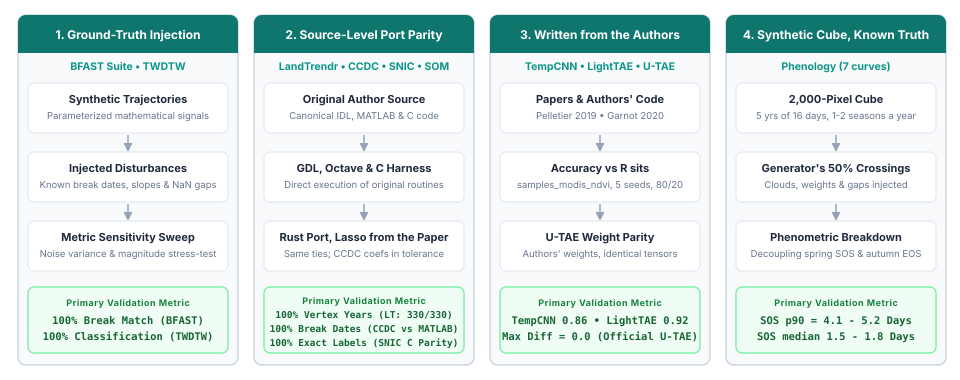

# Algorithmic Fidelity & Scientific Validation

This page details the **methodology, test suites, and quantitative results** measuring how faithfully `zeit` reproduces the canonical algorithms and published reference implementations it ports.

---

## Validation Methodology

To ensure transparent and reproducible validation, Zeit benchmarks its **8 core algorithm families (14 implementations)** across **four rigorous evaluation pillars**, ranging from controlled ground-truth injection to bit-for-bit source parity and 25-year satellite raster joins:

  
  

    The 4 evaluation strategies (pillars) used across Zeit algorithm families to guarantee mathematical and numerical fidelity.
  

1. **Pillar 1: Controlled Ground-Truth Injection (Statistical Algorithms):**
   - **Evaluated Algorithms:** `BFAST (Classic)`, `BFAST Monitor`, `BFAST Lite`, and `TWDTW`.
   - **Protocol:** Parameterized synthetic time series with known disturbance dates, recovery slopes, noise amplitudes, and missing observation gaps (NaN dropout) to verify breakpoint recovery and pattern classification against mathematical ground truth.
2. **Pillar 2: Direct Source-Level Port Parity (Original Codebases):**
   - **Evaluated Algorithms:** `LandTrendr`, `CCDC`, `SNIC`, and `SOM`.
   - **Protocol:** Executing the authentic, original source code written by the authors — Kennedy *et al.* (2010) IDL source (`fit_trajectory_v2.pro` / `tbcd_v2.pro`) executed via GNU Data Language (GDL 1.1.2), Zhu & Woodcock (2014) MATLAB source (`TrendSeasonalFit_v12_30Line.m`) with its bundled GLMnet lasso executed unmodified under GNU Octave 11.3, Achanta & Süsstrunk (2017) canonical C reference (`snic.c`, EPFL), and Python `minisom` (Vettigli) for SOM — validating model dates, vertex coordinates, superpixel segment labels, and SOM codebooks (CCDC's coefficients within the tolerances given in section 2; the rest bit for bit).
3. **Pillar 3: Architectures Written from the Authors (Deep Learning):**
   - **Evaluated Algorithms:** `TempCNN`, `LightTAE (LTAE)`, and `Official U-TAE`.
   - **Protocol:** `TempCNN` and `LightTAE` are written from the papers and the authors' code, not ported from R `sits`, so their weights are no longer compared with `sits`'s: the two are compared by accuracy on `sits`'s `samples_modis_ndvi` (12 dates, 4 classes; 5 seeds, the same 80/20 split on both sides). `Official U-TAE` is run against the authors' code with the same weights, testing forward-pass outputs for floating-point equivalence on identical input tensors.
4. **Pillar 4: Synthetic Cube with Known Truth (Phenology Extraction):**
   - **Evaluated Algorithms:** `Phenology Extraction` (Beck, Elmore, Gu, Klosterman, Zhang, asymmetric Gaussian and double logistic curves).
   - **Protocol:** A synthetic cube of 2,000 pixels (5 years of 16 days, half of the pixels with one season a year and half with two), with clouds, weights and gaps. The truth is the 50% crossings of the generator; the error is that of TRS5 in the single-season pixels, as median / 90th percentile in days. Zeit's phenology is written from the papers, not from phenofit's code, so it is no longer compared with phenofit's outputs record by record; the comparison with the earlier Zeit 1.x, derived from phenofit, is in section 4.
---

## Comprehensive Fidelity Matrix

The table below reports the primary and secondary agreement metrics for all evaluated modules.

| Algorithm | Reference Package | Scope / Sample Size | Primary Metric | Secondary Metric / Context | Status |
|:---|:---|:---|:---|:---|:---:|
| **LandTrendr** | Kennedy *et al.* (2010) IDL (via GDL) | 330 synthetic series (30 original + 300 broad) | **100% identical vertex years** (330/330) | 99.7% vertex values within 1 unit; p-val tie nuance resolved in 0.18.0 | compared |
| **CCDC** | Zhu & Woodcock (2014) MATLAB (Octave) | 11 cases of the parity suite (`tests/test_ccdc_matlab_parity.py`); lasso swap measured on 2,812 pixels | **Identical segment dates, categories and `num_obs`** | Coefficients, RMSE and magnitude within the tolerances of the test (predictions at the segment's start, middle and end within 0.5, i.e. at most 0.2% of the segment's RMSE) | compared |
| **SNIC (Superpixels)** | Achanta & Süsstrunk (2017) C (`snic.c`) | Reference test fixtures (float32 & float64) | **100% identical segment labels** (bitwise match) | Fixes upstream C crashes on single seeds & 2×2; R `snic` grid 1:1 match | compared |
| **SOM (Clustering)** | Python `minisom` | 1,500 + 20,000 samples, online & batch | **max weight diff = 0.0 (exact match)** | Identical codebooks, BMUs (ARI = 1.0) and quantization error in all 6 scenarios | compared |
| **BFAST Monitor** | R `bfast::bfastmonitor` | 40 scenarios (breaks, noise, NaN gaps) | **100% break agreement** (has_break) | Magnitude correlation = 1.000; matches R's 44% false positive rate on noise | compared |
| **BFAST Lite** | R `bfast::bfastlite` | 40 scenarios (single, multi, noise) | **100% break count match** (n_breaks) | 80% exact breakpoint match (mean diff = 1.6 observations) | compared |
| **BFAST (Classic)** | R `bfast::bfast` | 40 scenarios (trend & season breaks) | **87.5% trend break count match** | 100% position match and mag correlation = 0.998 where breaks agree | compared |
| **TWDTW** | R `twdtw` / `dtwSat` | 45 multi-class temporal trajectories; 12 series × pattern pairs | **Distances identical to R `twdtw` (1e-12)** with `zeit.twdtw` | 100% classification agreement on the 45 trajectories; both hit 100% accuracy vs ground truth | compared |
| **Phenology (Beck)** | Zeit 1.x (derived from phenofit) | Synthetic cube, 2,000 px (one season a year: TRS5 error vs the generator's 50% crossings) | **Start of season: median 1.50 d, 90th percentile 4.12 d** | Zeit 1.x: 2.43 / 10.7 d; end of season at the same level (1.43 / 4.63 d) | compared |
| **Phenology (Elmore)** | Zeit 1.x (derived from phenofit) | Same cube | **Start of season: median 1.51 d, 90th percentile 4.23 d** | Zeit 1.x: 1.71 / 7.28 d | compared |
| **Phenology (Gu)** | Zeit 1.x (derived from phenofit) | Same cube | **Start of season: median 1.80 d, 90th percentile 4.99 d** | Zeit 1.x: 1.90 / 8.55 d | compared |
| **TempCNN** | R `sits::sits_tempcnn` (accuracy only) | `samples_modis_ndvi`: 12 dates, 4 classes, 5 seeds, 80/20 split | **accuracy 0.861 ± 0.024** (Zeit, the pipeline's defaults) | `sits`, its defaults: 0.879 ± 0.027; Zeit, the authors' defaults: 0.839 ± 0.031 | compared |
| **LightTAE (LTAE)** | R `sits::sits_lighttae` (accuracy only) | Same samples and split | **accuracy 0.915 ± 0.011** (Zeit, the pipeline's defaults) | `sits`, its defaults: 0.902 ± 0.016; Zeit, the authors' defaults: 0.892 ± 0.020 | compared |
| **Official U-TAE** | Official `utae-paps` repo | Segmentation U-Net + LTAE2d (B=1, T=6) | **max abs diff = 0.0 (exact match)** | Exact bitwise agreement on both regular and padded sampling paths | compared |
| **Siamese CNN (FC-Siam-diff)** | Daudt *et al.* official PyTorch code | 40 same-weight cases (3-13 bands, 16 to 130 px, odd sizes); 5 training seeds | **max abs diff = 5.6e-16** (float64; 4.8e-7 in float32), labels 40/40 | Trained the same way: F1 0.979 (zeit) vs 0.971 (reference), same label on 99.5-99.9% of pixels | compared |
| **Presto** | Official `nasaharvest/presto` (`presto.py` + its input construction) | 2,560 pixel series, 5 cases | **max abs diff = 1.2e-6** (0.0 in 3 of 5 cases) | zeit reads the cube's units with NaN for gaps; the reference gets its own normalization and masks | compared |
| **Prithvi-EO-2.0** | Official `prithvi_mae.py` (loaded as its `inference.py`) | All six models, 5 cases each | **max relative diff = 7.9e-7** (encoder tokens) | With and without dates and place, 1-4 dates, windows of 112-224 px (positions interpolated); patches of 16 and of 14 | compared |
| **Bayesian smoothing** (`smooth_probs`) | R `bayesEO` (`bayes_smooth`), the method of Camara et al. (2024) | `tests/test_postproc.py` | **agrees to about 2e-3**, the same class everywhere in the tests | Written from the paper; a missing pixel stays missing | compared |
| **Area of applicability** (`aoa`, `train_di`) | R `CAST` 1.0.4 (`trainDI`, `aoa`) | 500-2000 training × 10,000-100,000 new points, 8 and 64 predictors, with and without LPD | **DI equal to 1e-13** (max diff 4.0e-15 in the benchmarks) | The Mahalanobis distance (DI max diff 3.3e-13 on 2000 × 100,000 points) and a buffered leave-one-out (`CVtrain`, on the test cases) to 1e-13 as well | compared |
| **kNNDM** (`spatial_folds(method="knndm")`) | R `CAST` 1.0.4 (`knndm`) | 1000 and 5000 clustered points, k = 5; `tests/data/make_knndm_cast_fixtures.R` | **W of CAST's folds equal to 1e-9** | Zeit draws its own folds: their W was 0.572 against CAST's 0.685 on 1000 points, 0.267 against 0.269 on 5000 (smaller is better) | compared |
| **Error profile** (`error_profile`) | R `CAST` 1.0.4 (`errorProfiles`) with `scam` 1.2.23 | 2000 cross-validated points; `tests/data/make_error_profile_cast_fixtures.R` | **windows equal to 1e-14** (5.3e-15) | The monotone curve is a P-spline of Zeit's, within 1.2% of scam's; a window of one class all predicted right has accuracy 1, where CAST gives 0 | compared |
| **Autocorrelation range** (`autocorrelation_range`) | R `blockCV` 4.0.1 (`cv_spatial_autocor`, automap) | 300² px maps correlated up to 300, 700 and 1500 m | **range 0.89-1.02 × blockCV's** | Each draws its own sample of pixels; the bands of distance are automap's; with an exponential or Gaussian model blockCV reports its scale, Zeit its practical range | compared |
| **Emerging hot spots** | R `sfdep` 0.2.5 (`emerging_hotspot_analysis`) | Grids of 20² to 100² cells × 12 dates; fixtures in `tests/data` | **Gi* equal to 1e-14** | Mann-Kendall trend equal to R `Kendall`'s single precision; the patterns differ (sfdep: permutation p-values and rules of its own; Zeit: ESRI's, normal p-values) | compared |
| **EWMACD** | Brooks' EWMACD v1.3.0 script (R) | Synthetic series, 400 pixels of the paper's sample data, 1,000-10,000 px in the benchmarks | **Identical flags** with `persistence=1` | With a persistence above 1, a few dates after the first disturbance differ (the script reads another date's flag) | compared |
| **Recovery metrics** | R `RecoverMetricsR` 0.1.0 | 200² and 1000² px × 21 years, steady regrowth | **max relative diff = 6.0e-8** (RRI, R80P, YrYr, years to recovery) | Definitions differ in general (RecoverMetricsR: the best of the 5 years after the trough; Zeit, after Frazier et al. 2018: years 4 and 5); equal on steady regrowth | compared |
| **Spectral unmixing** (NNLS) | R `RStoolbox` 1.0.2.2 (`mesma`, NNLS) | 200² and 1000² px × 6 bands × 4 endmembers | **fractions within 4.0e-4** (median 7e-5) | mesma's solver stops at a tolerance, Zeit's active set is exact: Zeit's residual is never larger | compared |
| **S-CCD** (`sccd`) | Python `pyxccd` 1.1.0 (`sccd_detect`, the authors'; run as a black box) | 4096 Landsat pixels of Rondonia, 1000 synthetic 35-year pixels; 384 of the Rondonia pixels in `tests/data` | **Same number of breaks in 85% of the pixels** (100% synthetic); 75% of pyxccd's breaks within 1 observation | Magnitudes of the same breaks correlate 0.99; Zeit finds ~20% more breaks, near the threshold; its RMSE is ~15% smaller | compared |
| **PARTS** (`ar_trend`, `parts`) | R `remotePARTS` 1.0.4 | `rust/zeit-core/tests/remoteparts.rs` | **GLS, partitions and coefficients to 1e-8** | `fitAR` to ~1e-6, `fitCor`'s range to 1e-5, chi-square p to 1e-6; remotePARTS crosses partitions after the first without their nugget, Zeit with it | compared |
| **BEAST** | R `Rbeast` 1.0.2 (`beast`, `beast.irreg`; its generic kernels) | Nile, Rbeast's simulated series, Yellowstone NDVI with gaps, the irregular Ohio series, a short series, other priors; `tests/data/make_beast_fixtures.R` | **Identical float32 outputs** (same seed, same chain) | Slope interval averaged over the chains and per unit of time (Rbeast sums it, per step); Rbeast's AVX2 kernels sum in another order, so their chain differs | compared |
| **NBAR** (`nbar`, `sentinel2_angles`) | NASA HLS v2.0 L30 and S30 (a product: its NBAR reflectance and angle bands), against Landsat Collection 2 L2 and Sentinel-2 L2A | Tile 23LKC, 3 windows of 1000 × 1000 px each, `benchmarks/vs_originals/nbar_hls.py` | **L30: the median of R = NBAR / SR in every bin of view zenith and azimuth within 0.0083 of Zeit's c (tolerance 0.01 and 0.02), slope 0.98-1.07** | S30 (Sen2Cor against LaSRC): 0.010-0.021 from the red edge to SWIR once each window's processor offset is out (not the visible bands); the angles equal HLS's to 0.015° (sun) and 0.05° (view zenith, std), the c from them to 0.003 (std) | compared |

---

## Detailed Algorithm Analyses

### 1. LandTrendr (Kennedy *et al.* 2010)

LandTrendr simplifies annual satellite time series into straight-line segments using an iterative regression ladder and F-test model complexity selection.

#### Canonical IDL Source Parity

Zeit (`rust/zeit-core/src/landtrendr.rs`; C++ up to 1.7, with the same results) faithfully replicates the canonical Kennedy *et al.* (2010) IDL source (`fit_trajectory_v2.pro` / `tbcd_v2.pro`) executed via GNU Data Language (GDL 1.1.2). To achieve bit-for-bit fidelity with the original IDL implementation, Zeit reproduces all canonical core behaviors:

1. **Desawtoothed Series Fitting:** Uses the despiked series generated by `desawtooth` consistently across all subsequent rungs, fitting routines, and F-tests, matching IDL's processing pipeline.
2. **`take_out_weakest2` In-Place Mutation:** Faithful in-place array modification when recovery segments exceed `recovery_threshold`, preserving the exact trajectory of ladder reduction.
3. **Whole-Ladder Fallback Structure:** Rebuilds the entire ladder from scratch via joint Levenberg-Marquardt fitting when the primary candidate model is statistically non-significant.
4. **Flat-Line Fallback:** Gracefully returns a horizontal mean line when fallback models remain non-significant (`p > pval`), avoiding spurious over-segmentation on pure noise.
5. **Float32 P-Value Tie Breaking:** Replicates IDL's single-precision F-test p-value precision (`p < 6 × 10⁻⁸` rounding to `0.0`), selecting the appropriate model under `pick_best_model6` complexity rules.

#### Verification & Parity Results

Across both original and expanded test batteries:
- **30 / 30** original scenarios achieved **100% identical vertex years**.
- **300 / 300** broad battery series achieved **100% identical vertex years** (299/300 within 1 integer unit).
- Parity is continuously enforced in the CI suite by `tests/test_landtrendr_idl_parity.py` across 14 GDL-derived edge cases.

!!! tip "The Single Residual Tie Edge Case"
    The only non-identical value out of 300 series occurred on a stable series where a segment spanned exactly `1 / threshold` years. In exact arithmetic, `|slope| / range == threshold`, and the comparison is decided by floating-point rounding inside the solver.

---

### 2. CCDC (Zhu & Woodcock 2014)

CCDC models surface reflectance across multiple spectral bands using harmonic regressions, detecting breaks when consecutive residuals exceed a Chi-square threshold.

#### MATLAB Parity and the Clean-Room Lasso

Zeit (`rust/zeit-core/src/ccdc.rs`) follows the canonical MATLAB codebase (`TrendSeasonalFit_v12_30Line.m`) by Zhu & Woodcock (2014). Until the swap the lasso was a port of the GLMnet Fortran solver bundled with it, and the results matched the MATLAB's coefficients to about 5e-10. That solver is GPL-2.0-only, so the lasso is now written from the paper (Friedman, Hastie & Tibshirani 2010, coordinate descent; `rust/zeit-core/src/lasso.rs`), and CCDC is no longer bit for bit with the MATLAB.

- **Lasso swap (before against after, 2,812 pixels).** Same number of segments, same start, end and break dates (exactly), same category and same `num_obs` in every pixel; `change_prob` is the same. The RMSE of the optical bands differs by a median of about 5e-6 (absolute) and the harmonic coefficients by a median of 0 (p99 about 2e-4; the largest 0.03 on a coefficient near zero).
- **Against the MATLAB (11 cases, `LASSO_THRESH = 1e-8`).** Same segments, category, `num_obs` and `change_prob`, and the same predictors kept by the lasso in every segment of every band. The predicted value at the start, middle and end of a segment differs by at most 0.234 (reflectance x 10000), 0.2% of the segment's RMSE; the harmonic coefficients by at most 0.035; the RMSE by 7.9e-4. The intercept `a0` is collinear with the trend `c1` on the datenum axis, so the two differ together (c1 by at most 1.3e-5 per day) and their sum, the prediction, stays. The MATLAB's single precision leaves 1e-3 to 1e-2 of noise in the RMSE of a constant band; the new fit gives 0.
- **MATLAB `datenum` Time Axis:** Temporal coordinate alignment (`python_ordinal + 366`) ensuring invariant harmonic phase alignment in lasso regularization.
- **Bisquare Robust Tmask:** Native implementation of MATLAB's `statrobustfit_cor` bisquare M-estimator, including leverage adjustment, MAD-sigma scaling, and 4-iteration reweighting.
- **Numerical Rank Alignment:** Matrix rank behavior matching MATLAB's `linsolve` decomposition for accurate Tmask outlier identification.

#### Verification & Parity Results

- Segment dates, categories and observation counts are exact. Coefficients, RMSE and magnitude are compared within tolerances (`tests/test_ccdc_matlab_parity.py`): the model through its predictions at the segment's start, middle and end (atol 0.5), `c1` (atol 1e-4), the harmonics (atol 0.1), the RMSE (rtol 1e-4, atol 0.01) and the magnitude (atol 0.25), about twice the largest differences measured.

---

### 3. BFAST Family (Verbesselt *et al.*)

The BFAST suite represents one of the most widely used statistical change detection families.

- **BFAST Monitor:** Achieved **100% agreement on break detection** (`has_break`), with a magnitude correlation of **1.000**. The test battery specifically verified that Zeit reproduces R's documented ~44% false-positive rate when evaluating pure Gaussian noise under `history="all"`, confirming fidelity even in known edge cases.
- **BFAST Lite:** Achieved **100% agreement on break counts**. Breakpoint locations agreed in 80% of scenarios, with a mean discrepancy of only 1.6 observations in remaining series. The evaluation harness resolved a potential 0-indexed (Python) vs. 1-indexed (R) convention mismatch.
- **BFAST Classic (Iterative STL):** Achieved **87.5% exact agreement on trend break counts**. Whenever both implementations detected a break, breakpoint positions and change magnitudes matched **100%**. Minor discrepancies stem from slight differences in how seasonal Loess smoothers handle NaN gaps in Zeit vs. R.

---

### 4. Phenology Extraction

Phenology extraction fits parametric curves (Beck, Elmore, Gu, Zhang, asymmetric Gaussian, double logistic) to multi-year vegetation index time series and derives critical transition dates (Start of Season, End of Season, Peak, Maturity, Senescence, Dormancy).

Zeit's phenology is written from the papers (Whittaker: Eilers 2003; HANTS: Roerink et al. 2000; Beck et al. 2006; Elmore et al. 2012; Gu et al. 2009; Klosterman et al. 2014; Zhang et al. 2003; the asymmetric Gaussian of Jönsson & Eklundh; the double logistic of Fisher et al. 2006), not from the code of R `phenofit`, so it is no longer comparable with phenofit's outputs record by record. The earlier comparison on the real 25-year EVI raster (against phenofit) no longer applies and was not redone. What was measured is the error against a known truth, on a synthetic cube of 2,000 pixels (5 years of 16 days, half of the pixels with one season a year and half with two, with clouds, weights and gaps). The truth is the 50% crossings of the generator; the table gives the error of TRS5 in the single-season pixels, as median / 90th percentile in days, for Zeit 1.x (derived from phenofit) and for the current Zeit.

| Curve (start of season) | Zeit 1.x (derived from phenofit) | Current Zeit |
|:---|---:|---:|
| Beck | 2.43 / 10.7 | **1.50 / 4.12** |
| Elmore | 1.71 / 7.28 | **1.51 / 4.23** |
| Gu | 1.90 / 8.55 | **1.80 / 4.99** |
| Klosterman | 1.94 / 8.84 | **1.74 / 4.97** |
| Zhang | 1.71 / 7.51 | **1.50 / 4.12** |
| Asymmetric Gaussian | 1.95 / 10.5 | **1.70 / 5.15** |
| Double logistic | 1.73 / 8.39 | **1.49 / 4.15** |

```mermaid
xychart-beta
    title "TRS5 error at the start of season, 90th percentile (days)"
    x-axis ["Beck", "Elmore", "Gu", "Klosterman", "Zhang", "Ag", "Dl"]
    y-axis "Days" 0 --> 12
    bar [4.12, 4.23, 4.99, 4.97, 4.12, 5.15, 4.15]
    bar [10.7, 7.28, 8.55, 8.84, 7.51, 10.5, 8.39]
```

The first series is the current Zeit and the second Zeit 1.x. The end of season stays at the same level (Beck: median 1.43 d, 90th percentile 4.63 d). Fitted with 4 jobs on this cube (annual mode), Beck takes 0.25 s, Gu 0.68 s and Klosterman 0.79 s; on the real EVI raster (638 pixels, 575 dates), Beck takes 0.30 s and Gu 0.95 s. Zeit 1.x took 0.27 s, 1.58 s and 3.56 s for Beck, Gu and Klosterman on the cube.
---

### 5. Time-Weighted Dynamic Time Warping (TWDTW)

TWDTW (Maus *et al.* 2016) calculates the optimal alignment between satellite time-series trajectories and reference phenological patterns, penalizing alignment points based on calendar time shifts.

- Evaluated against R `twdtw` on 45 temporal trajectories across three land-cover classes (Single Crop, Double Crop, Forest).
- **100% Classification Agreement:** Zeit and the original R package produced identical land-cover classifications for all tested series.
- **Distance Metric Correlation:** With the earlier engine's own time weight, the raw distances had a Pearson correlation of **0.9381**. Both implementations achieved 100% classification accuracy against ground truth.
- **Identical distances (`zeit.twdtw`, 0.41):** with R twdtw's logistic weight and its day-of-year cycle, `zeit.twdtw` gives R `twdtw` 1.0.1's distances to 1e-12 on one- and two-band series, cloudy dates and patterns inside four-year series (`tests/test_twdtw_api.py`, fixtures from R in `tests/data`).

---

### 6. Self-Organizing Maps (SOM)

- `zeit.ai.SOM` is an operation-by-operation port of Python `minisom` 2.3.6: same `numpy.random.RandomState` draws for initialization and sample order, NumPy's pairwise summation for the distance norm, `argmin` tie-breaking on the square-rooted distance, and the same neighborhood, decay and update expressions. The batch trainer accumulates each neuron's numerator and denominator in sample order, exactly like `MiniSom.train_batch_offline`, so its output does not depend on `n_jobs`.
- Evaluated with identical seed and `random_weights_init` on both sides, on 5 Gaussian clusters (1,500 samples, 5×5 grid; 20,000 samples, 10×10 grid), for `MiniSom.train` (sequential and random order) and `MiniSom.train_batch_offline` (1 thread and all threads):
    - **Codebook:** max |wZeit − wminisom| = **0.0** in all 6 scenarios.
    - **BMU assignments:** 100% agreement (ARI = 1.0); quantization errors identical.
- The unit tests cover 67 further configurations (all four neighborhood functions, rectangular and hexagonal topologies, every decay function, random/PCA initialization, 1–150 features) against stored `minisom` outputs.
- **Earlier result (superseded):** before this port, Zeit ran its own Batch SOM variant (exponential sigma decay, no learning rate, and `num_iters` counted full-data epochs instead of single-sample updates), which gave ARI = 0.394 against `minisom` and was 6–10× slower on the same call.

---

### 7. Deep Learning (`zeit.ai`)

`TempCNN` and `LightTAE` are written from the papers and from the authors' code (Pelletier et al. 2019, [temporalCNN](https://github.com/charlotte-pel/temporalCNN); Sainte Fare Garnot & Landrieu 2020, [lightweight-temporal-attention-pytorch](https://github.com/VSainteuf/lightweight-temporal-attention-pytorch)). They are no longer ports of R `sits`, and weights trained in `sits` do not load into them, so the forward-pass comparison with `sits` that was made for the earlier port no longer applies.

#### TempCNN & LightTAE (accuracy vs. R `sits`)
Measured on `samples_modis_ndvi` of `sits` (12 dates, 4 classes), with the same 80/20 split on both sides and 5 seeds, the mean accuracy was:

| | `sits`, with its defaults | Zeit, the authors' defaults | Zeit, the pipeline's defaults (150 epochs) |
|---|---|---|---|
| TempCNN | 0.879 ± 0.027 | 0.839 ± 0.031 | 0.861 ± 0.024 |
| LightTAE | 0.902 ± 0.016 | 0.892 ± 0.020 | 0.915 ± 0.011 |

The authors' defaults for TempCNN (20 epochs, patience 0, 5% of the samples for validation) stop early on a set as small as this one.

#### Bonus Finding: Official U-TAE Segmentation Architecture
During code inspection, `zeit.ai.utae` contains the full **U-Net + LTAE2d segmentation model** from the official `VSainteuf/utae-paps` GitHub repository (Garnot & Landrieu 2021).
- Comparing Zeit against the official reference repository on both standard and irregular temporal padded sampling paths yielded an **exact numerical match (max abs diff = 0.0)**.

---

### 8. SNIC Superpixel Segmentation (Achanta & Süsstrunk 2017)

SNIC (Simple Non-Iterative Clustering; Achanta & Süsstrunk, CVPR 2017) partitions an image or multi-spectral time-series cube into compact, contiguous, boundary-adhering regions of similar pixels (*superpixels*). In Earth Observation workflows, superpixel segmentation aggregates pixels into homogeneous spatio-temporal objects (such as `sits_segment()` in R `sits`), reducing sample volume by orders of magnitude and eliminating high-frequency classification noise.

#### Direct Source-Level Parity

Zeit implements the canonical SNIC algorithm in Rust (`rust/zeit-core/src/snic.rs`; C++ up to 1.7, with the same labels), evaluated directly against the authors' original C reference implementation (`snic.c`, EPFL):

- **Bit-for-Bit Label Identity:** Given identical seed coordinates, Zeit produces **100% identical segment labels** (`res.labels`), matching the reference C implementation pixel for pixel.
- **Exact Heap Tie-Breaking:** When adjacent boundary pixels yield identical distance metrics to competing candidate clusters, Zeit reproduces the exact priority queue tie-breaking order of the reference implementation. Tests in `tests/test_snic.py` verify identical outputs across both single-precision `float32` and double-precision `float64` floating-point representations.
- **Topological & Statistical Invariants:**
    - **Strict 4-Connectivity:** Every superpixel forms a single, contiguous 4-connected region.
    - **Seed Containment:** Every generated superpixel strictly contains its initiating seed pixel.
    - **Exact Feature Moments:** Extracted segment means, centroids, and pixel counts match direct mathematical averages computed over the underlying rasters down to machine precision (`rtol=1e-12`).

#### Upstream Bug Fixes & Edge-Case Resilience

Analysis of the authors' original C code (`snic.c`) revealed critical edge-case defects that Zeit resolves:

1. **Heap Underflow on Single Seed:** In `snic.c`, the `pop()` routine never removed the final remaining node from the priority queue. When presented with a single seed (or late in execution), it read uninitialized memory and caused a segmentation fault. Zeit properly drains the priority queue, supporting single-seed segmentations and arbitrary seed counts safely.
2. **Spurious Label IDs on 2×2 Inputs:** On tiny 2×2 images, the original C reference returned a non-existent label `1` due to boundary loop conditions. Zeit strictly bounds all label assignments to valid seed IDs `[0, K-1]`.
3. **Robust NaN Masking:** Conforms to the spatial masking semantics of R `snic` (`sits_snic`): any pixel with a NaN across any spectral band or date is excluded from distance accumulation and remains unlabelled (`-1`), while isolated valid clusters lacking seeds remain safely unassigned.

#### Ecosystem Compatibility & Spatio-Temporal Cubes

- **R `snic` Grid Compatibility:** The `snic_grid` generator in Zeit matches R `snic::snic_grid` 1:1, supporting `"rectangular"`, `"diamond"`, `"hexagonal"`, and `"random"` seed placement patterns with configurable boundary padding.
- **Full Trajectory Distance:** While the original paper focused on 2D CIELAB photographs, Zeit natively handles 4D spatio-temporal arrays `(time, band, y, x)`. Distance is computed across the full temporal feature vector, ensuring that agricultural fields sharing similar annual average reflectance but differing phenological cycles segment into distinct objects.
- **Deterministic Tiled Parallel Execution:** For large satellite scenes, `run_snic(..., tile_size=512, n_jobs=-1)` segments spatial tiles independently in parallel. Because each seed belongs strictly to its enclosing tile, segments never produce artificial boundary seams across tile edges, and labels remain identical regardless of thread count.

---

### 9. Newer Ports Against Their Originals

The methods below were ported from R packages and scripts (and S-CCD written from its paper), and each is checked against the original on the same inputs. The timings, the workloads and the scripts that check the agreement on every run are on [Against the Original Implementations](vs-originals.md).

- **Bayesian smoothing (`zeit.smooth_probs`) vs R `bayesEO`.** Written from the paper (Camara et al. 2024, Remote Sensing 16(23):4572): it agrees with bayesEO's `bayes_smooth` to about 2e-3, with the same class everywhere in the tests (`tests/test_postproc.py`). A pixel with no probabilities stays missing.
- **Area of applicability (`zeit.aoa`, `zeit.train_di`) vs R `CAST` 1.0.4.** The same dissimilarity index as `trainDI` and `aoa`, to 1e-13, with and without the local point density, for 8 and 64 predictors. The Mahalanobis distance (`method = "MD"`) and a leave-one-out without the neighbours within a buffer (`CVtrain`) give CAST's DI to 1e-13 too, on the test cases (`tests/data/make_aoa_cast_fixtures.R`) and on 100,000 new points in the benchmark.
- **ImproPhe (`zeit.improphe`) vs FORCE 3.11.00's CF-ImproPhe and L2-ImproPhe.** On synthetic Sentinel-2A (10 m, 90 dates), Landsat 8 (30 m, 24 scenes) and field (30 m) data, `force=True` truncated to integers equals FORCE's built against GSL's reference CBLAS in every value (176,130 CF values and 12.5 million L2 values per configuration, radii of 10 and 20 pixels, two sets of seasonal windows; also the seasonal means, components and texture, bit for bit); FORCE linked to OpenBLAS as in the reference build differs in the last bits of GSL's eigenvectors and so in 0.002-0.003% of the L2 values (by 1, up to 11 in a handful) and 0.001-0.002% of the CF ones (more, up to 0.9%, on a cube whose seasonal means are collinear). The comparison found that Rust's `hypot` on Windows is not correctly rounded as glibc's is, and that GSL's eigenvectors, which FORCE's transposed PCA projection makes depend on every bit, differed from the first Householder step; Zeit's port now equals GSL 2.7 in every stage. FORCE 3.11.00's L2IMP does not start as released (the secondary sensors' target sensor and products are never set); conda-forge's `libgslcblas.so.0` is OpenBLAS, GSL's reference is `libgslcblas.so.0.0.0`. Details in [Against the Original Implementations](vs-originals.md#improphe-vs-force).
- **Sentinel-2 resolution merge (`zeit.sentinel2_resmerge`) vs FORCE 3.11.00's `resmerge-ll.c`.** `force=True` equals FORCE's regression (`resolution_merge_1`, a 25-pixel least squares by GSL's SVD) and ImproPhe-like weighted mean (`resolution_merge_2`) in every value of the six 20 m bands (245,534 pixels each, on a 500 x 500 scene with no-data pixels, clouds, shadows, constant spectra and zeros): FORCE's functions copied verbatim into a C harness linked statically to GSL 2.7 and its reference CBLAS, run on one thread. FORCE runs it only inside `force-l2ps`, so there is no ARD-level program to compare with. With `force=False` the regression does not read earlier predictions as neighbours (FORCE's in-place sweep does, in an order that is a race on several threads) and differs from `force=True` by 11-20 digital numbers on average. Details in [Against the Original Implementations](vs-originals.md#the-resolution-merge-vs-force).
- **Spatial folds and the error profile vs R `CAST` 1.0.4 and `blockCV` 4.0.1.** kNNDM's statistics (the nearest-neighbour distances Gij, Gj* and their W) equal CAST's on its own folds to 1e-9; the folds themselves are drawn by Zeit's own clustering of other candidates, and their W was as small as CAST's or smaller on the benchmark's points (`tests/data/make_knndm_cast_fixtures.R`). The error profile's windows of the DI and their RMSE or accuracy equal CAST's `errorProfiles` to 1e-14 (`tests/data/make_error_profile_cast_fixtures.R`); the monotone curve is a P-spline (Bollaerts et al. 2006) within about 1% of scam's. One difference is deliberate: CAST gives a window of a single class, all predicted right, an accuracy of 0 (17 of the 145 windows of the test case), Zeit gives it 1. The range of a map's autocorrelation is within 2% of blockCV's `cv_spatial_autocor` at ranges of 7 and 15 pixels, and 1-11% shorter at 3 pixels; each draws its own pixels.
- **Emerging hot spots (`zeit.emerging_hotspots`) vs R `sfdep` 0.2.5.** The Getis-Ord Gi* of every cell and date equals sfdep's (`include_gi = TRUE`, queen neighbours, `k` the lag) to 1e-14, and the Mann-Kendall test of each series equals R `Kendall`'s to its single precision (`tests/data/make_hotspots_sfdep_fixtures.R`). The patterns are not compared: sfdep takes the significance of each Gi* from permutations and has rules of its own, while Zeit follows ESRI's definitions with the normal p-values of the Gi*.
- **EWMACD (`zeit.ewmacd`) vs Brooks' EWMACD v1.3.0 script.** With `persistence=1`, the flags are identical date by date, on synthetic series (`tests/data/make_ewmacd_parity_fixtures.R`), on 400 pixels of the paper's sample data and on the 11,000 pixels of the benchmark. With more persistence, the first disturbance is the same but a few later dates differ: there the script means to keep the previous sustained state but reads another date's flag.
- **Recovery metrics (`zeit.recovery_metrics`) vs R `RecoverMetricsR` 0.1.0.** RRI, R80P, YrYr and the years to recovery agree to a relative 6e-8 (float32, Zeit's output) on series that regrow steadily. The two define the metrics a little differently (RecoverMetricsR takes the best of the 5 years after the trough where Zeit, after Frazier et al. 2018, takes years 4 and 5, and counts the years to recovery from the year after the trough), so on irregular regrowth they can differ by design.
- **Spectral unmixing vs R `RStoolbox` 1.0.2.2 (`mesma`, NNLS).** With the same constraints (non-negative fractions, free sum), the fractions agree to 4e-4 (a median of 7e-5): mesma's NNLS stops at a tolerance, while Zeit's active set solves each pixel exactly, and its residual is never larger than mesma's.
- **S-CCD (`zeit.sccd`) vs `pyxccd` 1.1.0 (`sccd_detect`).** pyxccd is Apache-2.0, but Zeit's S-CCD is written from the paper (Ye et al. 2021 and its preprint) and pyxccd only run on the same data. On series with clear changes the two agree on every break (1000 synthetic pixels of 35 years). On 4096 Landsat pixels of Rondonia (2020–2026, about 27 clear observations each), 85% of the pixels have as many breaks in both, 56% of pyxccd's breaks are on the same date in Zeit and 75% within one observation (76% on the 61 dates of the timing benchmark, which leaves out the dates without data anywhere); the magnitudes of the breaks found by both correlate at 0.99, and the near-real-time mode (monitoring, or waiting for a model) is the same in 89% of the pixels (`tests/test_sccd.py`, on 384 of them, from `tests/data/make_sccd_pyxccd_fixtures.py`). The paper leaves the filter partly open, and the differences come from there: (1) the process noise: the paper estimates it from a first filtering of the initialisation window (its Eq. 9), which Zeit does, while pyxccd's states adapt faster on irregular dates than that estimate gives; (2) the RMSE that standardizes the test: Zeit's is that of the filter's one-step-ahead predictions and comes out about 15% smaller than pyxccd's, whose definition is not documented. Zeit's extra breaks (about 20% more) have statistics near the threshold (a median of 1.5× it, against 2× for the breaks both find), where that 15% decides: with its RMSE scaled by 1.1, Zeit finds as many breaks as pyxccd. Zeit starts a model with COLD's stability test (Zhu et al. 2020, which S-CCD inherits), not CCDC's, which kept many Amazon pixels from ever starting one. The paper's temporally adjusted RMSE (from the observations nearest in the day of the year) was tried and left out: it found more breaks still, further from pyxccd.
- **FORCE's time series analysis (`zeit.temporal_metrics`, `standardize`, `interpolate`, `linear_trend`, `cat`, `clear_observations`, `polar_metrics`) vs FORCE 3.11.00.** On 10,000 pixels the 16 metrics, the folds by year, quarter, month, week and day, the standardization and the linear and moving-average interpolation equal FORCE's int16 values (a few of 1.1 million differ by 1); the RBF and the harmonic fit to all the series are within 1 (99.98% and 99.999% equal), and the harmonic fit to part of the series, with its near-real-time dates, is equal. The trends equal FORCE's, and CAT's values are equal or within 1 (`loss`, where FORCE truncates the offset before dividing). Differences are deliberate: Student's t is exact where FORCE iterates Hill's approximation; the CAT penalty compares penalized with penalized drops (a literal Python port of FORCE's comparison reproduces the pixels where the step differs); CSO takes every statistic over the same `k` intervals and keeps the last window; skewness and kurtosis of a constant series are NaN; the pixels whose harmonic IRLS does not converge in 100 iterations are left out. The 39 polar metrics equal FORCE's, adaptive and fixed, with gaps and other thresholds (NaN where FORCE casts an undefined value); against the authors' R package (PolarMetrics 0.1.0) the eight metrics in common agree once its year start (one sample off in 60% of the pixels) and its reading of the unrotated steps are accounted for, shown with a literal port of `calc_metrics`. Details in [Against the Original Implementations](vs-originals.md#force-tsa).
- **FORCE's spectral adjustment (`zeit.spectral_adjust`) vs FORCE 3.11.00.** The ten Sentinel-2A bands of synthetic Landsat 8, 7 and 5 cubes (200 x 200 pixels, 136 dates, 4.9 million observations each; vegetation, soil, water, snow and urban spectra and their mixtures, plus zeros, negatives, high and near-saturated values) equal FORCE's int16 output in every value (49 million per sensor, none off by 1) when the core runs FORCE's own first search of the nearest cluster (`force_search=True`, truncation and 16-bit wrap as FORCE's `(short)`). Zeit's default departs on purpose: FORCE's first search skips cluster 9 (`s != N_SIM-1`, which looks like a slip for the global cluster, 50) and may pick the global cluster, so the default, where the global cluster is never the first pick and cluster 9 competes, differs beyond 1 in 2.29% (Landsat 8), 1.87% (7) and 1.60% (5) of the observations, and those are exactly the observations where the two searches differ (none beyond 1 that the two modes do not share, none the other way). MODIS is not compared: FORCE's TSA rejects it with `SPECTRAL_ADJUST` (the union of its bands with Sentinel-2A's has 11 bands, and the target sensor must have the same number); its tables are checked against FORCE's source by checksum. The authors' own SpecHomo is not run: its trained classifiers are 218 MB `dill` files (loading executes code) of undeclared license. Details in [Against the Original Implementations](vs-originals.md#force-spectral-adjustment).
- **Tasseled Cap (`zeit.tasseled_cap`) vs FORCE 3.11.00 and RStoolbox 1.0.2.2.** FORCE's `TC-BRIGHT`, `TC-GREEN`, `TC-WET` and `TC-DI` (Crist 1985 for every sensor) equal Zeit's in every observation FORCE computes of synthetic Sentinel-2A (11.7 million values) and Landsat 8, 7 and 5 (19.7 million each) cubes, none off by 1 (Zeit adds the six float32 products in FORCE's order and truncates as `(short)`); for Sentinel-2 FORCE's `NIR` is B8A. RStoolbox's `tasseledCap` equals Zeit's matrices of OLI (Baig et al. 2014) and ETM+ (Huang et al. 2002) to 1e-7, and its Landsat 5 table differs from Crist's in the sign of the SWIR1 weight of greenness and wetness (+0.0002, +0.6806 against -0.0002, -0.6806, the paper's and FORCE's), which Zeit follows. Details in [Against the Original Implementations](vs-originals.md#tasseled-cap-vs-rstoolbox-and-force).
- **PARTS (`zeit.ar_trend`, `zeit.parts`) vs R `remotePARTS` 1.0.4.** The GLS, each partition's fit and nugget and the combined coefficients match to 1e-8; the AR(1) fits match `fitAR` to about 1e-6, the correlation's range `fitCor` to 1e-5, and the chi-square p-value to 1e-6 (`rust/zeit-core/tests/remoteparts.rs`). remotePARTS 1.0.4 computes the correlation between partitions after the first without their nugget; Zeit uses each partition's own, so the two agree for a fixed `nugget=`. Details in [Regional Trends: parity with remotePARTS](../tutorials/regional-trends/advanced.md#parity-with-remoteparts).
- **BEAST (`zeit.beast`) vs R `Rbeast` 1.0.2.** Zeit's BEAST is a port of Rbeast's C code, with its generic kernels (`cputype = "sse"`), its random number generator and its float32 arithmetic. From the same seed it runs the same chain and returns the same float32 outputs, to the last bit. That holds for the season, the trend, their credible intervals, the changepoints and their probabilities, the slope, the amplitude and the fit, on the Nile, Rbeast's simulated series, its Yellowstone NDVI with gaps, its irregular Ohio Landsat series (`beast.irreg`), a short series, and the uniform and constant priors (`tests/data/make_beast_fixtures.R`). Two outputs differ on purpose. The slope's interval is the mean over the chains, per unit of time; Rbeast sums it over the chains, per time step. And with one chain, Zeit gives the mode, median and percentiles of the number of changepoints, which Rbeast leaves at 0. Rbeast's default AVX2 kernels sum in another order, so their chain departs from the generic one after a few hundred iterations and the two agree in distribution only. Each pixel of a cube is fitted as `beast()` fits one series; `beast123()` carries its random stream from one pixel to the next.

### 10. NBAR Against HLS (`zeit.nbar`, `zeit.sentinel2_angles`)

This one is a validation against a **product**, not against another implementation: HLS v2.0 applies the same method, the c-factor of Roy et al. (2016, 2017) with the same fixed MODIS parameters, and publishes the NBAR reflectance and the angles it used. It does not publish the reflectance before the NBAR, so the test cannot compare the two states of one scene. Zeit's NBAR is written from the papers and the HLS User Guide, never from HLS's or FORCE's code; the product is used only through its outputs. `python benchmarks/vs_originals/nbar_hls.py` (network: Planetary Computer and Earth Search; results in `benchmarks/results/nbar-hls.json`) does the following.

- **HLS L30 against Landsat Collection 2 Level-2 of the same scene and day.** HLS.L30.T23LKC.2023214T131426.v2.0 (Landsat 9, 2023-08-02, 0% cloud) and LC09_L2SP_221071_20230802_02_T1, both LaSRC (scale 2.75e-05, offset -0.2 for the USGS product), read onto HLS's 30 m grid (nearest neighbour) in three windows of 1000 × 1000 pixels chosen for their spread of view zenith (the lowest, the middle and the highest median, clear and with angles), 2.2 to 2.9 million valid pixels per band. Zeit computes the c-factor from HLS's own angle bands (0.01°, fill 40000) with the file's `NBAR_SOLAR_ZENITH` (44.0496°) as the normalized zenith, and the ratio R = NBAR_HLS / SR_USGS of each pixel is binned by view zenith (1°) and relative azimuth (six sectors of 60°); the table compares the median of R with the median of Zeit's c in the 15 bins with at least 300 pixels.

| Band | c range | median R | median c | largest \|median R - median c\| | tolerance | slope of R-1 on c-1 (bins) | after each window's own offset |
| :--- | :---: | :---: | :---: | :---: | :---: | :---: | :---: |
| coastal | 1.004-1.029 | 1.0135 | 1.0149 | 0.0057 | 0.02 | 1.04 | 0.0039 |
| blue | 1.004-1.029 | 1.0145 | 1.0148 | 0.0053 | 0.02 | 1.04 | 0.0049 |
| green | 1.005-1.035 | 1.0182 | 1.0178 | 0.0045 | 0.01 | 1.03 | 0.0050 |
| red | 1.005-1.031 | 1.0155 | 1.0160 | 0.0083 | 0.01 | 1.07 | 0.0081 |
| NIR | 1.004-1.031 | 1.0170 | 1.0156 | 0.0014 | 0.01 | 0.98 | 0.0024 |
| SWIR1 | 1.005-1.031 | 1.0175 | 1.0157 | 0.0026 | 0.02 | 1.03 | 0.0043 |
| SWIR2 | 1.005-1.030 | 1.0166 | 1.0156 | 0.0049 | 0.02 | 1.06 | 0.0057 |

  Every bin of every band is inside the tolerance (0.01 for green, red and NIR, 0.02 for the rest) and the slope is between 0.98 and 1.07 (0.9-1.0 on the individual pixels), so the c-factor has the right sign, size and dependence on the geometry. The test sees c between 1.004 and 1.035 because Landsat's field of view is narrow (view zenith 0.6-8.5°) and the azimuth in this scene is about 240° from the sun's (far from the hot spot); it would not catch a mistake that only matters near the hot spot.

- **HLS S30 against Sentinel-2 L2A (Sen2Cor).** HLS.S30.T23LKC.2023204T132241.v2.0 against S2A_23LKC_20230723_0_L2A of Earth Search (the item that the tile metadata below belongs to), three windows of 1000 × 1000 pixels at 30 m, Zeit's c from `sentinel2_angles` (B06's view angles, as HLS does) and the file's `NBAR_SOLAR_ZENITH` (45.8260°). HLS S30 is bandpass-adjusted after the NBAR (the slope and offset are in the file's tags), which is undone before the ratio. Sen2Cor and LaSRC correct the atmosphere differently, so R carries a processor offset that is not the geometry's (the medians of R are 0.84 in the coastal band, 0.94 in blue, 0.96 in red, 0.98 in B8A): against the c alone, the largest difference between bin medians passes 0.03 in B8A (0.012), red edge 3 (0.024) and SWIR1 (0.026), and does not in B08 (0.035), red edge 2 (0.041), red (0.042), SWIR2 (0.077), red edge 1 (0.090) and the visible and coastal bands (0.08-0.25), where aerosol dominates. With each window's own offset removed (what is left of the disagreement is the geometry's), the largest difference is 0.010-0.012 in the red edge, B08 and B8A, 0.016-0.021 in SWIR1, SWIR2 and red (all inside 0.03), and the slope of the bin medians is 1.16-1.20 (1.13-1.32 in the pixels) from the red edge to SWIR2, 1.3 in red. The visible bands do not pass (green 0.033, blue 0.072, coastal 0.119, slopes 1.4-2.2): their R changes from window to window with the aerosol more than with the view geometry (c changes by 0.035 across the three windows), so the S30 test says little about them.

- **`sentinel2_angles` against HLS S30's angle bands.** HLS reads the same ESA 5 km grids (from the Level-1C metadata). Over the whole tile (a decimated read, 366 × 366 pixels, 134 thousand pixels) Zeit's angles minus HLS's: the solar zenith +0.015° on average (std 0.004, maximum 0.029) and the solar azimuth +0.013° (maximum 0.028), a constant that is the difference between the Level-1C and Level-2A metadata's sun grids (the means in HLS's tags, 44.763° and 37.577°, against the Level-2A file's 44.778° and 37.590°); the view zenith -0.002° on average (std 0.053°, 99% of the pixels within 0.25°, maximum 0.48°); the view azimuth -0.4° on average (std 6.7°, 99% within 31°, maximum 64°). The view differences are at the borders of the detectors: HLS gives each pixel the angles of its detector, a step of 20-60° in azimuth at each border, where Zeit's fused 5 km grid changes smoothly over the cell between two detectors (a fifth of the tile is in cells that no single detector covers). In the cells that one detector covers, taking that detector's own grid instead of the fused one agrees with HLS to a std of 0.013° in zenith and within 1° in azimuth for 99.4% of the pixels. The c-factors from the two sets of angles (the same normalized zenith) differ by -0.0001 on average, with a standard deviation of 0.0027, 99% of the pixels within 0.010 and a maximum of 0.015 (blue, red, red edge 1, B8A and SWIR1 alike). Choosing the detector of each pixel by the largest weight in the cell's four corners (flat in the cells no detector covers) agrees with HLS within 1° in azimuth for 96% of the pixels, but its c differs from HLS's just as much (standard deviation 0.0029): where the detector chosen is not HLS's, the error is as large as the blend's, so Zeit keeps the smooth fusion, which has no sharp border to get wrong. HLS's own rule for the cells between two detectors (it seems to extend one detector's grid) was not recovered from the outputs.

Not checked: the forward/backward overlap test of Roy et al., a Landsat scene other than this one, a geometry near the hot spot or with a large view zenith, and the Landsat angle bands (Level-1, USGS credentials). The step is not tested for snow.

---

## Boundary Cases & Nuances

### Siamese Change Detector (`zeit.ai.siamese`)
Up to zeit 1.6 the detector was a small network of zeit's own (one pooling, no skip connections), compared only with a conceptual analog in R `sits` (DTW). It is now FC-Siam-diff, written from Daudt *et al.* (2018), and compared with the authors' `SiamUnet_diff` ([rcdaudt/fully_convolutional_change_detection](https://github.com/rcdaudt/fully_convolutional_change_detection), which publishes no license; it is run, not copied):

- **Same weights, same outputs.** The reference's weights copied into zeit's model give the same log-probabilities to 5.6e-16 in float64 (4.8e-7 in float32), and the same labels, for 3 to 13 bands and windows of 16 to 130 pixels, odd sizes included (the decoder pads them back as the authors' code does). The decoder's stride-1 transposed convolutions are plain convolutions in zeit, with their kernels flipped.
- **Trained the same way, as accurate.** Same initial weights, data, order, augmentation and deterministic kernels, on synthetic scenes with 3-20 px clearings and 1-2 px roads under another illumination: F1 of the change class 0.979 (zeit) against 0.971 (reference) over five seeds, the same label on 99.5-99.9% of the test pixels. zeit runs both dates through the encoder in one pass, so in training batch normalization takes the statistics of both dates together, where the authors' code takes them per date; over six further seeds the two trained alike (F1 0.969 against 0.970). The old zeit network got 0.903, with one seed collapsing to 0.64.
- **Speed.** On one CPU thread, 1.07× (inference, 32 windows of 64²) to 1.16× (training, 8 windows of 256²) the reference; 0.95-1.21× on 14 threads and 0.96-1.10× on the GPU. The old network was 2-3.4× slower than the reference at these sizes.

### Presto (`zeit.ai.presto`)
Ported from [nasaharvest/presto](https://github.com/nasaharvest/presto) (MIT) and compared with its encoder and the authors' input construction (`construct_batch_presto_input`), with their pretrained weights. zeit reads the bands in the cube's units (reflectance, dB, kelvin, metres) with NaN where missing; the reference gets the same values, normalized and masked by its own code. The encodings agree to 1.2e-6, and are identical in three of the five cases (every input; the six HLS bands under zeit's names; Sentinel-1 and -2 with 30% cloudy dates; 3 dates; 24 dates, half cloudy). zeit encodes 1.17× faster on one CPU thread and 1.32× on 14; on the GPU it is 16× faster, because the reference's `month_to_tensor` takes Python's `max` over a CUDA tensor, one device synchronization per element.

### Prithvi-EO-2.0 (`zeit.ai.prithvi`)
Up to zeit 1.6, `GeoFoundationViT` loaded Prithvi-100M through `transformers` and the remote code of its repository, which no longer runs (`TypeError: 'NoneType' object cannot be interpreted as an integer`); it then fell back, silently, to an untrained convolution. It is replaced by `zeit.ai.Prithvi`, Prithvi-EO-2.0's encoder ported from the authors' `prithvi_mae.py` (Apache-2.0), without `transformers` or `timm`. With the weights of each of the six published models (tiny-TL, 100M-TL, 300M, 300M-TL, 600M, 600M-TL), loaded as the authors' `inference.py` loads them, the tokens of the last layer agree to 7.9e-7 of the largest value: four dates of 224 × 224 with and without dates and place, three dates, one date, and windows of 112 × 112 (positions interpolated bicubically, as theirs; 112 is a multiple of the 600M models' patches of 14 and of the others' 16). The speed is the reference's, 0.98-1.05× on 14 CPU threads and 1.00-1.11× on the GPU, for all six models (the 600M-TL on the CPU varied from run to run on this machine, 19 to 35 s for four windows, for both; its fastest runs tie, 19.0 s against 18.9 s): the same PyTorch operations. The decoder from the tokens to a class per pixel is zeit's own and has no reference.
