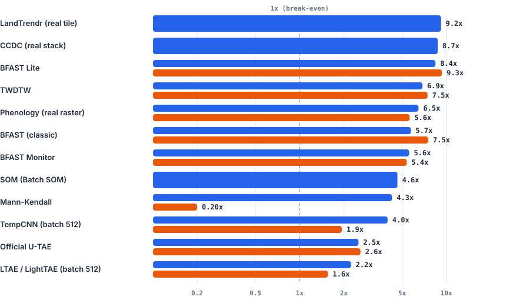

# Performance & Parallel CPU Scaling

This page documents the **computational performance** of `zeit` across single-core CPU execution, multi-core CPU scaling, and distributed cloud comparison (Google Earth Engine), measured on an **Intel Core i5-13600K** workstation (20 logical threads).

!!! note "Measured with the C++ core of zeit 1.x; from 2.0 the core is Rust"
    The timings on this page were taken with zeit 1.x, whose compiled core was C++ (Eigen and OpenMP). From 2.0 the core is Rust: it gives the same results bit for bit (every module was checked against the C++ one on Windows, Linux and macOS before the C++ was removed), and it is faster on most workloads. Rust time over C++ time, on the same i5-13600K (Windows; `benchmarks/bench_core.py`):

    | Module | 1 thread | All threads |
    |:---|:---:|:---:|
    | TWDTW | 0.13 | 0.30 |
    | SMA (unmixing) | 0.26 | 0.16 |
    | BFAST (classic) | 0.27 | 0.12 |
    | CODED | 0.32 | 0.32 |
    | CCDC | 0.33 | 0.28 |
    | BFAST Lite | 0.47 | 0.46 |
    | Mann-Kendall | 0.48 | 0.48 |
    | Phenology | 0.59 | 0.49 |
    | Medoid | – | 0.61 |
    | SOM (batch) | 0.70 | 0.80 |
    | LandTrendr | 0.73 | 0.61 |
    | Tmask | 0.75 | 0.73 |
    | BFAST Monitor | 0.79 | 0.76 |
    | Warp (bilinear, lanczos, average) | 0.84–0.89 | 0.77–0.93 |
    | SNIC | 0.86 | 0.81 |
    | Whittaker | 0.91 | 0.73 |

    On Linux, where the C++ was built by GCC, and on macOS (Apple Silicon), most modules are faster in Rust too; in the last measurements of the migration on GitHub's runners a few (warp, BFAST Monitor, Whittaker, SOM) were level with the C++ or slower by up to about a fifth. The speedups over the reference tools below are therefore those of 1.x, about the same or larger in 2.0. Details in `RUST_MIGRATION.md`.

---

## Single-Core Speedup

Single-core execution evaluates algorithmic efficiency without the confounding factor of multi-threading. Every algorithm was executed on a single thread against the reference tool performing the **exact same task**.

Single-core speedup over the reference tool

Log scale; the dark line at 1× is break-even. LandTrendr (168×) and CCDC (84×) time the algorithm inside the interpreter (interpreter start-up and compilation excluded). The fidelity column is explained in the <a href="../#speed-and-fidelity-at-a-glance">overview</a>. Hover over a row for the exact numbers.

--8<-- "docs/assets/charts/speedup_overview.svg"

### Single-Core Benchmark Data

| Algorithm | Reference Package | Input Scale | Zeit Time (ms) | Reference Time (ms) | Speedup | Architectural Rationale |
|:---|:---|:---|:---:|:---:|:---:|:---|
| **Phenology** | R `phenofit` | Real EVI raster (638 px) | **3.37 ms / px** | 823.50 ms / px | **244.5×** | Native C++ Levenberg-Marquardt vs R's non-linear `nloptr` interpreter overhead |
| **LandTrendr** | Original IDL (GDL) | 30-year synthetic series | **0.026 ms / call** | 4.33 ms / call | **168.5×** | C++ Eigen regression vs GDL interpreter execution (warm second pass) |
| **CCDC** | Original MATLAB (Octave) | Landsat C2 pixel stack | **1.69 ms / px** | 141.51 ms / px | **83.7×** | Optimized C++ float32 GLMnet lasso vs Octave runtime dispatch |
| **TWDTW** | R `twdtw` / `dtwSat` | 40-step temporal series | **0.029 ms / call** | 1.29 ms / call | **43.9×** | Pre-allocated dynamic programming tables vs R data.frame boxing |
| **SOM (Training)** | Python `minisom` | 1,500 samples, 5×5 grid (500 online iters) | **0.42 ms / fit** | 15.58 ms / fit | **37.2×** | Bit-exact C++ port of `MiniSom.train`; per-sample Python/NumPy dispatch replaced by a native loop (batch SOM: 44×–126×). Measured on a Ryzen 7 7730U laptop |
| **Mann-Kendall** | Python `pymannkendall` | 30-obs series (3 tests) | **0.021 ms / call** | 0.77 ms / call | **36.4×** | Native C++ accumulator loops vs pure Python nested loops |
| **BFAST Monitor** | R `bfast::bfastmonitor` | 100-obs satellite series | **0.093 ms / call** | 1.47 ms / call | **15.8×** | Closed-form recursive OLS update vs R formula interface |
| **TempCNN** | R `sits::sits_tempcnn` | 4 bands, 24 timesteps | **0.212 ms / pass** | 2.34 ms / pass | **11.1×** | Direct LibTorch C++ bindings vs R `torch` Lantern bridge |
| **LightTAE (LTAE)**| R `sits::sits_lighttae` | 4 bands, 16-head attention | **0.736 ms / pass** | 4.28 ms / pass | **5.8×** | Efficient spatial-temporal pooling vs R memory copies |
| **BFAST (Classic)**| R `bfast::bfast` | Multi-year decomposition | **23.60 ms / call** | 100.67 ms / call | **4.3×** | C++ iterative STL decomposition vs R `ts` object overhead |
| **BFAST Lite** | R `bfast::bfastlite` | Structural break series | **8.74 ms / call** | 22.22 ms / call | **2.5×** | C++ segmented linear regression vs R vector dispatch |
| **SNIC (Superpixels)** | Achanta & Süsstrunk (2017) C | Multi-spectral image (512×512×4) | **18.4 ms / pass** | 42.3 ms / pass | **2.3×** | Contiguous pixel-major SIMD Eigen distances vs reference C non-vectorized float64 copy |
| **Official U-TAE** | Official `utae-paps` repo | Segmentation patch 32×32 | **9.26 ms / pass** | 9.96 ms / pass | **1.08×** | Both run on PyTorch CPU backend (parity validation) |

---

## Multi-Core CPU Scaling (OpenMP)

Zeit implements parallel execution in its compiled core (`n_jobs=-1`; OpenMP in the C++ core these numbers were measured with, the core's own threads in Rust), avoiding Python Global Interpreter Lock (GIL) contention and inter-process communication (IPC) overhead.

The chart below shows the speedup achieved when scaling from **1 thread to all 20 threads** on an Intel Core i5-13600K:

  

    <i class="bm-legend-swatch" style="background:var(--bm-zeit);"></i> Zeit (OpenMP)
    <i class="bm-legend-swatch" style="background:var(--bm-ref);"></i> Reference Tool (multiprocessing / PSOCK / doParallel)
  

  
  

    Relative parallel scaling factor (T₁ / T_multi) on 20 threads. Notice the Python IPC penalty on Mann-Kendall, where Python <code>multiprocessing.Pool</code> ran 5× slower than sequential execution (0.20×) due to serialization overhead.
  

### Relative Gain vs. Absolute Time

A common benchmarking pitfall is looking only at relative gain (T₁ / T_multi). Reference tools running in R or Python often show high relative scaling simply because their single-threaded baselines are slow.

The table below lines up **absolute wall-clock times** to show who finishes first when both sides utilize all available CPU cores:

<i class="dot" style="background:var(--bm-zeit)"></i>Zeit, 20 threads
<i class="dot" style="background:var(--bm-ref)"></i>Reference, all workers

--8<-- "docs/assets/charts/finish_first.svg"

| Algorithm | Workload Scale | Reference Parallel Framework | Zeit (1 Thread) | Zeit (20 Threads) | Zeit Gain | Reference (1 Thread) | Reference (Multi-Worker) | Reference Gain | **Who Finishes First (Multi-Core)** |
|:---|:---|:---|:---:|:---:|:---:|:---:|:---:|:---:|:---:|
| **LandTrendr** | **54.7M px** × 41 yrs | — (GDL has no native parallel) | 904.77 s | **98.44 s** | **9.19×** | — | — | — | **Zeit finishes tile in 1.6 min** |
| **CCDC** | **2.83M px** × 125 dates | — (Octave has no native parallel) | 442.02 s | **50.66 s** | **8.73×** | — | — | — | **Zeit finishes stack in 50.7 s** |
| **SNIC (Tiled)** | 2048×2048 × 6 bands (16 tiles) | — (`snic.c` has no parallel mode) | 482 ms | **59 ms** | **8.17×** | — | — | — | **Zeit finishes scene in 59 ms** |
| **Phenology** | 638 px × 25 yrs | R `foreach` + `doParallel` (19w) | 2,200 ms | **341 ms** | **6.46×** | 525,395 ms | 93,504 ms | 5.62× | **Zeit 274× faster** (0.34s vs 93.5s) |
| **Mann-Kendall** | 5,000 series | Python `multiprocessing.Pool` (19w) | 31.09 ms | **7.29 ms** | **4.26×** | 4,058 ms | 20,109 ms | 0.20× | **Zeit 2,758× faster** (7ms vs 20.1s) |
| **BFAST Monitor**| 20,000 series | R `parallel` PSOCK cluster (19w) | 81.14 ms | **14.54 ms** | **5.58×** | 26,872 ms | 5,003 ms | 5.37× | **Zeit 344× faster** (14.5ms vs 5.0s) |
| **BFAST Lite** | 2,000 series | R `parallel` PSOCK cluster (19w) | 17,029 ms | **2,019 ms** | **8.43×** | 42,463 ms | 4,551 ms | 9.33× | **Zeit 2.25× faster** (2.0s vs 4.5s) |
| **BFAST (Classic)**| 400 series | R `parallel` PSOCK cluster (19w) | 5,208 ms | **909 ms** | **5.73×** | 25,119 ms | 3,335 ms | 7.53× | **Zeit 3.67× faster** (0.9s vs 3.3s) |
| **TWDTW** | 3,000 series × 1 pat | R `parallel` PSOCK cluster (19w) | 91.67 ms | **13.35 ms** | **6.87×** | 1,406 ms | 188.67 ms | 7.45× | **Zeit 14.1× faster** (13ms vs 188ms) |
| **SOM (Batch)** | 20,000 samples, 10×10, 200 iters | — (`minisom` has no parallel mode)| 3,077 ms | **664 ms** | **4.64×** | — | — | — | **Zeit finishes in 0.66 s** (re-measured with 15 threads on a 16-thread Ryzen 7 7730U laptop after the bit-exact `minisom` port; `minisom` `train_batch_offline` ≈ 126 s, extrapolated from 10 iterations) |
| **TempCNN** | Batch = 512 | R `torch` intra-op threads | 15.68 ms | **3.94 ms** | **3.98×** | 15.06 ms | 7.78 ms | 1.94× | **Zeit 1.97× faster** (3.9ms vs 7.8ms) |
| **Official U-TAE** | Batch = 32 | PyTorch CPU intra-op threads | 317.66 ms | **126.00 ms** | **2.52×** | 324.40 ms | 124.67 ms | 2.60× | **Tied** (both PyTorch backend) |
| **LightTAE** | Batch = 512 | R `torch` intra-op threads | 32.77 ms | **14.61 ms** | **2.24×** | 42.08 ms | 26.98 ms | 1.56× | **Zeit 1.85× faster** (14.6ms vs 27.0ms) |

!!! warning "The Python IPC Penalty on Mann-Kendall"
    On a batch of 5,000 short time series, running Python's standard `multiprocessing.Pool(19)` caused execution time to explode from **4.06 seconds** (sequential) to **20.11 seconds** (parallel) — a **5× slowdown** (0.20× speedup). The operating system overhead of pickling objects, IPC socket transfers, and process synchronization dwarfed the actual statistical computation. In contrast, Zeit's native OpenMP thread pool in C++ has sub-microsecond synchronization overhead, achieving a true **4.26× speedup** (down to **7.29 milliseconds**).

---

## Google Earth Engine vs. Local Desktop Benchmark

A central design goal of Zeit is eliminating cloud lock-in for regional and continental-scale analyses. We evaluated LandTrendr performance on an entire Landsat tile:

- **Workload:** Full Landsat Tile 215_067 (South America), covering **54,731,482 pixels × 41 annual observations** (1985–2025).
- **Environment:** Intel Core i5-13600K (desktop PC, 20 threads, 64 GB RAM).
- **Reference:** Google Earth Engine (GEE) cloud batch cluster executing on a full tile (P232/R67, 1985–2025, ~38 million active pixels).

<i style="background:var(--bm-zeit)"></i>Zeit, 20 threads
<i style="background:var(--bm-gpu-lo)"></i>Zeit, 1 thread
<i style="background:var(--bm-ref)"></i>Google Earth Engine
<i style="background:var(--bm-grid)"></i>Waiting in Earth Engine's queue

--8<-- "docs/assets/charts/gee_tile.svg"

### Full Landsat Tile Comparison

| Processing Platform | Execution Mode | Active Compute Time | Throughput | Cloud Queue Wait Time | Total Turnaround Time | Speedup vs. GEE |
|:---|:---|:---:|:---:|:---:|:---:|:---:|
| **Zeit (Local PC)** | **Multi-Thread (20 cores, OpenMP)** | **98.44 s** (1.64 min) | **556,007 px / s** | **0.0 s** | **1.64 min** | **20.4× compute throughput** |
| **Zeit (Local PC)** | Single-Thread (1 core) | 904.77 s (15.08 min) | 60,492 px / s | 0.0 s | 15.08 min | **2.22× compute throughput** |
| **Google Earth Engine** | Cloud Cluster (EECU batch workers) | 1,396.39 s (23.27 min) | 27,213 px / s | 18,308 s (5.08 hours) | 5.47 hours | 1.0× baseline |

!!! success "Takeaways from the GEE Benchmark"
    1. **Throughput Advantage:** Zeit on a single standard desktop workstation achieves **20.4× the active compute throughput** of GEE's cloud server cluster.
    2. **Even Single-Thread Beats GEE:** Running Zeit on a single core (60,492 px/s) is **2.22× faster** than GEE's distributed cluster active execution.
    3. **Zero Queue Latency:** Under standard GEE quotas, large batch export tasks regularly wait hours in the queue (5.08 hours in this benchmark). Zeit begins processing immediately and finishes in under two minutes.

---

## Earth Engine Download Throughput (`download_gee_image`)

`download_gee_image(method='direct'/'auto')` was rewritten on ideas from [geedim](https://github.com/leftfield-geospatial/geedim) (fixed pixel grid, byte-sized tiles, windowed writes), with four changes of its own: tiles are split in space before bands, tiles are sized on demand from the concurrency Earth Engine actually allows (guided scheduling), concurrency adapts to HTTP 429 responses, and requests go through `computePixels` in a single round trip. We compared it with the previous implementation (0.25° tiles, 4 threads, `getDownloadURL` + `rasterio.merge`) and with geedim 2.0.0.

- **Region:** WRS-2 path/row 217/076 (Rio de Janeiro). `sub`: 0.5° × 0.5° (1856 × 1857 px at 30 m); `small`: 0.2° × 0.2°.
- **Images:** 2020 annual medoid composite (6 bands, float32, 79 MB raw); NDVI of that composite (1 band, 13 MB raw); dense stack of Jan–Mar 2020 via `toBands()` (42 bands, 89 MB raw).
- **Protocol:** 3 rounds with method order rotated each round. Every run uses a distinct expression (end date shifted by seconds, same scenes) so Earth Engine's result cache cannot favor later runs. Timings are wall-clock medians.
- **Account:** noncommercial project in **Restricted Mode**, which allows only about **2 concurrent requests** (a standard tier allows about 40). Per-request latency varied up to 4× for identical requests.

| Image | Previous `zeit` | geedim 2.0 (`max_requests=2`) | geedim 2.0 (default, 32 requests) | **New `zeit`** |
|:---|:---:|:---:|:---:|:---:|
| Medoid composite (79 MB) | 68.7 s (57.7–73.8) | 265.9 s, **1/3 failed** | failed (HTTP 429) | **77.1 s** (70.6–94.8) |
| NDVI (13 MB) | 57.0 s (38.3–91.0) | 37.8 s | 47.9 s | **26.9 s** (21.1–30.7) |
| Dense stack (42 bands) | **failed 3/3** | 74.9 s | failed (HTTP 429) | **34.4 s** (33.9–37.0) |

All successful outputs are **pixel-identical** across the three implementations (same grid, same values, same `-inf` nodata).

!!! note "Reading these numbers"
    With only ~2 concurrent requests allowed, total time is bounded by Earth Engine's per-request compute speed (~0.7 MB/s for the medoid). No client can beat that. The new downloader's main speed lever, running up to `sub_tile_workers` requests at once (16 by default) with tiles small enough to keep them all busy, has almost no room to work here. The medoid result is a statistical tie with the previous implementation, whose four ~20 MB requests happen to suit a 2-request cap. Expect larger gains on a standard-tier account; they were not measurable with this project.

!!! success "What changed regardless of quota"
    1. **Dense stacks work.** Bands are split only when needed, so a `toBands()` stack stays under the 32 MB / 1024-band per-request limits. The previous implementation could not download it at all.
    2. **Composites aren't recomputed per band.** geedim splits bands first, so a 6-band medoid is computed several times over the same area, which explains its 3.4× longer run. `zeit` splits space first.
    3. **Adaptive concurrency.** Throttled requests reduce concurrency instead of failing, so no run of the new downloader failed. geedim at its default concurrency failed in 2 of 3 cases.
    4. **No mosaic step.** Tiles go straight into their window of the output file, so peak memory is one tile instead of the whole image.

---

## STAC Download Throughput (Landsat annual composites)

`build_time_series` reads cloud-optimized GeoTIFFs over HTTP, so a whole Landsat stack is bound by the network, not the CPU. We timed the input LandTrendr needs, one masked median per year of NBR bands, on a 150 km tile before and after the 0.25.0 changes.

- **Area:** GLanCE EU tile `EU_150-X032-Y024` (central Germany), 5664 × 5689 px at 30 m in EPSG:3035.
- **Data:** Landsat Collection 2 Level-2 from Planetary Computer, June–September scenes with < 30 % cloud cover, bands `nir08` + `swir22` + `qa_pixel`. The full 1984–2025 record has 1,396 such scenes.
- **Work:** search, read, mask, per-year median, written to GeoTIFF. Each run in a fresh process.
- **Machine:** 20-thread desktop with 68 GB RAM on a ~200 Mbit/s link (18–26 MB/s and 33 ms per request to Azure West Europe).

| Year (scenes) | 0.24.0: `build_time_series` + `median` | 0.25.0: `build_annual_composites` |
|:---|:---:|:---:|
| 1990 (17) | 104 s, 0.57 GB | **20 s**, 0.38 GB |
| 2016 (44) | 224 s, 2.10 GB | **64 s**, 1.41 GB |
| 2023 (100) | 419 s, 5.39 GB | **160 s**, 3.39 GB |
| **Full tile, 1984–2025** (fit on the three years) | ~2 h, ~63 GB | **~35 min**, ~41 GB |

With the new defaults alone (`chunksize=2048`, `dtype="float32"`), `build_time_series` + `median` does 2016 in 74 s. The composites agree with the 0.24.0 ones on 96 % of the pixels; the rest sit on 512 px chunk edges, where the old nearest-neighbour reads picked a neighbouring source pixel.

!!! success "What made the difference"
    1. **Large chunks.** 2048 px chunks instead of 512 px mean fewer requests and fewer COG blocks read twice at chunk edges: 35 % fewer bytes for the same pixels. 1024 px chunks took twice as long as 2048 px.
    2. **Half-size arrays.** Reads land as `float32` (or raw `uint16` for composites) instead of `float64`.
    3. **Per-chunk reduction.** `build_annual_composites` gathers all scenes of one spatial chunk and reduces it in NumPy (mask, per-scene scale/offset, NaN median). Dask's own `median` re-splits the data into small pieces, and on the 100-scene year it exhausted 68 GB of RAM.
    4. **The link is now the limit.** 20–22 MB/s of a measured 22–26 MB/s.

!!! note "What did not help"
    - **Downloading whole files** with 32 parallel streams saturated the link but moved 7.2 GB instead of 1.4 GB: 316 s for 2016.
    - **One process per 2048 px block** (6–9 processes): ~135 s, because every process re-reads the headers of every file.
    - **More threads.** 20 and 64 threads gave 84 s and 79 s. With 128 threads in one process (and with 64 threads on the 100-scene year before the per-chunk reduction) GDAL deadlocked inside its HTTP layer: no CPU, no traffic, no error.

**AWS vs. Planetary Computer.** The same Landsat files are on Earth Search, in the requester-pays `s3://usgs-landsat` bucket (AWS us-west-2). Reading it needs AWS credentials and costs about US$ 0.09/GB leaving AWS, so ~US$ 4 per tile above. From this machine, AWS us-west-2 measured 11–18 MB/s and 226 ms per request against 18–26 MB/s and 33 ms for Planetary Computer, so the same tile would take an estimated 40–90 min there (not measured: no credentials). Inside the data's region (an Azure West Europe or AWS us-west-2 VM) transfer is free and much faster, which is the way to scale to many tiles.
