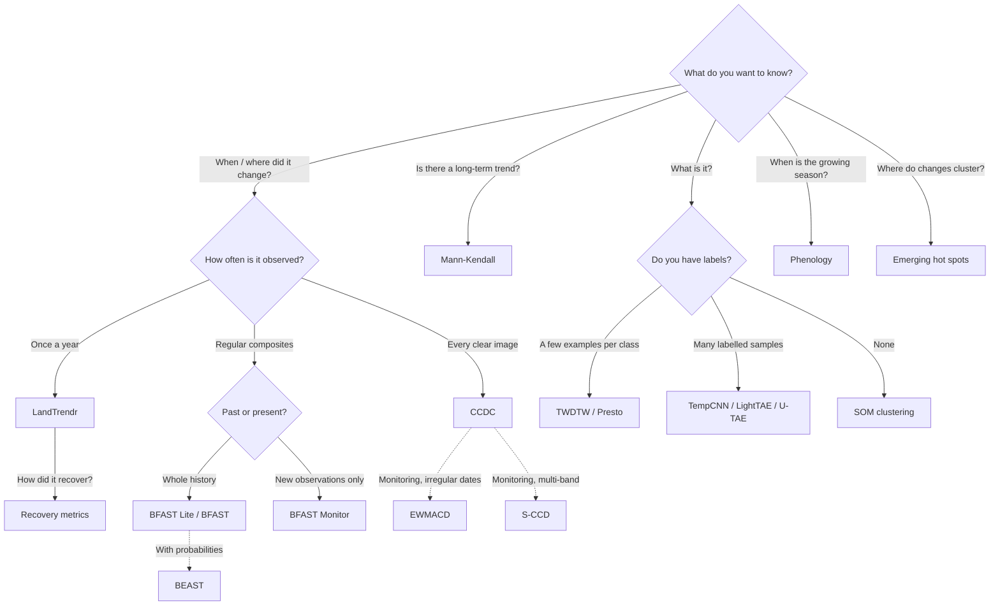
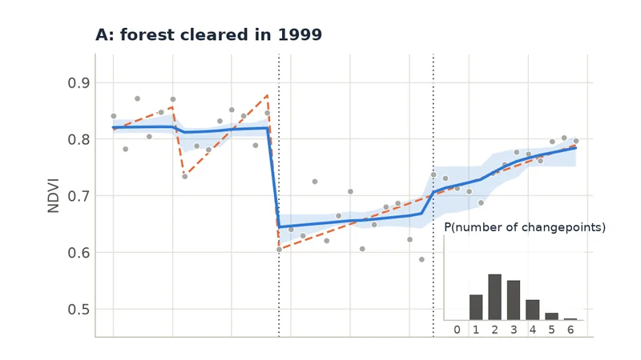
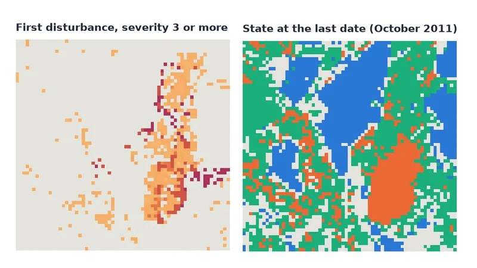

# Choosing an Algorithm

Zeit implements more than a dozen methods. Most projects need one or two. Start from the question you are trying to answer, and let it pick the method.

## Start from your question

| Your question | Use | Needs |
| :--- | :--- | :--- |
| *When* was this area disturbed (cleared, burned) and how badly? | [LandTrendr](../tutorials/landtrendr.md) | One image per year |
| How fast did it recover after the disturbance, and has it recovered yet? | [Recovery metrics](../tutorials/recovery.md) | One image per year (or a LandTrendr result) |
| Was the forest degraded (logged, burned) or cleared? | [CODED](../tutorials/coded.md) | Every clear Landsat image, six bands |
| Did anything change, at any time of year? What did it change into? | [CCDC](../tutorials/ccdc.md) | Every clear image (dense, multi-band) |
| The same, updated image by image: which pixels are changing *right now*, before the change is confirmed? | [S-CCD](../tutorials/sccd.md) | Every clear image (dense, multi-band) |
| Is something changing *right now*, compared with a stable past? | [BFAST Monitor](../tutorials/bfast_monitor.md) | Regular series (e.g. 16-day composites) |
| The same, from every observation, cloudy and irregular, and when did it recover? | [EWMACD](../tutorials/ewmacd.md) | Every clear image, any dates |
| How many changes happened, and when, in a regular series? | [BFAST Lite](../tutorials/bfast_lite.md) | Regular series |
| Did the trend change, the seasonal cycle, or both? | [BFAST](../tutorials/bfast.md) | Regular series |
| The same, with *how sure*: the probability of a change at each date, and of each number of changes? | [BEAST](../tutorials/beast.md) | One index: annual, or regular (irregular dates averaged onto a grid) |
| Is this area getting greener or browner over the decades? | [Mann-Kendall](../tutorials/mann_kendall.md) | One value per year (or `method="seasonal"`) |
| Is a whole region (or each land-cover class) trending, given that neighbouring pixels are correlated? | [PARTS](../tutorials/regional-trends/index.md) | A cube in a projected CRS |
| Where do high (or low) values cluster, and are those clusters new, growing or fading? | [Emerging hot spots](../tutorials/hotspots.md) | One map per date (at least 3) |
| What fraction of each pixel is vegetation, soil, water...? | [Spectral unmixing](../tutorials/unmixing.md) | Several bands per date, or spectra |
| When does the growing season start, peak and end? Is this year late? | [Phenology](../tutorials/phenology.md) | Dense series, several per month |
| Which crop or land-cover type is this pixel, given a few examples? | [TWDTW](../tutorials/twdtw.md) | Reference time series per class |
| Which land-cover types exist here, with no labels at all? | [SOM](../tutorials/som.md) | Any cube |
| Can I work with fields and patches instead of pixels? | [SNIC](../tutorials/snic.md) | Any cube |
| I have many labelled samples and want the best classifier. | [TempCNN / LightTAE](../tutorials/ai.md) | Labelled time series |
| I have few labelled samples, gaps or several sensors. | [Presto](../tutorials/presto.md) (pretrained) | Monthly composites, up to 24 |
| I have two dates and labelled change masks. | [Siamese Change Detector](../tutorials/siamese.md) | Image pairs + masks |
| My class map is noisy, or I don't know where the model can be trusted. | [Post-processing & AoA](../tutorials/postprocessing.md) | Class probabilities; the model's training data |

## A quick decision guide

## Change detection methods compared

The seven change-detection families answer related but different questions. The figures below all come from their tutorials.

<a class="tile" href="../../tutorials/landtrendr/">
  
  Annual · retrospectiveLandTrendrStraight segments through yearly values. Best for forest disturbance and recovery over decades.
</a>

<a class="tile" href="../../tutorials/ccdc/">
  
  Dense · retrospectiveCCDCHarmonic models of the seasonal cycle, multi-band. Dates changes within the year and describes the new state.
</a>

<a class="tile" href="../../tutorials/sccd/">
  
  Dense · near real timeS-CCDCCDC's models carried forward by a Kalman filter: one update per new image, and the changes still in progress.
</a>

<a class="tile" href="../../tutorials/bfast_lite/">
  
  Regular · retrospectiveBFAST Lite / BFASTStatistically optimal number of breaks in trend and season. Single index.
</a>

<a class="tile" href="../../tutorials/beast/">
  
  Annual or regular · retrospectiveBEASTBayesian model averaging of trend and season: the probability of each changepoint, and of each number of them.
</a>

<a class="tile" href="../../tutorials/bfast_monitor/">
  
  Regular · near real timeBFAST MonitorIs the newest data consistent with the stable past? The basis of many alert systems.
</a>

<a class="tile" href="../../tutorials/ewmacd/">
  
  Irregular · monitoringEWMACDControl charts on every observation after a training period: disturbances, gains and recoveries, cloudy dates welcome.
</a>

| | LandTrendr | CCDC | S-CCD | BFAST Lite / BFAST | BEAST | BFAST Monitor | EWMACD |
| :--- | :--- | :--- | :--- | :--- | :--- | :--- | :--- |
| Input | 1 index, 1 value per year | Up to 7 bands, every clear observation | Up to 7 bands, every clear observation | 1 index, regular series | 1 index, annual or regular (irregular dates put on a grid) | 1 index, regular series | 1 index, every observation, irregular dates |
| Models the season? | No (annual values) | Yes (harmonics) | Yes (harmonics, filtered) | Yes (harmonics) | Yes (harmonics), or none | Yes (harmonics) | Yes (harmonics of the training years) |
| Detects | Abrupt and gradual change, recovery | Abrupt change, any time of year | Abrupt change, and changes in progress at the last date | Breaks in trend (and season, for BFAST) | Changepoints in trend and season, with their probability | The first break after a date | Disturbances, gains and recoveries after the training years |
| Typical use | Forest disturbance history | Land-cover change mapping and classification | Monitoring as images arrive | Retrospective break analysis | Retrospective analysis, with its uncertainty | Alerts | Monitoring subtle and abrupt change |
| Speed per pixel | Very fast | Moderate | Fast | Moderate | Slow (an MCMC per pixel) | Very fast | Very fast |

!!! tip "Combine methods"
    The methods complement each other. A common pattern is Mann-Kendall to find *where* a region is trending, then LandTrendr or CCDC to find *when* and *how abruptly* it changed there. Another is Tmask to clean the data before CCDC. See the [User Guide](../tutorials/index.md) for every workflow.
