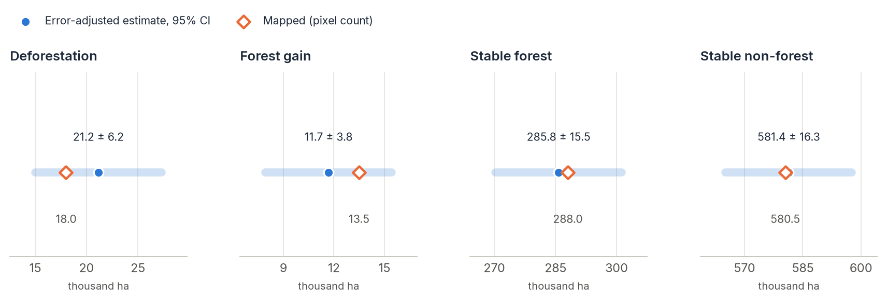
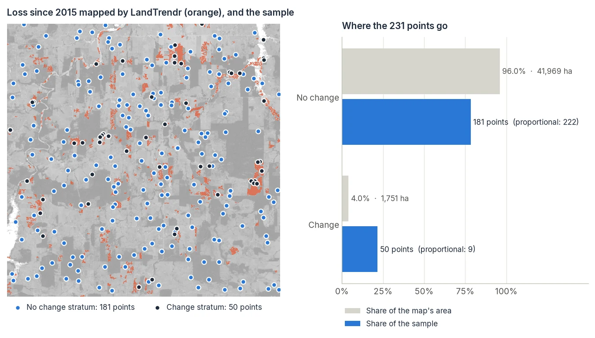
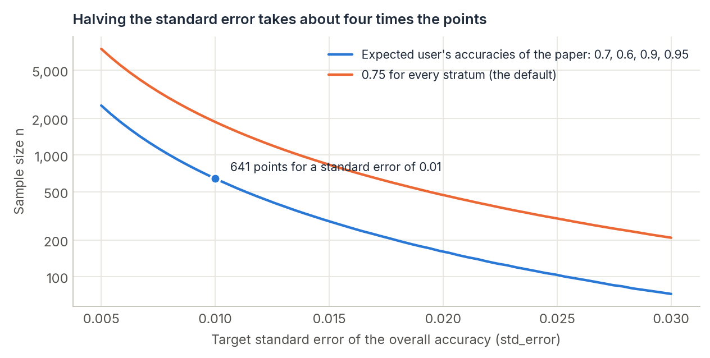
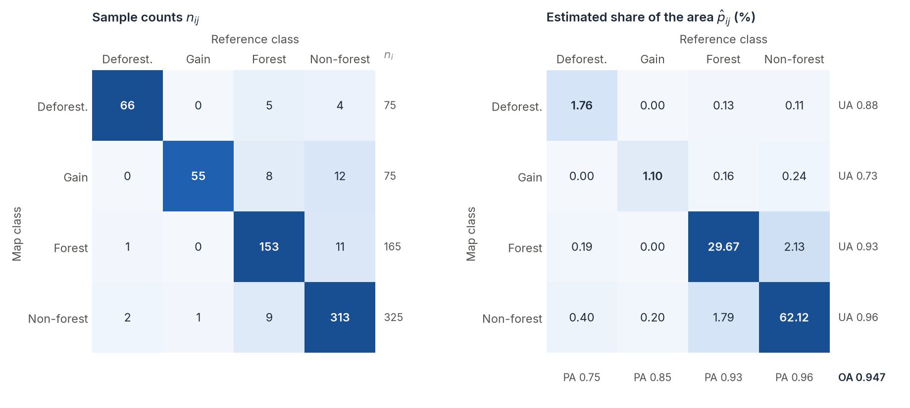

# Accuracy & Area

<p class="lead">A change map says that 18,000 ha were deforested. How sure is that number? Counting the pixels of a map gives a biased area: every map has omission and commission errors, and they rarely cancel. The good practice is to label a random sample of the map, estimate the error matrix in proportions of area, and correct the area with it. That gives an unbiased area with a confidence interval, which is what reports such as REDD+ or a paper's results need.</p>

<div class="glance" markdown>
<div><span class="k">Answers</span><span class="v">How accurate is the map? How much area really changed, ± how much?</span></div>
<div><span class="k">Input</span><span class="v">Any map of classes or of events, and reference labels at sample points</span></div>
<div><span class="k">Output</span><span class="v">Overall, user's and producer's accuracies and error-adjusted areas, with confidence intervals</span></div>
<div><span class="k">Reference</span><span class="v">Olofsson et al. (2014), <em>Remote Sensing of Environment</em> 148; Stehman (2014), <em>IJRS</em> 35</span></div>
</div>

## Why counting pixels is not enough

A map's area of a class is the number of its pixels times their size. It counts every false alarm as change and misses every change the map did not find. Both errors happen in every map, and they do not cancel: a change map usually misses more change (forest cleared slowly, small clearings, a cloudy year) than it invents, so its mapped area of change is too small.

The fix is to measure the errors on a sample and correct the area for them. In the numerical example of Olofsson et al. (2014), which zeit reproduces to the hectare, the map shows 18,000 ha of deforestation; corrected with a sample of 640 points, the estimate is 21,158 ha, between 15,000 and 27,316 ha with 95% confidence. The map missed a quarter of the deforestation, and the stable classes absorbed it.

<figure markdown>
  
  <figcaption>Mapped area (orange diamond) and error-adjusted estimate with its 95% confidence interval (blue), in thousand hectares, for the example of Olofsson et al. (2014). The mapped areas of the two rare classes fall well inside the intervals, but the estimates move them by 18% and 13%: what the map calls change is not what is on the ground.</figcaption>
</figure>

The interval is as important as the estimate. A ± 6,158 ha interval on 21,158 ha says the sample was too small to pin the area of deforestation down to better than ± 30%; with more points in the right strata, the interval shrinks.

## How it works

<div class="steps" markdown>

<div markdown>
**Stratify by the map**

Each class of the map is a stratum. Rare classes, change above all, get a sample of their own.

`sampling_design`
</div>

<div markdown>
**Draw the sample**

Points at random inside each stratum, as many as the design asks for.

`stratified_sample`
</div>

<div markdown>
**Label the points**

Decide what is really there, from better imagery or the field: the reference.

`interpret`
</div>

<div markdown>
**Estimate**

Weigh each point by its stratum's area: accuracies and areas, with intervals.

`accuracy`
</div>

</div>

The same steps work for any map, from zeit or not, and for maps of events: these are stratified as "no change" and "change" (or, with `bins`, as periods of the year of change).

<figure markdown>
  
  <figcaption>Steps 1 and 2 on real data. Left: forest loss since 2015 found by LandTrendr over 44,000 ha of Rondônia (orange), and a stratified sample for a standard error of 0.015. Right: change covers 4% of the map, so a sample proportional to area would put 9 of its points there, too few to measure the user's accuracy of change. <code>min_per_stratum=50</code> (the default) takes 41 points from "no change" and gives them to "change".</figcaption>
</figure>

## Step by step

### 1. Make the map of events

```python
import zeit

ndvi = zeit.load_raster("LT_Stack_NDVI_Rondonia.tif")
loss = zeit.extract_events(zeit.landtrendr(ndvi), min_magnitude=1500)
```

Any change algorithm works the same way: `zeit.extract_events` gives the same maps for [CCDC](ccdc.md), [BFAST](bfast.md) and the others, and `zeit.agreement` combines them. A map of classes works too: the `label` of `zeit.classify`, any land-cover GeoTIFF with its class codes (names come from the raster's `flag_meanings`, when it has them).

Assess the map you will report. If you clean it before publishing (a minimum mapping unit, a mask), clean it first and sample the cleaned map, since the sample measures the errors of the map it was drawn from.

### 2. Size and draw the sample

```python
design = zeit.sampling_design(loss, expected_ua={"change": 0.7, "no change": 0.95}, std_error=0.01)
print(design)        # per stratum: name, pixels, area (ha), weight, expected_ua, n

points = zeit.stratified_sample(loss, design=design)
points.to_file("loss_points.gpkg")
```

**How many points.** `expected_ua` is your guess of each stratum's user's accuracy and `std_error` the standard error you want for the overall accuracy. Together they set the total sample size (Olofsson et al. 2014, eq. 13):

\[
n = \frac{\left(\sum_i W_i S_i\right)^2}{S(\hat O)^2 + \frac{1}{N}\sum_i W_i S_i^2},
\qquad S_i = \sqrt{U_i\,(1 - U_i)}
\]

where \(W_i\) is the share of the map's area in stratum \(i\), \(U_i\) its expected user's accuracy, \(S(\hat O)\) the target standard error and \(N\) the number of pixels. Two things follow. Classes expected to be mapped well need fewer points than hard ones, so it pays to guess `expected_ua` honestly rather than leave the default 0.75. And the size grows with the inverse square of the standard error: halving it takes about four times the points.

<figure markdown>
  
  <figcaption>Sample size for the map of Olofsson et al. (2014). With the expected user's accuracies of the paper, a standard error of 0.01 takes 641 points (the paper's number); assuming 0.75 everywhere would ask for almost three times as many.</figcaption>
</figure>

**How to spread them.** `alloc` decides how the points go to the strata:

| `alloc` | Points per stratum | When |
| :--- | :--- | :--- |
| `"proportional"` (default) | In proportion to its area | Good overall accuracy and area of the large classes |
| `"equal"` | The same number in every stratum | Good user's accuracy of every class, rare ones included |
| `"neyman"` | In proportion to area × expected standard deviation | The smallest variance of the overall accuracy |
| a dict | As given, e.g. `{"change": 100, "no change": 300}` | Your own compromise |

Whatever the allocation, `min_per_stratum` (50 by default; Olofsson et al. recommend 50 to 100) raises the small strata to that many points, taken from the large ones, and the total stays the same. This is what makes the user's accuracy of rare change measurable at all.

**Strata by period.** A map of the year of change can be stratified by period, so that the estimates come out per period too:

```python
design = zeit.sampling_design(loss, bins=[1985, 2000, 2010, 2025], expected_ua=0.7)
```

Each `[a, b)` interval of years is a stratum, plus "no change".

`stratified_sample` draws the points at random inside each stratum (`seed=` makes the draw repeatable, in memory or lazy, whatever the chunks) and returns them at the centres of their pixels, with their `stratum`, `stratum_name`, `row` and `col`. Keep those columns: `zeit.accuracy` uses `stratum` to weigh the points.

### 3. Label the points

```python
s = zeit.interpret(landsat, points, rgb=["swir1", "nir", "red"], series="nbr",
                   map=loss, fit=zeit.landtrendr(ndvi), save="loss_reference.gpkg")
```

`zeit.interpret` goes through the points one by one: the map is centred on each, a strip of chips shows the place every year, and the chart its series. Press `1` or `2` for the class, click the chart (or press `d` on the image where the change appears) to date it, and `Enter` to save and move on. Each label is written to `loss_reference.gpkg` at once: close the window and run the same line tomorrow to go on.

By default it is **blind**: what the map and LandTrendr say at a point shows only once you have labelled it. A reference swayed by the map would only measure how much you agree with it. When every point has a label, the **Review** tab shows the accuracies, and a click on a cell of the error matrix (say, map "change", reference "no change") lists those points to look at again.

QGIS, Collect Earth or field visits work as well: what `zeit.accuracy` needs is a `ref` column (and `ref_date` for dates) in the points.

!!! tip "Write the labelling rules down before you start"
    The reference is only as good as its definitions. Decide, and write in your methods, what counts as change (a clearing? a degraded canopy? a crop harvest?), the period it must happen in, how much of the pixel must change, and which imagery is the reference (Landsat chips, Sentinel-2, very-high-resolution images, field visits). Points you cannot decide can stay without a label: `zeit.accuracy` leaves them out and says how many, but many of them in one stratum bias its estimate.

### 4. Estimate accuracy and area

```python
acc = s.accuracy(date_tolerance=1)          # or zeit.accuracy(loss, "loss_reference.gpkg", date_tolerance=1)
print(acc)
```

The summary looks like this one, of the numerical example in Olofsson et al. (2014): a map of 10 million 30 m pixels in four classes and 640 labelled points:

```
Accuracy of the map, from 640 reference points:
  overall: 0.947 ± 0.018 (95% CI)

                         user's     producer's mapped (ha)    estimated (ha)
class
deforestation     0.880 ± 0.074  0.749 ± 0.213      18,000    21,158 ± 6,158
forest_gain       0.733 ± 0.101  0.847 ± 0.254      13,500    11,686 ± 3,756
stable_forest     0.927 ± 0.040  0.935 ± 0.034     288,000  285,770 ± 15,510
stable_nonforest  0.963 ± 0.021  0.962 ± 0.018     580,500  581,386 ± 16,281
```

With `date_tolerance`, a last line gives the share of the change points whose dates agree.

## Reading the error matrix

The counts of the sample are not the error matrix of the map. The strata were sampled at different rates (in the example, 75 points for 200,000 deforestation pixels, 325 for 6.45 million stable non-forest pixels), so each point stands for a different area. The estimators weigh each count by its stratum's share of the map, \(W_i\), divided by the stratum's sample size \(n_{i\cdot}\):

\[
\hat p_{ij} = W_i\,\frac{n_{ij}}{n_{i\cdot}}
\]

\(\hat p_{ij}\) is the estimated share of the whole map that the map calls \(i\) and is really \(j\). Everything else comes from that matrix:

| | Estimator | Says |
| :--- | :--- | :--- |
| Overall accuracy | \(\hat O = \sum_j \hat p_{jj}\) | Share of the area mapped correctly |
| User's accuracy of \(i\) | \(\hat U_i = \hat p_{ii} / \hat p_{i\cdot}\) | Of the area mapped as \(i\), the share that is \(i\). Low: false alarms (commission) |
| Producer's accuracy of \(j\) | \(\hat P_j = \hat p_{jj} / \hat p_{\cdot j}\) | Of the area that is \(j\), the share mapped as \(j\). Low: missed change (omission) |
| Area of \(j\) | \(\hat A_j = A \cdot \hat p_{\cdot j}\) | The error-adjusted area: the column total times the map's area |

<figure markdown>
  
  <figcaption>Left: the 640 points as counted. Right: the same matrix in estimated shares of the map's area. The 2 deforestation points the map put in stable non-forest weigh 0.40% of the area, because that stratum is huge; with the 1 in stable forest, they are why the producer's accuracy of deforestation (0.75) is much lower than its user's accuracy (0.88).</figcaption>
</figure>

The figure shows the main lesson of area estimation: a few omission errors in a large stratum outweigh many points in a small one. The 2 deforestation points among the 325 of stable non-forest (0.6% of that stratum) stand for 0.40% of the whole map, a sixth of all the deforestation, and they make up two thirds of the variance of its area. To narrow the interval of the area of change, sample the strata where change hides, not only the change stratum. Olofsson et al. suggest a "buffer" stratum: a ring of pixels around the mapped change, where missed change is most likely. Add it as a class of the map you stratify (a dilation of the change map does it) and give it its own points.

The standard errors follow Stehman (2014): for an estimated proportion,

\[
\widehat{SE}(\hat p_{\cdot j}) = \sqrt{\sum_i W_i^2\,\frac{\frac{n_{ij}}{n_{i\cdot}}\left(1-\frac{n_{ij}}{n_{i\cdot}}\right)}{n_{i\cdot}-1}}
\]

and the ratio estimators (user's and producer's accuracies) have theirs. Intervals are \(\pm z\,\widehat{SE}\), \(z = 1.96\) for `confidence=0.95`.

## What `accuracy` returns

`print(acc)` is the summary; every number is also a table:

| Attribute | Content |
| :--- | :--- |
| `acc.overall` | `estimate`, `se`, `ci_low`, `ci_high` of the overall accuracy |
| `acc.users`, `acc.producers` | The same four columns, one row per class |
| `acc.area` | `mapped`, `estimate`, `se`, `ci` (the half-width), `ci_low`, `ci_high`, in `acc.area_unit` (hectares) |
| `acc.confusion` | The error matrix in proportions of area, \(\hat p_{ij}\) (rows: map, columns: reference) |
| `acc.counts` | The error matrix of the sample, \(n_{ij}\) |
| `acc.date` | With `date_tolerance`: `within` (share of the change points whose dates agree), `within_se`, `mean_difference` (years) and `n` |
| `acc.to_dataframe()` | One row per class with all of the above, for a paper's table |

```python
acc.area.loc["change", ["estimate", "ci_low", "ci_high"]]
acc.to_dataframe().to_csv("accuracy.csv")
```

## Assessing other maps with the same points

The reference describes the ground, not the map, so one set of labelled points assesses every map of the same area: LandTrendr, CCDC, the agreement of both. Pass the map the sample was drawn from as `strata`, so the points keep their weights:

```python
ccdc_loss = zeit.extract_events(zeit.ccdc(cube), band="nir", event_type="loss")
acc_ccdc = zeit.accuracy(ccdc_loss, "loss_reference.gpkg", strata=loss)
```

This is the fair way to compare algorithms: the same points, labelled once, without knowing which map they would favour. The intervals of the second map are wider than if it had been sampled on its own strata, since its errors are not where the sample concentrated.

## Pitfalls

!!! warning "What makes the estimates wrong"
    - **Points chosen by hand.** The estimators need a probability sample. Points picked where change is obvious, or moved to a "cleaner" pixel, are not one. Points without a `stratum` column are weighed as a stratified sample of the map, and `zeit.accuracy` warns about it.
    - **Labels that saw the map.** A reference interpreted with the map in view agrees with it more than the ground does. Keep `zeit.interpret` blind.
    - **The wrong strata.** With a sample drawn on one map and assessed on another, pass the first as `strata`. Otherwise every point is weighed by the wrong area.
    - **Empty strata.** A stratum without labelled points is left out, with a warning, and the estimates then cover only the rest of the area.
    - **Reporting the mapped area.** It is a pixel count, not an estimate. Report the error-adjusted area and its interval.

## What to report

Following Olofsson et al. (2014), a paper or a report should give enough to repeat the estimate:

1. The sampling design: strata, their areas, the sample size of each and how it was chosen (`print(design)`).
2. The response design: the reference imagery, the labelling rules, who labelled and whether it was blind.
3. The error matrix in proportions of area (`acc.confusion`), not only in counts.
4. User's, producer's and overall accuracies with their confidence intervals.
5. The error-adjusted area of each class with its confidence interval, next to the mapped area.

!!! tip "Validation checked against the reference implementations"
    `zeit.accuracy` reproduces the numerical example of Olofsson et al. (2014) (areas, accuracies and their intervals) and R's `sits_accuracy` to 1e-9. With a sample stratified by one map assessing another, its 95% intervals cover the true accuracy in about 95% of repeated samples.

## References

- Olofsson, P., Foody, G. M., Herold, M., Stehman, S. V., Woodcock, C. E., Wulder, M. A. (2014). Good practices for estimating area and assessing accuracy of land change. *Remote Sensing of Environment*, 148, 42–57.
- Stehman, S. V. (2014). Estimating area and map accuracy for stratified random sampling when the strata are different from the map classes. *International Journal of Remote Sensing*, 35(13), 4923–4939.
- Stehman, S. V., Foody, G. M. (2019). Key issues in rigorous accuracy assessment of land cover products. *Remote Sensing of Environment*, 231, 111199.
