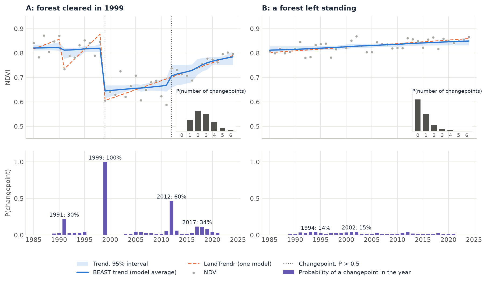
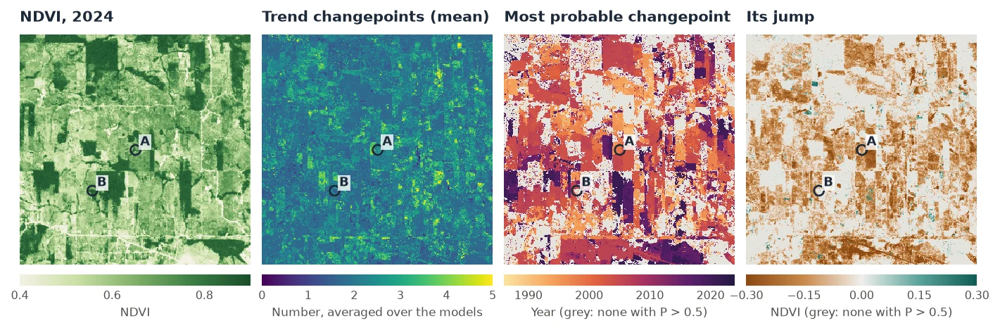
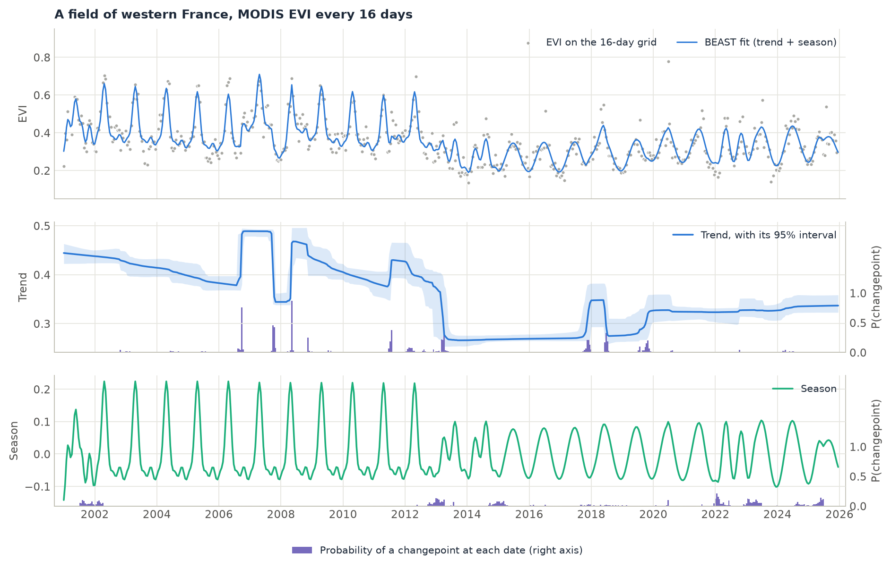

# BEAST (Bayesian changepoints)

<p class="lead">Most change detection methods choose one model of a series: so many breaks, at these dates. BEAST does not choose. It samples thousands of models of the trend and the season, with every number and position of changepoints, keeps each in proportion to how well it fits, and averages them. What comes out says how sure each answer is: the probability of a changepoint in each year, of each number of changepoints, and a trend with its 95% interval.</p>

<div class="glance" markdown>
<div><span class="k">Answers</span><span class="v">Did the trend or the season change, when, and how sure is it? How many changes were there?</span></div>
<div><span class="k">Input</span><span class="v">One index: an annual series, or a sub-annual one (regular, or irregular dates put on a regular grid)</span></div>
<div><span class="k">Output</span><span class="v">Trend and season with credible intervals, the probability of a changepoint at each date, the most probable changepoints with their probability and jump</span></div>
<div><span class="k">Reference</span><span class="v">Zhao et al. (2019), <em>Remote Sensing of Environment</em> 232; a port of the R package <code>Rbeast</code>'s C code</span></div>
</div>

<figure markdown>
  
  <figcaption><strong>What BEAST produces.</strong> Two real pixels of a Landsat annual NDVI series of Rondônia, Brazil, 1985 to 2024. Top: the NDVI of each year, BEAST's trend (blue, the average over the sampled models) with its 95% interval, and LandTrendr's single fit (dashed orange); the inset gives the probability of each number of changepoints. Bottom: the probability of a trend changepoint in each year; each label is a listed changepoint's probability, summed over the years around it. A: a forest cleared in 1999, a changepoint BEAST is sure of, and a rise in 2012 it gives 60%. B: a forest left standing, where no changepoint reaches 15% and none at all is the most probable answer.</figcaption>
</figure>

## How it works

BEAST (a Bayesian estimator of abrupt change, seasonal change and trend) writes a series as

$$
y(t) = T(t) + S(t) + \varepsilon(t)
$$

where the trend $T$ is a sequence of straight (or polynomial) segments, the season $S$ a sequence of harmonic segments, each with its own number of harmonics, and $\varepsilon$ Gaussian noise. A model is a choice of the changepoints of each component and of the order of each segment.

1. **A prior over the models.** Any number of trend changepoints from 0 to 10, and of season changepoints, at any date, with segments no shorter than a minimum (half a period for the season), 1 to 5 harmonics per season segment, a flat or a sloping trend per segment. The coefficients of each model have a Gaussian prior whose precision is itself estimated.
2. **Reversible-jump MCMC.** A Markov chain walks through the models: it adds a changepoint, removes one, moves one, merges two, or changes an order, and accepts the step in proportion to the marginal likelihood of the new model against the old one. With the coefficients integrated out, a model with one more changepoint has to fit enough better to be kept: the prior is the penalty, there is no threshold to set.
3. **Average over the models.** After a burn-in, every few iterations the chain's current model is kept: 8000 samples per chain, 3 chains, by default. The trend and the season are the means of those models' fits, with their 95% intervals. The probability of a changepoint at a date is the share of samples with a changepoint there; the probability of *k* changepoints, the share with *k* of them.
4. **List the changepoints.** From the probabilities by date, the most probable changepoints are picked: each peak, with the probabilities of the dates around it summed, the interval of dates it spans and the jump of the component there.

The answer is a distribution, not one model. When the data are clear, it is concentrated: a changepoint at 100%, two changepoints at 90%. When they are not, it says so: a changepoint at 40%, as likely two as three changepoints. That is the difference with [BFAST](bfast.md), [BFAST Lite](bfast_lite.md) and [LandTrendr](landtrendr.md), which return the best model and its dates, however close the second best was.

## Step by step

The annual data are the stack of the [LandTrendr tutorial](landtrendr.md): one Landsat NDVI value per year, 1985 to 2024, × 10,000, over about 50 km of Rondônia, Brazil, from LT-GEE's medoid composites. The tutorial follows two pixels, then maps a 300 × 300 pixel window (9 × 9 km) around the first.

### 1. Run BEAST on one pixel

```python
import zeit

ndvi = zeit.load_raster("LT_Stack_NDVI_Rondonia.tif")   # (40 years, y, x), dated 1985-01-01 ... 2024-01-01
a = ndvi.isel(y=913, x=306)                               # pixel A

res = zeit.beast(a, season="none")                        # one value a year: a trend, no season
```

An annual series has no season to fit, so `season="none"`. The dates become decimal years, and since they are a year apart the grid is the series itself: 40 steps of one year. With Rbeast's defaults (8000 samples, 3 chains), one pixel takes 0.06 s.

### 2. Read the changepoints

```python
found = res.trend_cp.notnull()
res[["trend_cp", "trend_cp_prob", "trend_cp_abrupt"]].where(found, drop=True).to_dataframe()
res.trend_cp_ci.where(found, drop=True)                   # the interval of dates of each
```

```text
     trend_cp  trend_cp_prob  trend_cp_abrupt     95% interval
tcp
0      1999.0          0.999          -1748.7     1998.0 – 2000.0
1      2012.0          0.596            374.7     2008.8 – 2013.8
2      2017.0          0.345            118.1     2013.6 – 2020.5
3      1991.0          0.298            -95.0     1988.6 – 1995.3
4      2005.0          0.136             19.4     2002.2 – 2008.7
```

The changepoints come most probable first. In 1999 the NDVI of pixel A fell from 0.85 to 0.61, a clearing: every sampled model has a changepoint there (0.999), the trend drops by 0.175, and the interval holds it to 1998–2000. In 2012 the NDVI rose from 0.59 to 0.74 and stayed higher: 60% of the models put a changepoint there, the others account for it with a steeper slope. The changepoints of 2017, 1991 and 2005 are each in a minority of the models; they are not changes BEAST is willing to vouch for.

How many changepoints? `trend_ncp_prob` answers:

```python
res.trend_ncp_prob.values[:7].round(2)     # P(0, 1, 2, ... changepoints)
# [0.  , 0.18, 0.33, 0.28, 0.15, 0.05, 0.01]
float(res.trend_ncp), int(res.trend_ncp_mode)   # (2.6, 2): 2.6 on average, 2 most likely
```

Two changepoints are the most likely (33%), three almost as likely (28%), and one, the clearing alone, has 18%. A method that chooses one model would report one of these answers; BEAST reports all three with their weights.

LandTrendr on the same pixel (dashed orange in the figure) puts its vertices in 1985, 1990, 1991, 1998, 1999 and 2024: the same clearing, then a single line of regrowth from 1999 to 2024, across the step of 2012. It is one good model; BEAST's trend is the average of many, and its interval (the blue band) widens where they disagree, around 2012 and 2017.

The trend's slope and its sign come per date:

```python
float(res.trend_slope[-1]), float(res.trend_slope_pos_prob[-1])   # (42.3, 0.64)
```

At the end of the series the trend rises by 42 (NDVI × 10,000) a year, and 64% of the models have it rising: the regrowth is still going on, more likely than not.

Pixel B, a forest 2 km to the south-west, is the other case. No changepoint is the most likely answer (54%), the mean is 0.74, and the most probable date, 2002, has 15%: BEAST does not claim a change it cannot see. Its trend is a slow rise of 0.04 NDVI over the 40 years, as LandTrendr's single segment. Its R² is low, 0.40, which is right: once the trend is drawn, there is little but noise left to explain.

### 3. Map the window

Every pixel of a cube runs in parallel, each from the same seed (so a pixel's result does not depend on the others or on the threads):

```python
win = ndvi.isel(y=slice(763, 1063), x=slice(156, 456))     # 300 x 300 pixels around A
res = zeit.beast(win, season="none", samples=2000, chains=2)

ncp = res.trend_ncp                                  # mean number of trend changepoints
first = res.isel(tcp=0)                              # the most probable changepoint of each pixel
sure = first.trend_cp_prob > 0.5
when = first.trend_cp.where(sure)                    # its year, where more likely than not
jump = first.trend_cp_abrupt.where(sure) / 1e4       # and its jump, in NDVI

zeit.save_raster(res[["trend_ncp", "r2"]], "results/beast")
```

BEAST is a few hundredths of a second per annual pixel, and its cost grows with the samples, the chains and the length of the series: a map is where the samples are worth cutting. With 2000 samples and 2 chains (the defaults of Janus' BEAST tool), the window's 90,000 pixels take about a minute on 19 threads; with Rbeast's 8000 samples and 3 chains, five to six times as long. Fewer samples make the probabilities noisier by a percent or two, not different: on pixel A, 2012 has 61% instead of 60%.

<figure markdown>
  
  <figcaption><strong>Result of this tutorial</strong>, over the 300 × 300 pixel window. From left: the NDVI of 2024; the mean number of trend changepoints; the year of each pixel's most probable changepoint, where its probability is above 0.5; and the jump of the trend there, in NDVI. A and B are the pixels above.</figcaption>
</figure>

Over the window, a pixel has 2.0 trend changepoints on average (the median; a tenth of the pixels have fewer than 1.6, a tenth more than 3.0). 67% of the pixels have a changepoint more likely than not, 39% one above 0.9, and 93% of those are drops: the history of this frontier is one of clearings. Their years follow the field edges, and a few years hold many of them: 2004 (8.5% of the window), 2006 (7.8%) and 2003 (6.2%). The drops have a median of 0.1 NDVI, a tenth of them more than 0.22. The rises, in 5% of the window (green in the last map), are smaller, a median of 0.04. The median R² is 0.6.

### 4. Compared with LandTrendr

[LandTrendr](landtrendr.md) on the same window finds a loss of 0.2 NDVI or more (its greatest, from `extract_events`) in 34% of the pixels; BEAST has a drop of 0.1 or more with a probability above 0.5 in 33%. The two date the loss within a year of each other in 43% of LandTrendr's, and that depends on how fast the loss was:

| LandTrendr's loss lasts | Share of its losses | With a BEAST drop within a year |
| :--- | ---: | ---: |
| 1 year | 53% | 70% (81% of those over 0.3 NDVI) |
| 2 years | 12% | 26% |
| 3 to 4 years | 12% | 15% |
| 5 years or more | 24% | 6% |

A clearing is a changepoint in both. A slow decline is a vertex of LandTrendr's, which draws straight segments between vertices, but a slope for BEAST, which has no reason to add a changepoint where a sloping segment fits: read `trend_slope` and `trend_slope_pos_prob` for those, not the changepoints.

### 5. A series with seasons

With several values a year, BEAST fits a season too, and changepoints of its own. The series here is MODIS EVI every 16 days, January 2001 to December 2025 (575 dates), at 250 m over western France: the series of [Janus' BFAST guide](https://sacridini.github.io/janus/bfast.html), and its first pin, a field.

```python
evi = zeit.load_raster("EVI_Series_ID_EU_150-X026-Y027_2001_2025.tif")   # dates from the band names
px = evi.isel(y=153, x=435)

res = zeit.beast(px, deltat=1 / 23)          # a 16-day grid; the season's period is one year
```

The MODIS dates are 16 days apart within a year and 13 or 14 across the new year, so the series is not regular to BEAST, which then puts it on a grid of its own choosing: half a month, 24 steps a year. `deltat=1/23` keeps one step per composite instead. The pixel takes about a second.

<figure markdown>
  
  <figcaption><strong>Trend and season, apart.</strong> Top: the EVI on the 16-day grid and BEAST's fit, trend plus season. Middle: the trend, its 95% interval and the probability of a trend changepoint at each date. Bottom: the season and the probability of a season changepoint. Until 2012 the field has one sharp peak a year, in spring; from 2013 its level is lower and its season a gentler wave.</figcaption>
</figure>

The pixel's EVI (38 of its 575 dates missing) has a sharp peak each spring until 2012; from 2013 its level is lower and its season a gentler wave. BEAST splits the change between its components. The trend drops by 0.036 in April 2013 (2013.26, probability 0.95). The season changes at the start of 2013 (probability 0.92): until 2012 it needs four harmonics on average (3.95) to draw the sharp peak, after 2014 one or two (1.5), and its range shrinks from −0.08…+0.22 to −0.08…+0.08. The season has changepoints of its own later, in 2022 and 2023 (0.92 and 0.89), when its shape changes again.

The trend also steps up in 2006.74 and back in 2007.74, up again in 2008.35 (each 0.99 or 1.0): the whole of 2007 sits higher, a year whose level is unlike the others, as a field that changes crops gives, and the trend takes it. With up to 10 changepoints allowed, the trend has 9.3 on average. Whether those steps are changes is a question for the prior:

```python
res3 = zeit.beast(px, deltat=1 / 23, tcp_minmax=(0, 3))
# the drop of April 2013 remains (2013.26, probability 0.96, jump -0.041);
# 2006.74 falls to 0.45 and nothing else is above 0.5
```

The drop of 2013 is what both answers share, at 0.95 and 0.96; the steps of 2006–2008 hold only while the prior lets the trend spend changepoints on single years. On crop land, set `tcp_minmax` and `tseg_minlength` for the changes you are after.

### Other inputs

The same function takes a raster on disk, a numpy array, one pixel as a `pandas.Series`, or values with numeric `times`; a dask cube stays lazy and is computed block by block ([all inputs](../api/change-detection.md#beast)):

```python
# a GeoTIFF of 16-day composites larger than memory, block by block
res = zeit.beast("ndvi_16d.tif", deltat=1 / 23, chunks="auto", samples=2000, chains=2)

# one pixel as a pandas Series with dates (irregular: averaged onto a monthly grid)
res = zeit.beast(series, deltat=1 / 12)

# numeric times in any unit: a monthly series counted in months, a season of 12
res = zeit.beast(values, times=months, period=12)
```

## Parameters

| Parameter | Default | Effect |
| :--- | :---: | :--- |
| `season` | `"harmonic"` | `"none"` for annual series (a trend alone). |
| `deltat` | from the dates | The step of the regular grid. A regular series keeps its own; otherwise the nearest of a day, half a month, a month and a week to the mean spacing, as Rbeast. Set it: `1/23` for 16-day composites, `1/12` monthly, `1` annual. |
| `period` | `1` with dates | The season's period, in the units of the times. |
| `tcp_minmax`, `scp_minmax` | `(0, 10)` | The least and most changepoints of the trend and of the season. The most is part of the prior: lower it when you know a series changes rarely. |
| `tseg_minlength`, `sseg_minlength` | half a period, or 3 steps | The shortest segment, in steps. |
| `torder_minmax` | `(0, 1)` | Flat or sloping trend segments; `(0, 2)` allows curves. |
| `sorder_minmax` | `(0, 5)` | The harmonics of a season segment. |
| `samples`, `chains`, `burnin`, `thin` | `8000`, `3`, `200`, `5` | The MCMC. More samples and chains steady the probabilities and cost time in proportion. |
| `seed` | `42` | The same seed gives the same result, in Zeit and in Rbeast. |
| `ci` | `True` | The 95% intervals of the trend, the season and the slope. |
| `max_missing_rate` | `0.75` | A series missing more of its grid is not fitted (NaN everywhere). |

All parameters and every output are in the [API reference](../api/change-detection.md#beast). In Janus, the same algorithm is the *BEAST (Bayesian changepoints)* tool: its fit and changepoints on the chart, and maps of the number of changepoints and of the most probable one ([its guide](https://sacridini.github.io/janus/beast.html)).

## Good practice

- **Read the probability with the date.** A changepoint is a date *and* how many of the models have it. Threshold the probability for a map (0.5: more likely than not), and keep it as a layer: it is the confidence a single-model method cannot give.
- **Set `deltat`.** BEAST works on a regular grid. With dates that are not exactly regular (16-day composites across the new year, or an annual series dated on 1 July, whose decimal years shift by a day in leap years), the grid is chosen from the mean spacing, and for an annual series that is a month: 469 monthly steps for 40 values, more than 75% missing, and the pixel is not fitted. `deltat=1` (annual), `1/23` (16-day), `1/12` (monthly) avoid it.
- **The prior is part of the answer.** With up to 10 trend changepoints, a busy series is allowed to use them: on fields whose crop changes from year to year, the trend steps up and down with the crops. Lower `tcp_minmax` or raise `tseg_minlength` when such steps are not what you are looking for.
- **On a long, flat series, read the mode, not the mean.** Many sampled models add a changepoint of almost no jump somewhere in a long stable series, each date at a low probability, and together they raise the mean number of changepoints: on the stable forest of [example 28](https://github.com/sacridini/zeit-cdts/blob/main/examples/example_28_beast.py) (460 16-day dates) the mean is 3.4 and the mode 1, with no changepoint above 15% (Rbeast gives the same). `trend_ncp_mode`, `trend_ncp_prob` and the probability of each changepoint say more than `trend_ncp`.
- **A season needs observations all year.** With only dry-season images (Landsat in the Amazon: none from November to April), there is little to fit a season on, and a clearing can be taken as a change of the season rather than of the trend. For such data, an annual composite and `season="none"`, or [S-CCD](sccd.md) and [CCDC](ccdc.md) on every observation, fit better.
- **`season_amp` is Rbeast's amplitude**: the sum of the squared coefficients of the harmonics, so a sine of amplitude 0.2 gives 0.04. Compare it between dates of a pixel, or take its square root.
- **Budget the time.** A long sub-annual series costs a second a pixel with the default samples. Map a window or an ROI first, with 2000 samples and 2 chains.

!!! note "About this implementation"
    Zeit's BEAST is a port of the C code of Rbeast 1.0.2 (Kaiguang Zhao, GPL ≥ 2): the same sampler, random number generator and single-precision arithmetic as Rbeast's `beast()` and `beast.irreg()` with its generic kernels (`cputype = "sse"`). From the same seed it runs the same chain and returns the same float32 outputs, to the last bit. That is checked in the tests on six series (the Nile, Rbeast's simulated series, its Yellowstone NDVI with gaps, its irregular Ohio Landsat series, a short series and other priors), and holds on the two pixels of this tutorial: pixel A and the EVI field give the same numbers in R, with `dump.ci = TRUE` (Rbeast leaves the intervals out by default, and drawing them changes the chain). Rbeast's default AVX2 kernels sum in another order, so their chain drifts apart from the generic one after a few hundred iterations and the results agree in distribution only. On one series of 360 months, Rbeast with AVX2 takes 0.13 s and Zeit 0.19 s, as fast as Rbeast's generic kernels; on a cube of 10,000 pixels × 144 months, Zeit is 1.5 times faster than Rbeast's `beast123()` on one thread and 1.9 times on 19 ([Against the Original Implementations](../benchmarks/vs-originals.md#beast-vs-rbeast)). Each pixel is fitted from the seed, as `beast()` fits one series; `beast123()` carries its random stream from one pixel to the next. Two outputs differ on purpose: the slope's interval is the mean over the chains, in the slope's units (Rbeast sums it, per time step), and with one chain Zeit still gives the mode, median and percentiles of the number of changepoints. See [Algorithm Fidelity](../benchmarks/fidelity.md#9-newer-ports-against-their-originals).

For a single best model of the breaks in trend and season of a regular series, see [BFAST](bfast.md) and [BFAST Lite](bfast_lite.md); for the segments of an annual series with their recovery, [LandTrendr](landtrendr.md); for a trend's significance alone, [Mann-Kendall](mann_kendall.md).

## References

- Zhao, K., Wulder, M. A., Hu, T., Bright, R., Wu, Q., Qin, H., Li, Y., Toman, E., Mallick, B., Zhang, X., & Brown, M. (2019). Detecting change-point, trend, and seasonality in satellite time series data to track abrupt changes and nonlinear dynamics: A Bayesian ensemble algorithm. *Remote Sensing of Environment*, 232, 111181. [doi:10.1016/j.rse.2019.04.034](https://doi.org/10.1016/j.rse.2019.04.034)
- Green, P. J. (1995). Reversible jump Markov chain Monte Carlo computation and Bayesian model determination. *Biometrika*, 82(4), 711–732. [doi:10.1093/biomet/82.4.711](https://doi.org/10.1093/biomet/82.4.711)
- Rbeast, the authors' R, Python and MATLAB package: [github.com/zhaokg/Rbeast](https://github.com/zhaokg/Rbeast)
