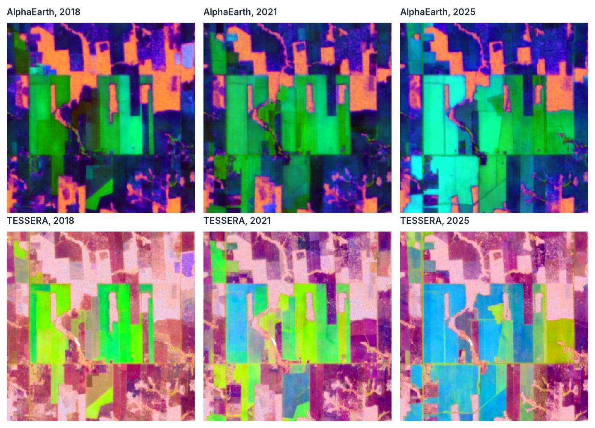
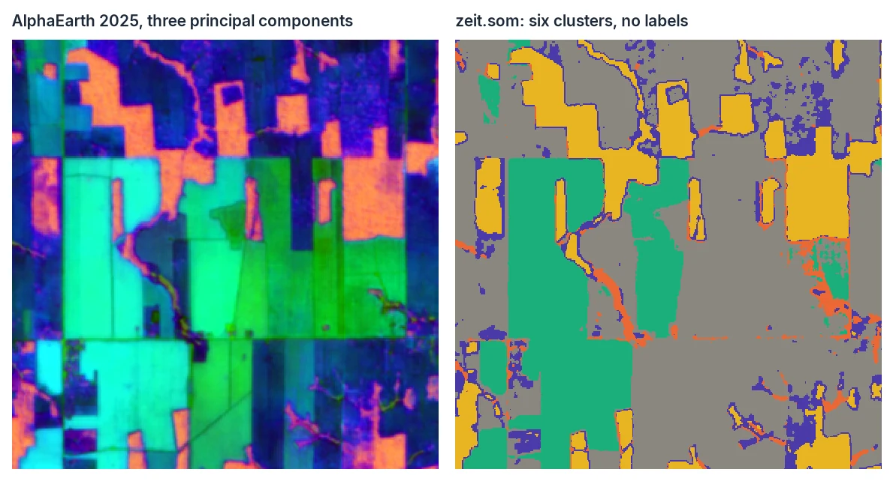
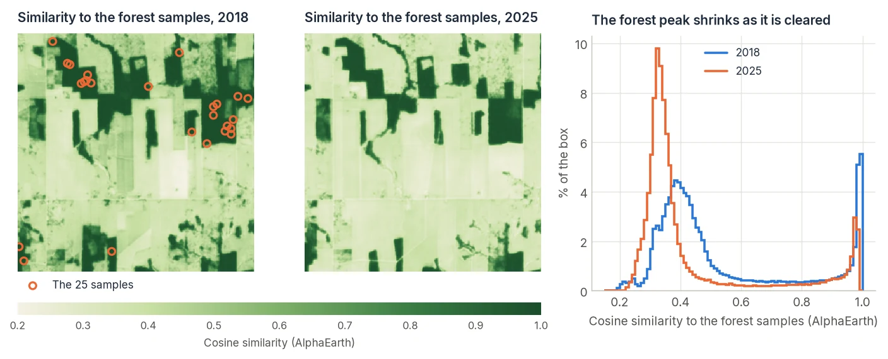
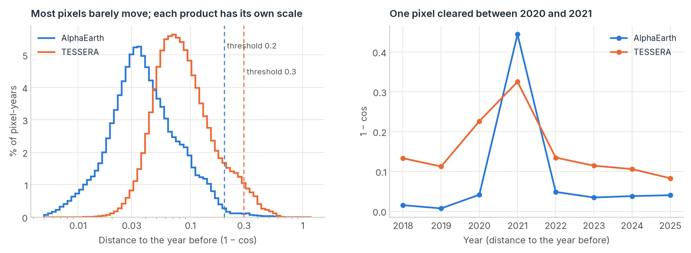
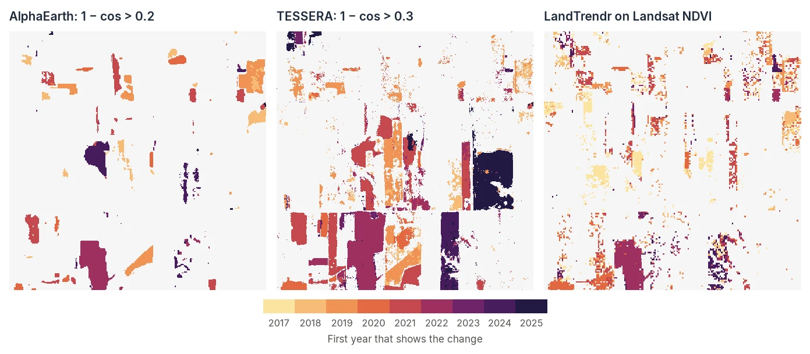

# Embeddings (TESSERA, AlphaEarth)

<p class="lead">Foundation models for Earth observation turn a whole year of satellite images into one vector per pixel: an embedding. Two products are global, open and made at 10 m every year since 2017, TESSERA and Google's AlphaEarth Foundations. zeit reads them as a cube like any other, so the classifiers, the clustering, the segmentation and the validation of zeit work on them as they are, and adds what is particular to embeddings: looking at them, searching for places like a sample, and following each pixel's embedding from year to year.</p>

<div class="glance" markdown>
<div><span class="k">Answers</span><span class="v">What is where, from few samples? Where else looks like this? Where did the land change, year to year?</span></div>
<div><span class="k">Input</span><span class="v">A region and years; the embeddings are downloaded</span></div>
<div><span class="k">Output</span><span class="v">A <code>(time, band, y, x)</code> cube of 128 (TESSERA) or 64 (AlphaEarth) dimensions</span></div>
<div><span class="k">Reference</span><span class="v">Feng et al. (2025), arXiv:2506.20380; Brown et al. (2025), arXiv:2507.22291</span></div>
</div>

## What an embedding is

A pixel seen by Sentinel-1 and Sentinel-2 through one year is a few hundred numbers: a dozen bands on every clear date, radar backscatter every few days, gaps under clouds. A foundation model is a neural network trained on such series from the whole planet to squeeze them into a short vector, so that the vector keeps what tells places apart (forest from pasture, soy from maize, a city from bare soil) and drops what does not (noise, clouds, the exact dates of the images). That vector is the embedding.

<div class="zeit-diagram">
--8<-- "docs/assets/charts/embedding_concept.svg"
</div>

<p class="zeit-diagram-caption">The vector of a pixel summarises how it looked through the whole year. Pixels whose vectors point the same way look alike; a pixel whose vector turns from one year to the next has changed.</p>

The numbers of an embedding have no physical meaning on their own: `A07` is not a band nor an index. What carries meaning is the **direction** of the vector. Two pixels whose vectors point the same way looked alike through the year; a pixel whose vector turns from one year to the next has changed. Everything zeit does with embeddings comes back to that angle, measured by the cosine similarity:

\[
\cos\theta = \frac{\mathbf a \cdot \mathbf b}{\lVert \mathbf a\rVert\,\lVert \mathbf b\rVert}
\]

1 for the same direction, 0 for unrelated ones. `zeit.similarity` maps it against a reference, and `zeit.embedding_change` maps \(1 - \cos\theta\) between consecutive years.

This makes embeddings very good at some things and blind to others:

| Embeddings are good at | They cannot tell |
| :--- | :--- |
| Classifying land cover from a few dozen samples | When in the year something happened (a whole year is one vector) |
| Finding more places like a sample, anywhere | Physical quantities: NDVI, biomass, a magnitude of loss in reflectance |
| Flagging that a pixel changed between two years, whatever the change | The direction of a change (loss and regrowth both just "move") |
| Clustering a region into its kinds of land without labels | Anything before 2017 |

For dates within a year, physical magnitudes and the record before 2017, use the classic algorithms ([LandTrendr](landtrendr.md), [CCDC](ccdc.md), [BFAST](bfast.md)) on the images themselves. The two approaches answer different questions, and zeit compares them on the same grid (see [below](#compare-with-the-classic-algorithms)).

## Two products, one cube

| | TESSERA | AlphaEarth Foundations |
| :--- | :--- | :--- |
| Dimensions | 128 | 64 (each embedding has length 1) |
| Cells, years | 10 m, 2017–2025 | 10 m, 2017–2025 |
| Made from | Sentinel-1 and Sentinel-2 | Sentinel-1, Sentinel-2, Landsat and more |
| Stored as | Zarr, int8 times a scale per pixel, a group per UTM zone | COGs, int8 on a fixed curve, per year and UTM zone |
| Read through | `geotessera`, installed with zeit (Python 3.12+) | nothing: free open COGs on Source Cooperative (default); or Earth Engine |
| Licence | CC0 1.0 (attribution requested) | CC-BY 4.0, attribution required |

Both are read with one function, and give the same thing: a georeferenced `(time, band, y, x)` cube, `time` on January 1 of each year, `band` the dimensions (`A00`, `A01`...), NaN where there is no embedding. A region within a UTM zone keeps the zone's CRS and the cells the embeddings were made on, so the two products line up cell by cell:

```python
import zeit

box = (-63.136, -10.133, -63.086, -10.083)           # 5 x 5 km of Rondônia, Brazil
emb = zeit.load_embeddings(box, source="tessera", years=range(2017, 2026))
aef = zeit.load_embeddings(box, source="alphaearth", years=range(2017, 2026))
emb.rio.transform() == aef.rio.transform()      # True: the same 554 x 549 cells of 10 m, EPSG:32720
```

Every figure of this page comes from these two cubes, a box of the Rondônia scene used by the [LandTrendr](landtrendr.md) tutorial, where cattle pasture and soy fields have kept replacing the forest since 2016.

The cube is lazy: the blocks are read when computed, a year and every dimension at a time, kept as downloaded (up to 1 GB, so that what is computed twice is downloaded once) and dequantised as they arrive. Over this box, all nine years took 38 s for TESSERA and 59 s for AlphaEarth on a home connection: 700 MB of AlphaEarth and 1.4 GB of TESSERA once in memory as `float32`. `chunks=None` reads it all at once; `zeit.save_raster(emb, "emb.tif")` keeps a copy that `zeit.load_raster` reads back, still knowing what it holds.

Regions come as bounds in longitude and latitude, a vector file or a `GeoDataFrame` (cells outside its polygons become NaN), or the grid of another raster:

```python
emb = zeit.load_embeddings("municipality.gpkg", source="tessera", years=2024)
on_landsat = zeit.load_embeddings(source="alphaearth", like=landsat, years=range(2018, 2025))   # 30 m, averaged
```

With `like=` (or `crs=`/`res=`) the embeddings are put on that grid: by the nearest cell, or by the mean of the cells when the new ones are at least 1.5 times larger. A region across UTM zones needs `crs=`.

!!! note "Check the coverage of each year"
    The products are global, but not every year covers every cell. Over this box, TESSERA has no 2017 embedding for 72% of the cells (AlphaEarth has all of them), so the figures below start in 2018. One line shows the share of cells without an embedding, per year:

    ```python
    emb.isel(band=0).isnull().mean(["y", "x"]).values      # [0.72, 0.00, 0.00, ...]
    ```

### What the cube remembers

The cube's attributes say which embeddings it holds: product, version and variant (TESSERA has had several inference runs, and each is a space of its own), the licence and the citation. A model trained with `zeit.train_classifier` or `zeit.ai.train` records them, and `zeit.classify`/`zeit.ai.predict` refuse a cube of other embeddings rather than produce a map from vectors it was never trained on. The algorithms that fit a physical, seasonal signal (LandTrendr, CCDC, BFAST, phenology, TWDTW, indices...) refuse a cube of embeddings too: there is nothing in a yearly summary for them to fit.

## Look

```python
zeit.plot(emb)
```

Dozens of dimensions cannot be shown at once, so `zeit.plot` shows the first three principal components as red, green and blue. They hold much of the variety of a region: here 69% of the variance of AlphaEarth (51%, 13% and 5%) and 70% of TESSERA's. The components are fitted once, on pixels of every year, and applied to all of them: a colour means the same embedding in 2018 and in 2025, and paging through the years shows the land changing.

<figure markdown>
  
  <figcaption>The same box in 2018, 2021 and 2025, through the first three principal components of each product. Within a product, a colour is the same embedding in every year. In AlphaEarth, forest is orange (compare the similarity maps below) and fields green to cyan. A patch whose colour changes between two years changed on the ground; the change maps below date it. The colours of the two products are unrelated (each has its own components), but the patches are the same.</figcaption>
</figure>

The viewer has two more views, picked in the panel beside the map, and computes all of them on the GPU from the vectors themselves:

- **Similarity**: move the mouse, and every pixel is coloured by how much it looks like the one under the cursor (the cosine similarity of their embeddings). Click a pixel to pin it as the reference, tick *keep the reference's year*, and page through the years: a pasture that comes to look like the forest you pinned, or a field that stops looking like it, shows up. The chart below the map follows the cursor's pixel over the years.
- **Change**: how far each pixel moved from the previous year (1 − cosine), the same distance as `zeit.embedding_change`.

The components can also be fitted on the visible area only: zoom into a forest, and the colours spread over its differences instead of over forest versus city. See [Visualisation](../api/plot.md#embeddings) for the details.

## Classify from few samples

The embeddings were made for this. Each dimension of a year is a feature:

```python
year = emb.sel(time="2024")                               # blocks read for training are kept for classify
rf = zeit.train_classifier(year, "samples.gpkg", label="class")
classes = zeit.classify(year, rf)
```

Because the model behind the embeddings has already learned what tells land covers apart, a random forest on them needs far fewer samples than one on raw bands: both papers report accurate maps from sparse labels. Then validate it as any map, with a probability sample and error-adjusted areas ([Accuracy & Area](accuracy.md)):

```python
design = zeit.sampling_design(classes.label, expected_ua=0.8)
points = zeit.stratified_sample(classes.label, design=design)
```

Several years at once (`emb.sel(time=slice("2022", "2024"))`) give the classifier how each pixel changed. Train on the same product, version and variant you classify: the cube's attributes enforce it.

Without labels, `zeit.som` clusters the embeddings into a few kinds of land and `zeit.snic` segments them into objects:

```python
clusters = zeit.som(aef.sel(time="2025"), x=2, y=3, sample=20_000)   # six clusters
```

<figure markdown>
  
  <figcaption>Six clusters of the 2025 AlphaEarth embeddings, found by a self-organizing map without a single label. Forest, the fields and the pasture come out as clusters of their own, and the river with its edges as others; naming them takes a look at each, not a training set.</figcaption>
</figure>

## Find more places like these

```python
forest = zeit.similarity(aef, "forest_samples.gpkg", year=2018)   # (time, y, x): cosine similarity
per_class = zeit.similarity(emb, "samples.gpkg", by="class")       # one map per class
```

The reference is the mean embedding of the samples (every cell of a polygon) in one year (`year`, the last of the cube by default), and every year of the cube is compared with it: where something like it appears, and when. With `by=`, each value of a column gets its own reference and its own map, under a `class` dimension. `metric="euclidean"` gives a distance instead (0 for the same embedding).

<figure markdown>
  
  <figcaption>25 pixels of forest picked in 2018 (orange rings) are the reference. Left and centre: every pixel's similarity to them, in 2018 and in 2025; dark green is forest. Right: the distribution of the similarity over the box. The peak near 1, the forest, shrinks from 2018 to 2025 as it is cleared (the share of the box above 0.8 drops from 21% to 13.5%), and the pasture peak grows.</figcaption>
</figure>

A similarity map has no fixed threshold: how similar "the same thing" is depends on the product and on how varied the samples are. Look at its distribution, as in the figure: when the samples are a coherent class, it has a clear peak near 1, and the valley before it is the threshold.

## Change from year to year

```python
change = zeit.embedding_change(emb)                   # distance of each year to the year before
events = zeit.extract_events(change, min_magnitude=0.3)
```

`embedding_change` returns two maps: `distance` (time, y, x), how far each pixel's embedding moved (`1 - cos` of the angle between two years, 0 for no movement, up to 2), and `noise` (y, x), the median of a pixel's distances, its usual movement from year to year. With `baseline="first"` or a year, every year is measured against that one instead of the year before.

`extract_events` keeps the largest move of each pixel in the schema of the other change algorithms: `yod` the year before the first embedding that shows the change, `date`, `magnitude` (the distance), and `dsnr` (the move over the pixel's noise). An embedding summarises a year, so a clearing in the middle of a year shows partly in it and partly in the next.

### Choosing a threshold

Each product has its own scale. Over this box, the median pixel moved 0.037 a year in AlphaEarth and 0.082 in TESSERA, and the 99th percentile was 0.21 and 0.41. The same threshold flags very different amounts of change: at 0.2, 1.1% of AlphaEarth's pixel-years and 11% of TESSERA's; at 0.3, 0.45% and 4.0%.

<figure markdown>
  
  <figcaption>Left: the year-to-year distance of every pixel and year, on a log scale. Most pixels barely move; TESSERA's whole distribution sits about twice as far out as AlphaEarth's. Dashed lines: the thresholds used below, which 1.1% (AlphaEarth) and 4.0% (TESSERA) of the pixel-years exceed. Right: a pixel cleared between 2020 and 2021. Both products jump in 2021; AlphaEarth's move stands out ten times above its usual one, TESSERA's three times.</figcaption>
</figure>

Two ways to set it:

- **From the distribution.** Plot `change.distance` as a histogram, as above: the bulk is year-to-year noise, and the threshold goes where its tail ends. Here, 0.2 for AlphaEarth and 0.3 for TESSERA.
- **Relative to each pixel.** `extract_events(change, sort_by="dsnr")` keeps, for each pixel, the move that stands furthest above its usual one, and a threshold on `dsnr` means the same in both products. It suits places with very different usual movement (a field that changes crop every year next to a forest that does not):

    ```python
    events = zeit.extract_events(change, sort_by="dsnr")
    strong = events.where(events.dsnr >= 4)          # moves at least 4 times the pixel's usual one
    ```

Then check the result as any change map, with a sample and error-adjusted areas: [Accuracy & Area](accuracy.md).

### Compare with the classic algorithms

```python
agree = zeit.agreement({
    "tessera": zeit.extract_events(zeit.embedding_change(emb), min_magnitude=0.3),
    "alphaearth": zeit.extract_events(zeit.embedding_change(aef), min_magnitude=0.2),
    "landtrendr": zeit.extract_events(zeit.landtrendr(ndvi), min_magnitude=2000),
}, tolerance=1)
```

<figure markdown>
  
  <figcaption>The first year that shows each pixel's largest change, 2017–2025, by the two embedding products and by LandTrendr on annual Landsat NDVI (losses only, put on the 10 m grid). The same clearings come out in all three, with the same years: the large block of the bottom centre in 2022, the patches of the left in 2019–2021.</figcaption>
</figure>

On this box, with the thresholds above:

| Pair | Pixels where both find a change | ... and agree on its year (± 1) |
| :--- | ---: | ---: |
| AlphaEarth and LandTrendr | 15,042 | 12,664 (84%) |
| TESSERA and LandTrendr | 19,449 | 14,869 (76%) |
| AlphaEarth and TESSERA | 17,040 | 14,575 (86%) |

The maps also differ, and for reasons worth knowing. LandTrendr was asked for losses of NDVI only; the embeddings find any change, so changes inside fields (the dark block on the right of TESSERA's map is a field in every year, and changed in 2025) show up in them and not in LandTrendr. LandTrendr works on 30 m Landsat pixels, so its map is grainier, and its record starts in 1985: its losses of 2017 (light yellow) happened between the 2016 and 2017 images, before the first embedding, so the embeddings cannot see them. And TESSERA, at 0.3, flags more pixels than AlphaEarth at 0.2, among them small edges and field margins: a higher threshold, or `min_dsnr`, makes it stricter.

## Earth Engine, local copies, versions

- AlphaEarth comes by default from its open copy on Source Cooperative: free, no account, no quota. `backend="gee"` reads it from the `GOOGLE/SATELLITE_EMBEDDING/V1/ANNUAL` collection of Earth Engine instead (start a session with `zeit.gee.auth.initialize_gee()`), which counts against the account's quota; each year is downloaded once into `cache_dir`.
- `store=` reads a copy of either product: a TESSERA Zarr store (a local one needs no `geotessera`), or a folder with AlphaEarth's `aef_index.parquet` and its COGs.
- `version=`/`variant=` choose a TESSERA run (default v1.1, the complete global one) and `depth=` the first dimensions of a v2 store (Matryoshka embeddings, trained to work truncated).
- From the shell: `zeit embeddings ./out --source tessera --bbox -63 -10 -62.9 -9.9 --years 2018-2024` ([CLI](../cli.md)).

## Cite

TESSERA: Feng et al. (2025), *TESSERA: Temporal Embeddings of Surface Spectra for Earth Representation and Analysis*, arXiv:2506.20380 (embeddings and weights CC0; the authors ask to be cited). AlphaEarth: Brown et al. (2025), *AlphaEarth Foundations: An embedding field model for accurate and efficient global mapping from sparse label data*, arXiv:2507.22291; the dataset is CC-BY 4.0 and requires the attribution "The AlphaEarth Foundations Satellite Embedding dataset is produced by Google and Google DeepMind." Both are in the cube's attributes.
