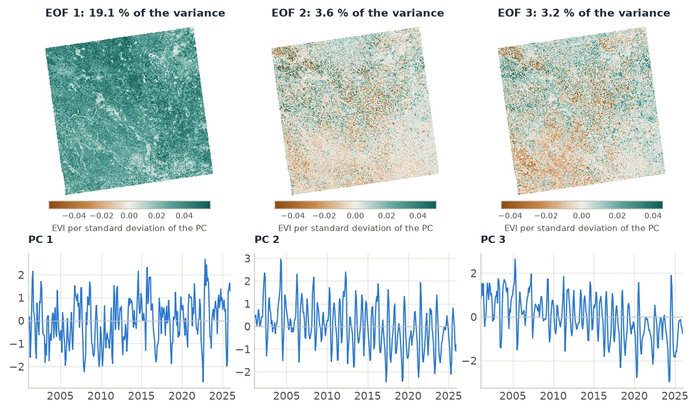
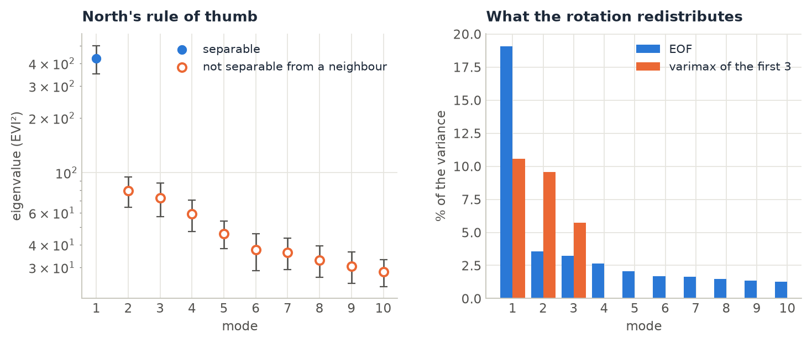
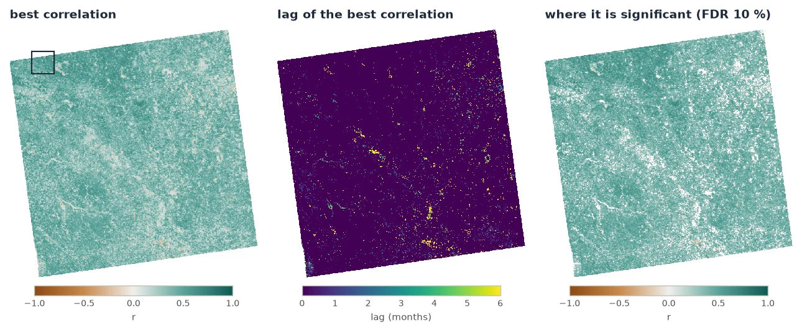

# EOFs and Lagged Correlation

<p class="lead">A cube of maps over time holds a few stories told at once: the whole area is greener than usual this month, the north-west is moving against the south-west. Empirical orthogonal functions (EOFs) find those stories: a handful of maps, each with a time series that says when it was on. Lagged correlation asks the question the other way round: given a series you already have (a climate index, a regional mean), where do the pixels follow it, and after how many months? Both answers come with a test, and the tests are chosen for series that remember their past.</p>

<div class="glance" markdown>
<div><span class="k">Answers</span><span class="v">Which patterns explain most of the variability of a cube, and when? Where, and with what delay, do pixels follow a driver?</span></div>
<div><span class="k">Input</span><span class="v">One variable, one map per date: <code>(time, rows, cols)</code>. For the lagged correlation also a driver: a series, or another cube on the same grid.</span></div>
<div><span class="k">Output</span><span class="v">EOF maps and PCs with North's test and an optional varimax rotation; the correlation, p-value and effective sample size at each lag, the best lag and the pixels that survive the false discovery rate</span></div>
<div><span class="k">Reference</span><span class="v">North et al. (1982); Halko et al. (2011); Kaiser (1958); Bretherton et al. (1999); Benjamini &amp; Hochberg (1995); the Python packages <code>xeofs</code> and <code>eofs</code></span></div>
</div>

<figure markdown>
  
  <figcaption><strong>Result of this tutorial.</strong> The first three EOFs (top) and principal components (bottom) of 25 years of 16-day EVI over a 170 km square of Europe at 250 m (677 × 680 pixels, 575 dates), averaged to months, with the seasonal cycle of each pixel taken out. EOF 1 (19.1 % of the variance) has one sign over almost the whole area: all of it is greener or browner than its calendar month's normal at the same time, and PC 1 says when. EOFs 2 and 3 (3.6 % and 3.2 %) have both signs, strongest in the west of the area. The decomposition of 361,000 pixels × 299 months took 2 s on 8 threads. <em>Data: a 16-day EVI series, 2001-2025, EPSG:3035.</em></figcaption>
</figure>

## How it works

### EOFs

1. **Anomalies.** Each pixel's seasonal cycle is taken out: for every calendar month, that month's mean over the years. What is left is how much a month differs from its normal. Without this step, the first modes would simply be the seasons.
2. **A table of dates by pixels.** The anomalies form a matrix `X` with one row per date and one column per pixel. The pixels are weighted by the area they cover (equal weights in a projected equal-area grid such as EPSG:3035).
3. **The decomposition.** `X = U S V^T`. The columns of `V` are the **EOFs**, the maps; the columns of `U` are the **principal components** (PCs), the time series; the singular values give the share of the variance of each mode. The dates are the short side (hundreds, against hundreds of thousands of pixels), so Zeit works on the dates × dates matrix `X X^T`, which it sums over blocks of pixels read in parallel: the cube never has to be in memory at once. For cubes with many dates, a randomized method (Halko et al. 2011) needs a few passes over the data instead.
4. **Units.** By default a map is in the data's units per standard deviation of its PC (`scaling="units"`): a value of 0.03 on an EVI EOF means that when the PC is one standard deviation above its mean, that pixel's EVI is 0.03 above its normal.

An EOF is a statistical pattern, not a process. Each mode is orthogonal to the others by construction, and real phenomena are not, so a mode can mix two of them.

### North's rule of thumb

The eigenvalue `λ` of a mode is estimated from a finite number of dates, and has a sampling error of about `λ sqrt(2 / n)` (North et al. 1982). If the error bars of two neighbouring eigenvalues overlap, the two modes are not separable: sampling noise could rotate one into the other, and each alone should not be interpreted. Zeit gives `north_error` and `separable` for every mode. Which `n` to use matters: `n` is the number of *independent* dates. The default, `north_n="dates"`, counts all the dates (as the Python package `eofs` does) and is right for series without memory. Monthly anomalies of vegetation have a lot of memory, and `north_n="autocorrelation"` counts `T (1 - ρ) / (1 + ρ)` dates, `ρ` being the lag-1 autocorrelation of the PC.

### Varimax

When modes are mixtures, rotating a few of them can give more local, easier to read patterns. `rotate=3` rotates the first three modes by Kaiser's (1958) varimax criterion (with Kaiser's normalization by default), which pushes the loadings of every pixel towards a single mode. The rotated modes share the variance of the three differently (and are no longer ordered by the singular values). Rotation is a choice of the analyst; in particular, it changes with the number of modes rotated.

### Lagged correlation

For each pixel, the correlation of its series `x_t` with the driver `y_{t-k}`, `k = 0, 1, ..., K`. **The driver leads:** a driver that acts two months later has its strongest correlation at lag 2. At each lag the pairs are the dates where both values exist.

Then the questions of significance. A series of monthly vegetation anomalies is not made of independent values: the next month looks like this one. The effective number of independent pairs is `n (1 - rx ry) / (1 + rx ry)`, with `rx` and `ry` the lag-1 autocorrelations of the two series (Bretherton et al. 1999), and the t test of the correlation uses it instead of `n`. Here the effective `n` is about half the real one (median 0.52), and for smoother series it is less; without the correction a map of correlations is covered with false positives. Two more steps follow, because there are `K + 1` lags and many pixels:

- the p-value of the best lag is adjusted for having tried `K + 1` lags (Šidák);
- of all the pixels' best p-values, the ones that pass the Benjamini-Hochberg procedure at a false discovery rate `alpha_fdr` are `significant`. With thousands of pixels, a 5 % level for each would give hundreds of false hits; controlling the share of false discoveries among the hits is the question a map asks. Wilks (2016) recommends 0.10 for a map where each pixel alone would be tested at 0.05.

## Step by step

### 1. Prepare the cube

```python
import zeit

evi = zeit.load_raster("EVI_2001_2025.tif").squeeze("band")        # (time, y, x), 575 16-day dates
monthly = evi.resample(time="MS").mean()                           # (time, y, x), 300 months
```

Both functions accept 16-day data directly; averaging to months first keeps the dates with few observations (winter, in this area) in the fit. EOFs also assume that the dates are about equally spaced, so an irregular series is better aggregated first.

### 2. Run the EOF analysis

```python
ds = zeit.eof(monthly, n_modes=10, weights="none", rotate=3, north_n="autocorrelation")
```

| Variable | Meaning |
| :--- | :--- |
| `eof (mode, y, x)` | The maps, in the data's units per standard deviation of the PC. |
| `pc (mode, time)` | The time series, of unit variance. |
| `variance (mode)` | The fraction of the total variance of each mode. |
| `eigenvalue (mode)`, `north_error (mode)`, `separable (mode)` | North's rule: the eigenvalue, its sampling error and whether the mode is separated from its neighbours. |
| `eof_rotated`, `pc_rotated`, `variance_rotated` | With `rotate`: the varimax-rotated modes, ordered by variance. |
| `pc_filled (time)` | Dates left out of the fit because too few pixels were valid; their PC was filled in by least squares on the valid pixels. |

The parameters that shape the result are in the [API reference](../api/time-series.md#eof). Those that matter most:

| Parameter | Default | Effect |
| :--- | :---: | :--- |
| `anomaly` | `"month"` | What is taken out of each pixel: the monthly climatology, a harmonic fit (`"harmonic"`, for dates that are not monthly) or only the mean (`"none"`). |
| `detrend` | `False` | Also remove a straight line. A trend in the data becomes the first mode otherwise. |
| `standardize` | `False` | Divide each pixel by its standard deviation: the correlation matrix instead of the covariance, so that noisy pixels do not dominate. |
| `weights` | `"area"` | `"area"` weights by the pixel area (`"coslat"` for a geographic CRS, `"none"` for equal weights, or your own array). Weights matter when the grid is in degrees. |
| `solver` | `"auto"` | `"exact"` or `"randomized"`. See below. |
| `min_valid`, `min_date_valid` | `0.8`, `0.5` | The share of valid dates a pixel needs, and of valid pixels a date needs. |

```python
ds.variance.values[:3]                        # 0.191, 0.036, 0.033
ds.separable.values[:3]                       # [True, False, False]
ds.eof.sel(mode=1).zeit.plot()
```

### 3. Read the result

<figure markdown>
  
  <figcaption>Left: the eigenvalues with their North error bars (with the autocorrelation of the PCs, about 0.7 at one month: roughly 55 independent dates of 299). Only mode 1 is clear of its neighbour; modes 2 to 10 overlap in a chain. Right: the variance of each mode, and of the first three after the varimax rotation, which spreads the 19.1 + 3.6 + 3.2 % over three modes of 10.6, 9.6 and 5.7 %.</figcaption>
</figure>

- **Mode 1** is separable and is the one to interpret on its own: 19.1 % of the variance, the same sign over the whole area.
- **Modes 2 and 3** are 3.6 and 3.2 %, and by North's rule they cannot be told apart. Their two maps are best read as one two-dimensional subspace. With the default `north_n="dates"` modes 4 and 5 look separable too: the rule then counts five times more independent dates than the PCs have, and its error bars are 2.2 to 2.6 times too narrow.
- **The tail** (modes 4 to 10, 2.7 % to 1.3 %) decays slowly. A slowly decaying tail is what noise looks like: do not interpret those modes.

**Which solver.** `solver="exact"` finds all the modes in one pass over the pixels, in time proportional to the pixels times the dates squared, and is the answer to which the others are compared. `solver="randomized"` samples the data with a random matrix and refines it with `power_iterations` passes (default 4): it reads the data a few more times but its cost grows only linearly with the dates. It is as exact as the exact solver for the modes that North's rule separates and less so for the others: on this cube its variance of mode 6 differs from the exact one by 7e-4 with 2 passes, 6e-5 with 4 and 1e-6 with 8. With up to 1000 dates `solver="auto"` uses the exact solver (on this cube of 300 months it is also the faster one); with more, the randomized one with 4 passes, or 8 when the deeper modes matter.

### 4. Lagged correlation with a driver

The driver is a series with a date for each value, here the mean EVI of a 15 km block, standing in for a regional index; a climate index (ENSO, NAO, a precipitation series) is used in the same way.

```python
block = monthly.isel(y=slice(60, 120), x=slice(60, 120))
driver = block.mean(("y", "x")).to_series()                       # a pandas Series, one value per month

lc = zeit.lagged_correlation(monthly, driver, lags=6)             # lags 0..6 months
```

| Variable | Meaning |
| :--- | :--- |
| `r`, `p`, `n`, `n_eff` `(lag, y, x)` | The correlation, its p-value, the number of pairs and the effective number of pairs at each lag. |
| `best_r`, `best_lag` `(y, x)` | The correlation of the lag with the largest `|r|` (or the largest positive or negative one, `best="positive"`), and that lag (`-1`: no lag had enough pairs). |
| `best_p`, `q` `(y, x)` | The p-value of the best lag adjusted for the lags tried, and its false-discovery-rate adjusted value. |
| `significant` `(y, x)` | `q <= alpha_fdr`. |

<figure markdown>
  
  <figcaption>The correlation of every pixel's monthly EVI anomalies with the mean of the block marked at the top left, at lags of 0 to 6 months. 72 % of the pixels are significant at a false discovery rate of 10 % (<code>p ≤ 0.092</code>). The best lag is 0 almost everywhere: a regional mean is followed at once, and the scattered patches with a later best lag (yellow) are where the correlation is weak (their mean best r is -0.05; 95 % of the pixels have lag 0). Counting each pair as independent would have given 76 %. The call took 2.3 s on 8 threads.</figcaption>
</figure>

A regional mean is a poor test of a lag: weather acts on the whole area in the same month. A driver that works through a delay, such as the precipitation of previous months on a dry-land vegetation, an ENSO index, or snow melt, shows its lag.

The options that change the question:

| Parameter | Default | Effect |
| :--- | :---: | :--- |
| `step` | `"month"` | `"month"` averages both series to calendar months (a monthly index can drive a 16-day series) and counts the lags in months; `"dates"` matches the driver to the dates of `x` (`match="nearest"` within `tolerance`, `"exact"`, `"month"` or `"year"`) and counts the lags in observations. |
| `anomaly` | `"month"` | Taken out of both series. With `"none"`, the seasonal cycle makes every pixel correlate with every seasonal driver. |
| `method` | `"pearson"` | `"spearman"` uses ranks, for series with outliers or a monotonic relation. |
| `effective_n` | `True` | `False` treats the pairs as independent. |
| `alpha_fdr` | `0.10` | The false discovery rate among the pixels called significant. |
| `lags` | `3` | A number `K` (lags `0..K`) or a list; negative lags let the pixels lead the driver. |

### 5. Use the false discovery rate on any map of tests

`zeit.fdr` is not tied to the correlation: it takes any array of p-values.

```python
mk = zeit.mann_kendall(monthly)
q, threshold, significant = zeit.fdr(mk.p, alpha=0.10)      # the trend map, corrected for testing every pixel
```

## Choices and pitfalls

- **The signs are arbitrary.** The sign of an EOF and its PC can be flipped together without changing the result. Zeit fixes it so that a PC correlates positively with the mean anomaly of the area (the largest value positive for a dipole), so that a rerun, or a run with a different number of threads, gives the same signs; the references (`eofs`, `xeofs`) choose their own.
- **A trend is a mode.** A pixel's linear trend is variance, and ends up as an EOF with a PC that rises or falls. `detrend=True` takes it out if it is not the subject.
- **Equal weights for degrees.** On a latitude-longitude grid the pixels near the poles are smaller; `weights="area"` (or `"coslat"`) keeps them from counting as much as those at the equator.
- **Gaps.** A pixel with less than `min_valid` of valid dates has no map; a date with less than `min_date_valid` of valid pixels does not enter the fit, but gets a PC by least squares on its valid pixels, flagged in `pc_filled` (Everson & Sirovich 1995).
- **Lags are not causes.** A significant correlation at lag 3 says that the pixel follows the driver after three months, not that the driver is why. Two series with the same slow trend or a shared seasonal residual correlate at every lag, and the effective-n correction reduces but does not remove that.
- **Months, not dates, for the lags.** A lag of 2 steps is 32 days in a 16-day series and 2 months in a monthly one. `step="month"` makes the lags months whatever the frequency of `x` and the driver.

## Against the original implementations

The decompositions agree with `xeofs` and `eofs` to rounding (explained variance to 1e-14, the directions of the maps and PCs to 1 - |cos| of 1e-14, North's errors to 1e-14) on a synthetic cube with known modes and on this EVI cube, and the varimax rotation with xeofs' `EOFRotator` to 1e-14. The lagged correlations agree with `xarray.corr` (r in float32, the number of pairs and the best lag exactly), with `scipy.stats.pearsonr`, `spearmanr` and the Student t distribution for the p-values, and with `scipy.stats.false_discovery_control` and `statsmodels` for the false discovery rate. The 300-month, 361,000-pixel EOF takes Zeit 2.8 s on one thread and 1.5 s on 8, against 8.4 s for `eofs` and 11.4 s for `xeofs` with the exact solver; the correlation at 7 lags of the 460,000 pixels takes 7.2 s and 2.3 s, against 31.5 s for `xarray.corr` alone. The numbers, the conventions that differ between the packages and how to rerun them are in [Against the original implementations](../benchmarks/vs-originals.md#eofs-and-lagged-correlation).

## References

- North, G. R., Bell, T. L., Cahalan, R. F., & Moeng, F. J. (1982). Sampling errors in the estimation of empirical orthogonal functions. *Monthly Weather Review*, 110, 699-706.
- Halko, N., Martinsson, P. G., & Tropp, J. A. (2011). Finding structure with randomness. *SIAM Review*, 53, 217-288.
- Kaiser, H. F. (1958). The varimax criterion for analytic rotation in factor analysis. *Psychometrika*, 23, 187-200.
- Everson, R., & Sirovich, L. (1995). Karhunen-Loève procedure for gappy data. *JOSA A*, 12, 1657-1664.
- Bretherton, C. S., Widmann, M., Dymnikov, V. P., Wallace, J. M., & Blade, I. (1999). The effective number of spatial degrees of freedom of a time-varying field. *Journal of Climate*, 12, 1990-2004.
- Benjamini, Y., & Hochberg, Y. (1995). Controlling the false discovery rate: a practical and powerful approach to multiple testing. *Journal of the Royal Statistical Society B*, 57, 289-300.
- Wilks, D. S. (2016). "The stippling shows statistically significant grid points": how research results are routinely overstated and overinterpreted, and what to do about it. *Bulletin of the American Meteorological Society*, 97, 2263-2273.
