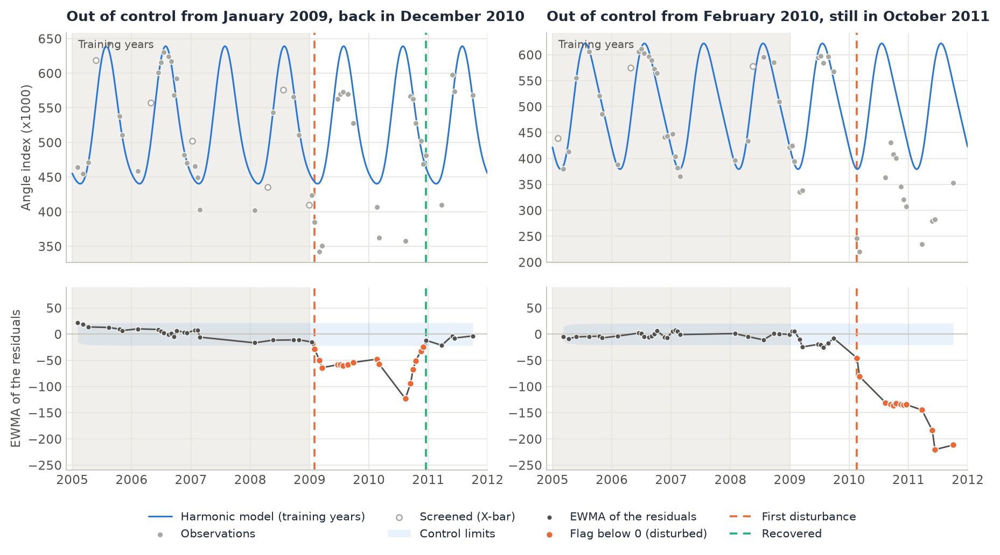
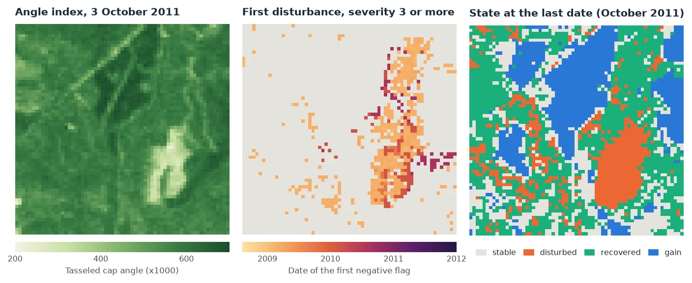

# Monitoring with EWMACD

<p class="lead">EWMACD watches every observation of a pixel with a control chart, the tool factories use to notice when a machine drifts. A harmonic model learns the pixel's normal seasonal cycle from a few stable years. After them, the chart follows how far each new observation falls from the model, and it signals when the departures add up. Because it works date by date, it takes irregular, cloudy Landsat series as they are, without compositing, and it catches subtle, lasting changes such as thinning as well as clear-cuts.</p>

<div class="glance" markdown>
<div><span class="k">Answers</span><span class="v">Since when has this pixel left its normal behaviour, how far, and has it come back?</span></div>
<div><span class="k">Input</span><span class="v">Every observation of one index, irregular dates welcome: <code>(time, y, x)</code></span></div>
<div><span class="k">Output</span><span class="v">The flags of every date; maps of the first disturbance, its severity, the recovery, the first gain and the state at the last date</span></div>
<div><span class="k">Reference</span><span class="v">Brooks et al. (2014), <em>IEEE Transactions on Geoscience and Remote Sensing</em> 52(6)</span></div>
</div>

<figure markdown>
  
  <figcaption><strong>What EWMACD produces.</strong> Two real pixels of the sample data of Brooks et al. (2014): the tasseled cap angle index of loblolly pine stands in Alabama, 51 Landsat dates from 2005 to 2011. Top: the observations and the harmonic model fitted on the training years (shaded); hollow dots are training dates screened out as clouds or shadows. Bottom: the EWMA of the residuals and its control limits. Orange dots are dates flagged as disturbed. Left: a drop from early 2009, deepest in August 2010, back within the limits in December 2010. Right: a sharp drop in February 2010, most likely a harvest, still far below the model in October 2011.</figcaption>
</figure>

## How it works

1. **Learn the normal cycle.** For each pixel, a constant plus `order` (2) sine and cosine pairs of the day of the year is fitted to the observations of the training years. Dates more than `xbar_train` (1.5) standard deviations from this first fit are dropped as clouds and shadows (a Shewhart X-bar chart), and the model is fitted again without them.
2. **Compute the residuals.** Every date gets its residual: observation minus model. After the training years, only gross anomalies, beyond `xbar_monitor` (20) standard deviations, are dropped, so that real changes stay in.
3. **Smooth them in a control chart.** The exponentially weighted moving average (EWMA) of the residuals, `z = (1 - lmbda) * z_previous + lmbda * residual`, remembers the recent dates, so that a small shift that lasts adds up while a single odd date fades. Its control limits are `sigmas` (3) standard deviations of the EWMA, from the training residuals.
4. **Flag.** Each date's flag is the EWMA divided by its limit, truncated: 0 inside the limits, -1, -2... for a loss of one, two... limits, and positive values for a gain. A signal must last `persistence` (3) dates to count.

From the flags after the training years come the maps: the first disturbance, its severity, the date it came back, the first gain, and the state at the last date.

## Step by step

The data are the sample data of the paper, a 65 x 64 pixel stack of the tasseled cap angle index (x 1000) over loblolly pine stands in Alabama, USA ([Virginia Tech data repository](https://doi.org/10.7294/W4WD3XHK)). Its 51 dates are uneven: 11 in 2006, 4 in 2007 and 4 in 2011.

### 1. Load every date

```python
import zeit

cube = zeit.load_raster("ewmacd_sample/angle_*.tif")   # one GeoTIFF per date, the date in the name
cube.sizes                                              # time: 51, y: 64, x: 65
```

The download is a single stack with its dates in a CSV file. Give them to `load_raster`:

```python
import pandas as pd

t = pd.read_csv("Temporal Distribution with DOY.csv")
dates = pd.to_datetime(dict(year=t.Year, month=t.Month, day=t.Day))
cube = zeit.load_raster("Sample Data - Angle Index x1000 Stack.tif", dates=dates)
```

Use **every** observation, with the clouds masked as NaN, and do not composite: EWMACD needs the dates as they are. Any vegetation index works (NDVI, NBR, EVI); the paper uses the tasseled cap angle, `atan(greenness / brightness)`.

### 2. Run EWMACD

The paper trains on 2005-2008 and monitors 2009-2011. `train_end` is the first year after the training period:

```python
res = zeit.ewmacd(cube, train_end=2009)

list(res.data_vars)
# ['flags', 'break_time', 'severity', 'recovery_time', 'gain_time', 'state', 'sigma', 'rmse', 'r2', 'coefficients']
```

The 4,160 pixels take 40 ms. The training years must be **stable**: a pixel disturbed during them has a poor model and signals at once when monitoring starts.

### 3. Read the maps

<figure markdown>
  
  <figcaption><strong>Result of this tutorial.</strong> Left: the angle index on the last date; the pale patch, cleared in 2010, is most likely a harvest. Middle: the date of the first disturbance, for the pixels whose disturbance reached 3 control limits or more. Right: the state at the last date.</figcaption>
</figure>

| Variable | Meaning |
| :--- | :--- |
| `flags` | `(time, y, x)`: the chart's flag at every date. 0 in control, negative a loss, positive a gain, in control limits. |
| `break_time` | The first disturbance after the training years, as a decimal year (NaN: none). |
| `severity` | Its most negative flag until it came back: -3 is three control limits below the model. |
| `recovery_time` | The first date back inside the limits (or above) after the disturbance. |
| `gain_time` | The first positive flag after the training years. |
| `state` | At the last date: 0 stable, 1 disturbed, 2 recovered (disturbed, then back), 3 gain. |
| `sigma`, `rmse`, `r2` | The training residuals' standard deviation behind the limits, and the model's fit. |
| `coefficients` | `(coefficient, y, x)`: the harmonic model's constant, sines and cosines. |

```python
names = res.state.attrs["flag_meanings"].split()   # ['stable', 'disturbed', 'recovered', 'gain']
res.state.to_series().value_counts()               # 0: 888, 1: 636, 2: 1648, 3: 988

severe = res.break_time.where(res.severity <= -3)  # the map in the middle
zeit.save_raster(res[["break_time", "severity", "state"]], "results/ewmacd")
```

The maps show how sensitive the method is. 2,284 pixels (55%) have a first disturbance, and 82% of them start in the first months of 2009: half of the scene drifts below its model in the spring of 2009, by one or two limits, and most of it comes back (57% of these pixels within 2009, 86% by 2011). That is why so many pixels are "recovered" at the last date. It is a weak, widespread signal, more likely weather than management. The severe changes are fewer: 15% of the pixels have a first disturbance of severity 3 or more, grouped in stands, and 5% are at -3 or less on the last date, most of them in the harvest (85% of them have an angle index below 450 in October 2011, against a median of 574 over the scene). Filter on `severity`, as in the middle map, to keep the clear changes.

The pixels in `gain` (24%) have an index that stays above their training model, as a young stand that keeps growing would.

### 4. Look at one pixel's chart

With one pixel's series, the result also has the chart itself, date by date: `ewma`, `limit` and `fitted` (the model).

```python
px = zeit.ewmacd(cube.isel(y=39, x=50), train_end=2009)   # the harvested pixel, right in the first figure
float(px.break_time), int(px.severity), int(px.state)     # (2010.13, -10, 1)

(px.ewma / px.limit).plot.line("o")                       # out of control beyond -1 and 1
```

`ewma` and `limit` are NaN on the dates that were screened out of the chart. Those dates carry the flag of the date before.

### Other inputs

The same function takes a raster on disk, a numpy array or a single pixel ([all inputs](../api/change-detection.md#ewmacd)):

```python
# many GeoTIFFs, read and computed block by block
res = zeit.ewmacd("landsat_ndvi/*.tif", train_end=2017, chunks="auto")
zeit.save_raster(res[["break_time", "severity", "state"]], "results/ewmacd")

# one pixel's series: a pandas Series indexed by date, or values with dates=
px = zeit.ewmacd(series, train_end=2017)
px = zeit.ewmacd(values, train_end=2017, dates=dates)
```

## Parameters

| Parameter | Default | Effect |
| :--- | :---: | :--- |
| `train_end` | required | The first year after the training period. The model is fitted on the years before it. |
| `train_start` | first year | Dates before it are left out. |
| `order` | `2` | Sine and cosine pairs of the harmonic model. |
| `lmbda` | `0.3` | Weight of each new residual in the EWMA, in (0, 1]. Lower: a slower, smoother chart, more weight on lasting shifts. `1` charts each date on its own. |
| `sigmas` | `3.0` | The control limits, in standard deviations of the EWMA. Higher: fewer and later signals. |
| `persistence` | `3` | Dates a signal must last. Counted in dates, not in time: in a cloudy year, 3 dates can span months. |
| `xbar_train` | `1.5` | Training dates beyond this many standard deviations are screened out of the model. |
| `xbar_monitor` | `20.0` | Later dates beyond this many standard deviations are screened as anomalies. Raise it for smooth series (see below). |
| `low` | `None` | Values not above it are missing: fill values, water, bare soil. |

## Good practice

- **Expect short false signals with the defaults.** Screening the training dates at 1.5 standard deviations makes `sigma` smaller than the noise, so the limits are tight: the chart sees small changes, and it also signals briefly on noise. On a synthetic series of stable forest (Gaussian noise only, 145 dates, [example 24](https://github.com/sacridini/zeit-cdts/blob/main/examples/example_24_ewmacd.py)), 24% of the pixels got a short signal with the defaults, nearly all of -1; 4% with `persistence=6`, none with `persistence=12`; 6% with `sigmas=4` or `xbar_train=2.5`. With each of these settings, a thinning that lowered the index by twice the noise was still found in every pixel, a median of one or two months after it. Brooks' later scripts use half the dates of a year as the persistence.
- **Mask clouds before.** Missing dates are fine. A dark date that the cloud mask missed is not: after the training years, only residuals beyond `xbar_monitor` are screened, and a cloud shadow is often less than that. It enters the EWMA and weighs on it for several dates (with `lmbda=0.3`, 70% of it remains on the next date). Mask with the QA band, or with [Tmask](tmask.md).
- **Raise `xbar_monitor` for smooth series.** A clear-cut larger than 20 standard deviations of a very quiet pixel is screened as an anomaly until it comes back within them, which delays the detection.
- **Check the training years.** A pixel disturbed during them signals at once after them, and its `r2` is low.
- **Read `severity`, not only `break_time`.** The first disturbance can be a flag of -1. The deeper and longer ones are the changes worth mapping.

!!! note "About this implementation"
    The flags are those of Brooks' EWMACD v1.3.0 R script, the paper's own; Earth Engine has the method as `ee.Algorithms.TemporalSegmentation.Ewmacd`. With `persistence=1` they were checked date by date on synthetic series and on 400 pixels of the sample data used here. With more persistence, the first disturbance is the same, and a few later dates differ where the script, which means to keep the previous lasting state, reads another date's flag. Values not above `low` are missing from the start, whereas the script still fits them in its first regression. On 10,000 pixels and 71 dates, the script takes 2.8 s, and Zeit 55 ms on one thread and 7 ms on 19. See [Against the Original Implementations](../benchmarks/vs-originals.md).

For a regular series and a statistical test of the break, see [BFAST Monitor](bfast_monitor.md). For degradation in the tropics from the fractions of each observation, see [CODED](coded.md).

## References

- Brooks, E. B., Wynne, R. H., Thomas, V. A., Blinn, C. E., & Coulston, J. W. (2014). On-the-fly massively multitemporal change detection using statistical quality control charts and Landsat data. *IEEE Transactions on Geoscience and Remote Sensing*, 52(6), 3316–3332. [doi:10.1109/TGRS.2013.2272545](https://doi.org/10.1109/TGRS.2013.2272545)
- Sample data and the EWMACD R script: Brooks, E. B., Virginia Tech. [doi:10.7294/W4WD3XHK](https://doi.org/10.7294/W4WD3XHK)
