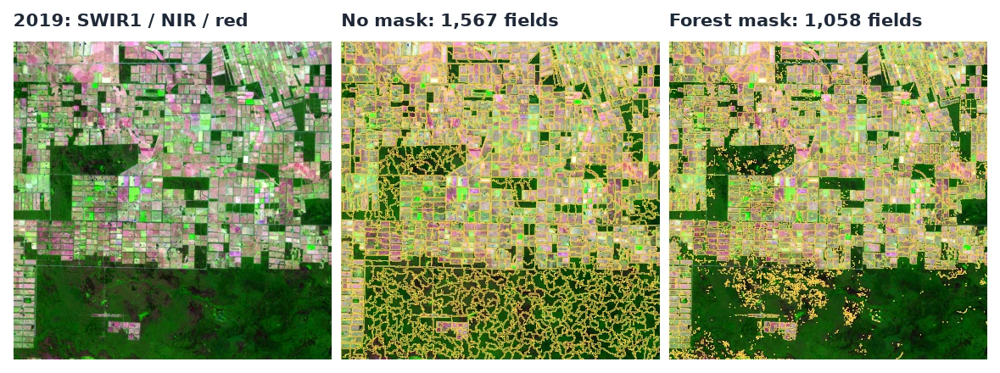
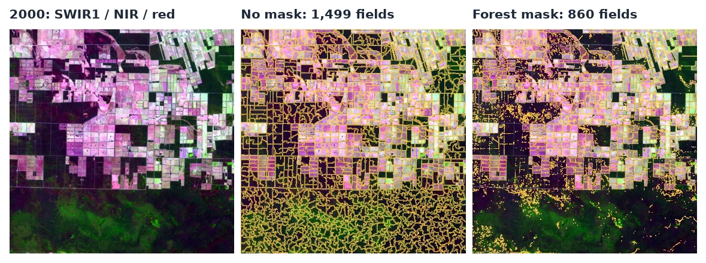
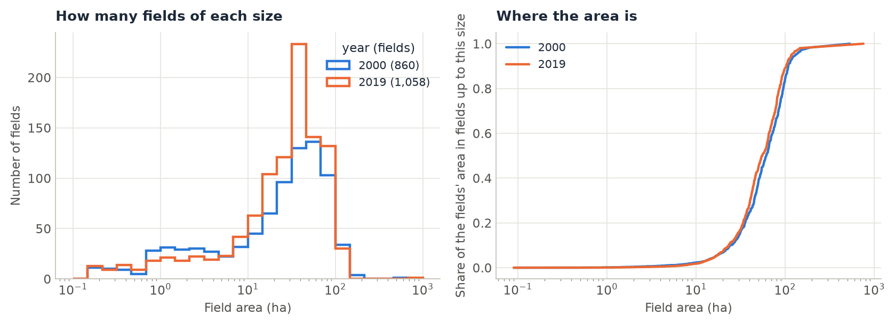

# Field Boundaries (Stochastic Watershed)

<p class="lead">Draw the fields of a landscape from one Landsat mosaic, as polygons with their area, and compare the size of the fields of two years. The example is a 30 km square of the Paraguayan Dry Chaco, in 2000 and in 2019, a landscape that was largely cleared for pasture and crops in between.</p>

<div class="glance" markdown>
<div><span class="k">Answers</span><span class="v">Where are the fields, how many, and how large are they?</span></div>
<div><span class="k">Input</span><span class="v">An image <code>(y, x)</code>, or a stack of bands and/or dates <code>(band, y, x)</code>, <code>(time, band, y, x)</code></span></div>
<div><span class="k">Output</span><span class="v">A label map, the probability that each pixel is on a field edge, and one polygon per field (area in ha, perimeter, compactness)</span></div>
<div><span class="k">Reference</span><span class="v">Angulo & Jeulin (2007), the stochastic watershed; the MappingDemo notebook (Baumann 2020)</span></div>
</div>

<figure markdown>
  
  <figcaption><strong>Result on real data.</strong> A 30 × 30 km window of the Paraguayan Dry Chaco (1000 × 1000 pixels at 30 m), Landsat 8 dry-season medoid of 2019. Left: SWIR1 / NIR / red. Middle: the fields from <code>zeit.fields</code> on the six reflective bands, without a mask (1,567 objects, forest included). Right: with a forest mask (1,058 fields). <em>Data: Landsat Collection 2 Level-2 surface reflectance (USGS), read from the Microsoft Planetary Computer.</em></figcaption>
</figure>

## How the stochastic watershed works

A watershed floods an image from markers and puts a boundary where two floods meet. With one set of markers the boundaries depend on where the markers fell, so most of them are accidents. The stochastic watershed (Angulo & Jeulin 2007) repeats the flooding from many random sets of markers and counts how often each pixel lands on a boundary. An edge that is real is a boundary in almost every run, because no marker placement can merge the two sides; an accidental one is a boundary only when a marker happened to fall on each side.

`zeit.fields` does the following:

1. builds a **gradient** image (edge strength): the Sobel magnitude of an image, or, when you pass several bands and/or dates, the mean of the Sobel magnitude of each standardised layer (the *multitemporal* gradient);
2. floods it from 200 random sets of markers (1000 per million pixels, kept 20 pixels apart) and records the **boundary probability** of every pixel;
3. keeps the pixels above a **hysteresis** threshold (low 0.1, high 0.6): a weak boundary counts only if it touches a strong one;
4. labels what is left between the boundaries, drops objects of fewer than 10 pixels, and grows the labels with a last watershed so that the fields fill the space between the boundaries.

An exact alternative, `method="exact"` (Malmberg & Luengo Hendriks 2014), computes the probability for one-pixel uniform markers in a single pass instead of 200 floods; in the validation it stayed behind the Monte Carlo, so it is not the default. The building blocks (watershed, Sobel, grey-scale morphology, hysteresis) are equal, value for value, to scikit-image's and SciPy's. The API reference has every parameter: [`zeit.fields`](../api/time-series.md#fields).

## The example: 2000 against 2019

### The window

The window is 1000 × 1000 pixels (30 km × 30 km) in the Paraguayan Chaco, about 55 km south-west of Filadelfia, in the area of the Mennonite colonies' agricultural frontier:

| | |
| :--- | :--- |
| CRS | EPSG:32620 (UTM 20, the zone Landsat itself uses for these scenes, with the southern hemisphere's negative northings) |
| Bounds (E, N, in m) | 749 985 to 779 985, −2 539 995 to −2 509 995 |
| Bounds (lon, lat) | about −60.57 to −60.27, −22.95 to −22.67 |

It was picked from the overviews of a Landsat scene of each year: a square that still has forest in 2000, at its southern edge and between the fields, and that is mostly pasture and crops in 2019. The edges are on Landsat's own pixel lattice, so nothing is resampled.

### The data

Each year is one **medoid mosaic** of the dry season (1 June to 30 September): for each pixel, the clear observation that is closest, over the six reflective bands, to the median of the clear observations. All the bands of a pixel then come from one date, which keeps the spectra consistent and the edges sharp. The mosaics are surface reflectance times 10000 (`int16`), the scale of the notebook's `B5 > 2000` forest threshold.

| Year | Sensors | Scenes (path 228, row 76) |
| :--- | :--- | :--- |
| 2000 | Landsat 5 TM and Landsat 7 ETM+ (before the scan-line failure of 2003) | 5, from 26 July to 28 September |
| 2019 | Landsat 8 OLI | 4, from 15 July to 17 September |

Both mosaics have a valid value in every pixel. With the notebook's six bands and the QA_PIXEL bits of Collection 2 (fill, dilated cloud, cirrus, cloud and cloud shadow clear, the clear bit set), the same asset names and bit positions work for Landsat 5, 7, 8 and 9. Reading both years cost about 120 MB from the Planetary Computer (an upper bound, measured on the network adapter), and the two COGs are 9 MB and 12 MB on disk.

With Zeit's public tools, a user gets the same kind of mosaic like this:

```python
import zeit

bands = ["blue", "green", "red", "nir08", "swir16", "swir22"]
bbox = [-60.57, -22.95, -60.27, -22.67]          # lon/lat; the window above, slightly larger

def mosaic(year):
    comp = zeit.build_annual_composites(
        source="planetary_computer", collection="landsat-c2-l2", bbox=bbox,
        start_year=year, end_year=year, season=("06-01", "09-30"),
        bands=bands, method="medoid", cloud_cover_max=40, epsg=32620, resolution=30,
    )
    return comp.isel(time=0).compute() * 10000   # reflectance x 10000, (band, y, x)

img2000, img2019 = mosaic(2000), mosaic(2019)
```

!!! warning "What the stock tools do not do yet"
    `build_annual_composites` has no platform filter (Landsat 7 after its scan-line failure, with stripes, enters the 2019 median or medoid; `method="bap"` only downweights it), its Landsat mask is the clear bit of QA_PIXEL alone, which keeps cloud shadow, and it rounds the grid to multiples of 30 m, 15 m off Landsat's own. The mosaics of this page come from `benchmarks/fields/validation/mosaics.py`, which fixes the three for its own use (platforms, a mask that includes shadow and the exact lattice) and is what the sensitivity analysis (see below) was run on.

`docs/scripts/make_fields_figures.py` rebuilds the two mosaics, the polygons, every number and every figure of this page (`plan`, `download`, `run`), with `random_state=0`.

### Fields from the stack

The six bands go in as a stack, so the gradient is the multitemporal one (the mean of the Sobel magnitude of each standardised band): an edge that shows in any band counts.

```python
res = zeit.fields(img2019, random_state=0)
res.labels      # (y, x) int32: 1..k, 0 outside the mask; label 1 is the boundary network
res.boundary    # (y, x) float32: probability of lying on a boundary
fields = zeit.fields_to_polygons(res)   # GeoDataFrame: field, n_pixels, area_ha, perimeter_m, compactness
```

Without a mask, *everything* is a field, forest included: the forest of the south of the window is cut into cells of tens of hectares (middle panels of the figures), which are no fields. In a landscape of forest and fields, tell it what is forest. The notebook did it with `swir16 > 2000` (reflectance times 10000), which keeps what is cleared and drops the dense forest. In the Chaco this is the better choice: on the Dry Chaco windows of the validation it raised the boundary F from 0.66 to 0.74 (see [How good is it?](#how-good-is-it)), because the forest no longer takes part and its texture no longer costs edges. Elsewhere the same absolute threshold removed part of the references (in Porto Murtinho, 55 %), so it is not the default.

```python
swir = img2019.sel(band="swir16")
res = zeit.fields(img2019, mask=swir > 2000, random_state=0)   # the notebook's forest mask
fields = zeit.fields_to_polygons(res)
```

(`mask_threshold=2000` is the same on one 2-D image; with a stack, pass the mask as an array, as above.) The same for 2000:

<figure markdown>
  
  <figcaption><strong>2000.</strong> The same window, Landsat 5 and 7 dry-season medoid. Much of the north-east is already cleared, the rest is forest with a few large clearings and the lines of the roads and boundary tracks. The panels are as above (860 fields with the forest mask), with the same stretch for both years.</figcaption>
</figure>

### The distribution of field sizes

With the forest-mask result of each year, the polygons give the areas in hectares:

```python
import numpy as np

for year, f in ((2000, fields2000), (2019, fields2019)):
    a = f["area_ha"]
    print(year, len(f), np.percentile(a, [10, 25, 50, 75, 90]).round(1))
```

| Forest mask | 2000 | 2019 |
| :--- | ---: | ---: |
| Cleared (SWIR1 > 2000) share of the window | 46.6 % | 57.8 % |
| Share of the window in field polygons | 34.7 % | 42.9 % |
| Number of fields | 860 | 1,058 |
| Area, 10th percentile (ha) | 1.2 | 1.4 |
| Area, 25th percentile (ha) | 6.9 | 12.2 |
| **Area, median (ha)** | **29.9** | **32.2** |
| Area, 75th percentile (ha) | 53.8 | 50.8 |
| Area, 90th percentile (ha) | 84.7 | 79.7 |
| Area such that half of the fields' area is in larger fields (ha) | 61.7 | 55.3 |
| Fields of 20 to 100 ha | 479 | 654 |
| Fields under 1 ha | 75 | 88 |

<figure markdown>
  
  <figcaption><strong>The two distributions.</strong> Left: number of fields by area (logarithmic classes). Right: the share of the fields' area that is in fields up to a given size. The 2019 curve has more fields of 10 to 100 ha; the share of the area in each size is almost the same in both years.</figcaption>
</figure>

How to read it:

- **More of the window is in fields, and there are more fields.** The cleared area went from 47 % to 58 % of the window and the number of fields from 860 to 1,058 (+23 %), mostly of 10 to 100 ha. About a quarter of the cleared pixels belong to no field in either year: the boundary network between fields, which `fields_to_polygons` leaves out.
- **The typical size barely moved: 30 ha in 2000, 32 ha in 2019, and half of the area is in fields of 55 to 62 ha.** The 2019 mosaic is fuller of fields but they are not detectably smaller or larger. A difference of two hectares in the median is inside what a change of the marker density does: with `marker_density=2000` (twice the default) the medians are 23.6 and 24.4 ha, still equal to each other but 20 % lower. **The sizes are the method's resolution as much as the landscape's**: the density of the markers (one per 90 ha at the default of 1000 per million pixels) sets a scale, and the histogram drops sharply above about 100 ha. Compare years with the same settings, and read the counts and areas before the exact sizes.
- **The merges bias the large end.** In both years one object is larger than 500 ha (533 and 759 ha): a stretch of contiguous cleared land with no edge between its parts, merged into one field.
- **The sensors differ.** 2000 is Landsat 5 TM and 7 ETM+, 2019 is Landsat 8 OLI. Their six bands are close but not identical, and the threshold is not adjusted between them. [Preparing images](preparing-images.md) has the spectral adjustment of Landsat 5 and 7 to Landsat 8 (`zeit.bandpass_adjust`).

## How good is it?

Measured against hand-drawn and cadastral references, on 64 windows of Brazil and the Chaco (Luis Eduardo Magalhães with Fields of The World's boundaries, Sorriso and Porto Murtinho with the rural property registry, 45 windows of the Dry Chaco and 12 of the Humid Chaco with the Trazo annotations; Landsat 30 m medoids; the sensitivity analysis and cross-validation are described in [`benchmarks/fields/sensitivity/README.md`](https://github.com/sacridini/zeit-cdts/blob/main/benchmarks/fields/sensitivity/README.md)). The score is F, the harmonic mean of the precision and recall of the boundary pixels, with a tolerance of one pixel (30 m):

- **The tuned defaults against the notebook's values.** The mean F of the five groups is **0.50** with the notebook's values and **0.63** with the defaults of `zeit.fields`, which were chosen by spatial cross-validation (a rule chosen on the other groups gives 0.62 on the held-out one). Most of the gain is the gradient: with the gradient fixed to the notebook's top-hat, the same cross-validation reaches only 0.51.
- **The Dry Chaco: 0.66 without a mask, 0.74 with the forest mask.** It is the only group where the notebook's absolute mask pays, and it pays because it removes the forest. The mask took 55 % of the Porto Murtinho references with it, so it is a choice for the Chaco, not a default.
- **A model at 10 m is clearly better only at Luis Eduardo Magalhães.** The Fields of The World global predictions (Kerner et al. 2025; the PRUE model of Muhawenayo et al. 2026 on Sentinel-2) have a mean F of 0.53 for 2024 and 0.46 for 2025 against 0.63 here. They win at Luis Eduardo Magalhães (0.86 against 0.68), where the reference is Fields of The World's own and may have been in its training, are level at Sorriso (0.51 against 0.49) and lose in the Humid Chaco (0.26 against 0.59), in the Dry Chaco (0.62 against 0.66, or 0.74 with the forest mask) and in Porto Murtinho (0.40 against 0.72). The years of the references and of the predictions do not match, so this is an indication more than a ranking.
- **Merges are the main weakness.** Two neighbouring fields with the same crop and no road or fence between them have no edge and become one object (under-segmentation, in the sense of Clinton et al. 2010). In the Dry Chaco, with the notebook's values, 69 to 89 % of the reference fields found no matching object, the object being 3 to 8 times larger than the field. A higher marker density splits more (the fraction of reference fields matched rose from 0.12 to 0.24 between 600 and 2000 markers per million pixels in the Chaco, where the fields are small) and costs time; at Luis Eduardo Magalhães and Sorriso, where the fields are large, that fraction fell, so no density is best everywhere.

## Large areas

`zeit.fields` reads the image into memory. For a raster too large for one call, `zeit.fields_tiled` cuts it into tiles with an overlap, computes the boundary probability of each tile's core from its enlarged window, and stitches the labels and polygons across the seams, reading by window and never the whole raster:

```python
res = zeit.fields_tiled("chaco_2019.vrt", "out/", tile=512, marker_density=1000,
                        random_state=0, n_jobs=8)
res["labels"], res["polygons"], res["n_fields"]      # out/labels.tif, out/fields.gpkg, ...
```

```bash
zeit fields chaco_2019.vrt out/ --tile 512 --marker-density 1000 --random-state 0 --polygons --jobs 8
```

The gradient uses the statistics of the whole raster, so a tile does not stretch its own contrast, and each tile's seed is derived from `random_state` and the tile's row and column, so the result does not depend on the number of threads. On a 3 × 3 tiles window of 1.8 Mpx the tiled result agrees with the single call as much as one seed agrees with another (F 0.971 against 0.969). The cost measured is **about 9 s per million pixels with 8 threads**: some 3.4 hours for one year of the whole Gran Chaco (1.2 billion pixels at 30 m), and the download of the mosaics is the larger cost. See [`fields_tiled`](../api/time-series.md#fields_tiled) for what a tile cannot see (a boundary connected to a strong one only beyond the overlap).

## Reproducing the notebook

`preset="notebook"` reproduces the MappingDemo notebook, step by step, from the image of one band: the top-hat gradient, 500 realisations of 1000 markers, hysteresis from 0.3, objects under 50 pixels removed, the final watershed on the image and the forest mask `B5 > 2000`. The notebook is by Baumann (2020), after Emmanuelle Gouillart's scikit-image segmentation tutorial; the author authorised the port. With the preset, `zeit.fields` equals the notebook's output given the same markers.

```python
res = zeit.fields(swir1_2019, preset="notebook", random_state=0)
```

Anything passed explicitly wins over the preset.

## References

- Angulo, J., & Jeulin, D. (2007). Stochastic watershed segmentation. *Proceedings of the 8th International Symposium on Mathematical Morphology (ISMM 2007)*, 265–276. MCT/INPE, Rio de Janeiro.
- Clinton, N., Holt, A., Scarborough, J., Yan, L., & Gong, P. (2010). Accuracy assessment measures for object-based image segmentation goodness. *Photogrammetric Engineering & Remote Sensing*, 76(3), 289–299. [doi:10.14358/PERS.76.3.289](https://doi.org/10.14358/PERS.76.3.289)
- Kerner, H., Chaudhari, S., Ghosh, A., Robinson, C., Ahmad, A., Choi, E., et al. (2025). Fields of The World: A machine learning benchmark dataset for global agricultural field boundary segmentation. *Proceedings of the AAAI Conference on Artificial Intelligence*, 39(27), 28151–28159. [doi:10.1609/aaai.v39i27.35034](https://doi.org/10.1609/aaai.v39i27.35034)
- Malmberg, F., & Luengo Hendriks, C. L. (2014). An efficient algorithm for exact evaluation of stochastic watersheds. *Pattern Recognition Letters*, 47, 80–84 (`method="exact"`). [doi:10.1016/j.patrec.2014.03.016](https://doi.org/10.1016/j.patrec.2014.03.016)
- Muhawenayo, G., Robinson, C., Khanal, S., Fang, Z., Corley, I., Wollam, A., et al. (2026). PRUE: A practical recipe for field boundary segmentation at scale. arXiv:2603.27101. [arxiv.org/abs/2603.27101](https://arxiv.org/abs/2603.27101)
