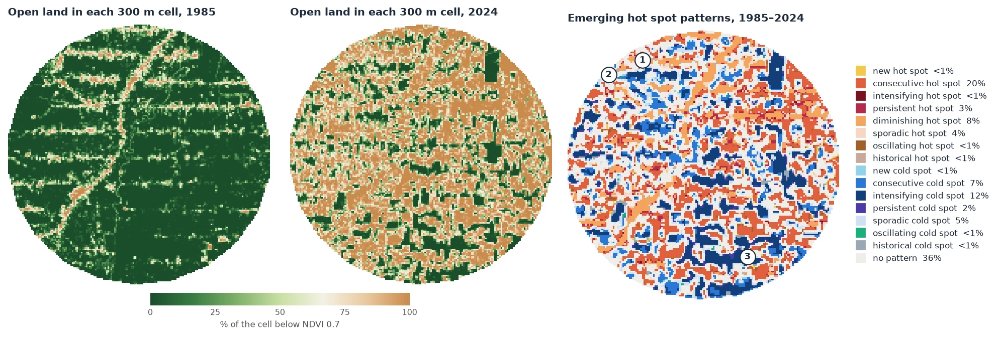
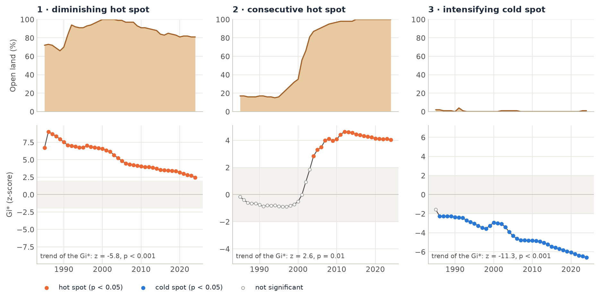

# Emerging Hot Spots

<p class="lead">Where do high values cluster, and is that cluster new, growing, steady or fading? Emerging hot spot analysis answers this for a cube of maps over time. For each date it asks whether a place and its neighbours are higher (a hot spot) or lower (a cold spot) than the rest. Then it reads the history of the answer and names the place's pattern: new, consecutive, intensifying, persistent, diminishing, sporadic, oscillating or historical.</p>

<div class="glance" markdown>
<div><span class="k">Answers</span><span class="v">Where do high or low values cluster, and how did the clusters change over time?</span></div>
<div><span class="k">Input</span><span class="v">One variable, one map per date (at least 3): <code>(time, rows, cols)</code>. A count, a rate, a share or an index.</span></div>
<div><span class="k">Output</span><span class="v">A pattern for every cell (17 classes), the Gi* of every date and the trend of that Gi*</span></div>
<div><span class="k">Reference</span><span class="v">Getis &amp; Ord (1992); ESRI's Emerging Hot Spot Analysis; the Gi* of R <code>sfdep</code></span></div>
</div>

<figure markdown>
  
  <figcaption><strong>Result of this tutorial.</strong> 40 years of annual Landsat NDVI over a 50 km area of Rondônia, Brazil, as the share of each 300 m cell that is open land (NDVI below 0.7), 1985–2024. Left and middle: that share at the start and at the end. Right: the pattern of each cell. Red and orange cells are where open land clusters: in one run up to today (consecutive), or since before 1985 but less and less distinctly (diminishing). Blue cells are forest blocks: they stand out more every year as the land around them is cleared (intensifying cold spots). The numbered cells are plotted below. The analysis of the 167 × 168 cells × 40 years took 55 ms. <em>Data: annual Landsat NDVI composites exported from <a href="https://github.com/eMapR/LT-GEE">LT-GEE</a> on Google Earth Engine.</em></figcaption>
</figure>

## How it works

1. **A hot spot at one date.** For each cell, the Getis-Ord Gi* adds up the values of its neighbourhood (the cell itself among them) and compares the sum with what it would be if values were spread at random. The result is a z-score. Above 1.96 the neighbourhood is significantly high at the 5% level: a hot spot. Below −1.96 it is significantly low: a cold spot. One high cell among low neighbours is not a hot spot; a cluster of high cells is.
2. **A neighbourhood in space and time.** `radius` sets the cells around (1: the 8 neighbours), and `lag` adds the same cells at the dates before (1: the previous date). Each date's Gi* is measured against that date's mean and spread (`reference="date"`), as in R's `sfdep`.
3. **The trend of the Gi*.** Each cell now has a series of z-scores, one per date. A Mann-Kendall test says whether it rises or falls significantly. By default this is the Hamed-Rao version, because consecutive Gi* share neighbours and are autocorrelated.
4. **The pattern.** The dates that are hot, the dates that are cold, the last date and the trend name the pattern, by the rules of ESRI's documentation:

| Code | Pattern | The cell was… |
| :---: | :--- | :--- |
| 1 | new hot spot | hot at the last date only. |
| 2 | consecutive hot spot | hot in one unbroken run of dates that ends at the last date, and on less than 90% of the dates. |
| 3 | intensifying hot spot | hot on at least 90% of the dates, the last one too, and its Gi* rises significantly. |
| 4 | persistent hot spot | the same, with no significant trend. |
| 5 | diminishing hot spot | the same, but its Gi* falls significantly. |
| 6 | sporadic hot spot | hot at the last date, on and off before, and never cold. |
| 7 | oscillating hot spot | hot at the last date, and cold at some date before. |
| 8 | historical hot spot | hot on at least 90% of the dates, but not the last one. |
| 0 | no pattern | none of these. |
| −1 … −8 | the cold spots | the same rules with cold dates. |

When two rules hold, the first in the table wins. Every rule but "historical" needs the last date to be hot (or cold). The patterns describe the clusters as they are **at the end of the series**. A cluster that was strong in 2003 and stopped in 2010 has no pattern unless it was hot on 90% of the dates.

<figure markdown>
  
  <figcaption>The three numbered cells of the map. Top: the share of open land. Bottom: the Gi* of each year; the grey band is not significant. (1) Cleared before 1985 and still open, but the rest of the area caught up: hot every year, less and less distinctly, so <em>diminishing</em>. (2) Cleared around 2003: hot in one run from 2004 to the end, so <em>consecutive</em>. (3) Forest throughout: cold almost every year and more so as the area around it was cleared, so <em>intensifying</em>. The first year's Gi* is closer to 0 because the first date has no previous date to add to its neighbourhood.</figcaption>
</figure>

## Step by step

### 1. Choose the variable and the cells

Emerging hot spot analysis was designed for counts of events in space-time bins: crimes per block per month, fires per cell per year. Raw pixels of an index are rarely the right input. Two choices go into the map above.

**Cells, not pixels.** A 30 m pixel is either cleared or not. Its 8 neighbours cover 90 m, much less than a clearing in Rondônia, where the settlement lots are a few hundred metres wide. The share of open land in 10 × 10 pixel cells (about 300 m) varies smoothly. With `radius=1`, each neighbourhood is then about 900 m across, the scale of the clearing process. It also turns 2.8 million pixels into 28,000 cells, 22,000 of them with data.

**A smooth variable.** Annual composites wobble from year to year: a dry year or some haze moves the NDVI of a whole region. That wobble makes the Gi* flip sign, and the patterns become sporadic and oscillating. With the raw NDVI, 40% of the cells get one of those four patterns. LandTrendr's fitted trajectories keep the clearings and drop the wobble, and with them only 10% do.

```python
import zeit

ndvi = zeit.load_raster("LT_Stack_NDVI_Rondonia.tif")      # (time, y, x), NDVI x 10000, 1985-2024
lt = zeit.landtrendr(ndvi, fitted=True)                      # the fitted trajectory of every pixel

valid = lt.fitted.notnull()                                  # NaN where the stack has no data
open_land = (lt.fitted < 7000).where(valid)                  # 1 open land, 0 forest
share = open_land.coarsen(y=10, x=10, boundary="trim").mean() * 100        # % of each 300 m cell
n = valid.coarsen(y=10, x=10, boundary="trim").sum()
share = share.where(n >= 50)                                 # cells at least half covered by data
```

`share` is a `(time, y, x)` cube of 167 × 168 cells and 40 years, georeferenced like `ndvi`. Across the area, open land went from 12% in 1985 to 52% in 2005 and 66% in 2024.

### 2. Run the analysis

```python
ehs = zeit.emerging_hotspots(share)           # radius=1, lag=1, reference="date"
```

| Variable | Meaning |
| :--- | :--- |
| `category (y, x)` | The pattern's code, from the table above. `-128` where a cell has fewer than 3 dates. The names are in `zeit.emerging_hotspots.PATTERNS`. |
| `gi (time, y, x)` | The Gi* z-score of every cell and date. |
| `p (time, y, x)` | Its two-sided p-value. |
| `trend_z`, `trend_p`, `tau` | The trend test of each cell's Gi* series. |
| `n_hot`, `n_cold` | The number of dates the cell was a significant hot or cold spot. |

The parameters that shape the result:

| Parameter | Default | Effect |
| :--- | :---: | :--- |
| `radius` | `1` | The neighbourhood in cells. With `shape="square"`, the (2 `radius` + 1)² cells around: `1` is the 8 neighbours (queen contiguity). |
| `shape` | `"square"` | `"circle"`: the cells whose centres are within `radius`. |
| `lag` | `1` | Dates before each date that are added to its neighbourhood. |
| `reference` | `"date"` | `"date"`: each date against its own mean and spread. `"cube"`: against the whole cube's. See below. |
| `alpha` | `0.05` | Significance of the Gi* and of its trend. |
| `trend` | `"hamed_rao"` | The trend test of the Gi* series: `"hamed_rao"`, `"yue_wang"` or `"original"` Mann-Kendall (what ESRI and sfdep use). |

All parameters are in the [API reference](../api/time-series.md#emerging_hotspots).

### 3. Read and save the map

In the map at the top:

| Pattern | Cells | What it is here |
| :--- | ---: | :--- |
| consecutive hot spot | 20% | Clusters cleared during the record and still open: the clearings of the 1990s and 2000s. |
| intensifying cold spot | 12% | Forest blocks. They stay forest while the mean rises, so they are colder every year. |
| diminishing hot spot | 8% | Clusters already open in 1985, along the main road and the first side roads. They are still open, but less exceptional every year. |
| consecutive cold spot | 7% | Forest that only became significantly cold once enough land around it was cleared. |
| sporadic hot or cold spot | 9% | Hot (or cold) at the end and on and off before: mostly cells at the edge of a cluster. |
| no pattern | 36% | Not significant at the last date, and not hot or cold on 90% of the dates. |

`diminishing` does not mean that less land was cleared in those cells. It means the cells are less exceptional than they were: the Gi* of a date is measured against that date's mean, and the mean rose. Read a pattern together with the values: a few series, as in the figure above, tell more than the class name.

```python
names = zeit.emerging_hotspots.PATTERNS
ehs.category.zeit.plot()                                    # the legend names the patterns
fronts = ehs.category.isin([1, 2, 3])                      # new, consecutive, intensifying hot spots
zeit.save_raster(ehs.category, "results/hotspot_patterns.tif")
zeit.save_raster(ehs.gi, "results/gi.tif")                 # one band per date
```

## The reference and the lag change the answer

The same cube with three other settings:

| Setting | consecutive hot | diminishing hot | intensifying cold | consecutive cold | no pattern |
| :--- | ---: | ---: | ---: | ---: | ---: |
| default: `lag=1`, `reference="date"` | 20% | 8% | 12% | 7% | 36% |
| `lag=0` | 12% | 6% | 0% | 16% | 55% |
| `reference="cube"` | 56% | 0% | 2% | 0% | 24% |
| `radius=2, shape="circle"` | 20% | 8% | 13% | 6% | 34% |

**`reference`.** With `"date"`, a hot spot is high compared with the other places at that date. With `"cube"`, it is high compared with every place and date of the cube. Here open land rose everywhere, so with `"cube"` most cells cleared at some point are above the 40-year mean at the end, and 56% of them become consecutive hot spots. Neither is wrong: `"date"` asks where clearing is concentrated at each date, `"cube"` asks where values are high in absolute terms. ArcGIS Pro makes the same choice with its "Define Global Window" parameter: its default, "Entire cube", is close to `reference="cube"`, and "Individual time step" to `reference="date"` (sfdep's and Zeit's default).

**`lag`.** With `lag=1`, a date's Gi* sums the neighbourhood at that date and at the date before: 18 values instead of 9. A contrast that lasts gets more significant, which is why the forest blocks are cold on 90% of the dates with `lag=1` (intensifying) but not with `lag=0` (consecutive). The first date has no date before it, so its Gi* sums half as many values and is closer to 0. There is also a bias, the same as in sfdep. The values of the date before are measured against **this** date's mean. When the variable rises everywhere, the dates before sit below that mean and pull the Gi* down. Here open land rose by about 1.4 points a year against a spread of about 35 points between cells, so the bias is small, but on a fast-rising variable it is not. Use `lag=0` or `reference="cube"` when that matters.

## Zeit, sfdep and ArcGIS

The Gi* of every cell and date is the same as R `sfdep` 0.2.5's (`include_gi = TRUE`, queen neighbours, `k` the lag) to 1e-14. The patterns are not always the same as sfdep's, for two reasons:

- sfdep takes the significance of each Gi* from permutations (199 by default). Zeit takes it from the normal distribution of the Gi*, as ArcGIS Pro does (ArcGIS also corrects the p-values for the false discovery rate, which Zeit does not).
- sfdep has rules of its own. For example, it can call a cell sporadic when the cell is not significant at the last date. Zeit follows the definitions of ESRI's documentation, given in the table above.

The permutations are also most of sfdep's time. On 50 × 50 cells and 12 dates, sfdep takes 13 minutes with 199 permutations (28 s with 9). Zeit takes 4 to 7 ms. See [Benchmarks against the originals](../benchmarks/vs-originals.md#emerging-hot-spots-vs-sfdep).

The example [example 25](https://github.com/sacridini/zeit-cdts/blob/main/examples/example_25_emerging_hotspots.py) builds a synthetic cube of hectares cleared per 1 km cell, with a frontier that opened in 2019, an accelerating one, a steady one, a cluster cleared only in the last year and a protected area. It prints the pattern of each, with `reference="date"` and `"cube"`.

## Good practice

- **Use cells at the scale of the process.** Aggregate pixels into cells (counts, shares, means) so that a neighbourhood covers what you want to find. In a geographic CRS, cells are square only near the equator. At 10° S, these are 296 × 300 m.
- **Remove the noise first.** Smooth the series ([LandTrendr](landtrendr.md) fits, [`smooth`](../api/preprocessing.md#smooth)) or use counts of detected events. Otherwise the patterns describe the noise.
- **Choose the last date for your question.** The patterns describe the end of the series. To describe a period that ended earlier, cut the cube there.
- **Many cells, many tests.** At `alpha=0.05`, some cells are significant by chance. Read the map as clusters, not single cells, and check a few series.
- **Missing values** (NaN, the raster's NoData) are left out of the sums and statistics. Cells with no data get `-128`.

## References

- Getis, A., & Ord, J. K. (1992). The analysis of spatial association by use of distance statistics. *Geographical Analysis*, 24(3), 189–206. [doi:10.1111/j.1538-4632.1992.tb00261.x](https://doi.org/10.1111/j.1538-4632.1992.tb00261.x)
- Ord, J. K., & Getis, A. (1995). Local spatial autocorrelation statistics: distributional issues and an application. *Geographical Analysis*, 27(4), 286–306. [doi:10.1111/j.1538-4632.1995.tb00912.x](https://doi.org/10.1111/j.1538-4632.1995.tb00912.x)
- ESRI. How Emerging Hot Spot Analysis works. ArcGIS Pro documentation, Space Time Pattern Mining toolbox. [pro.arcgis.com](https://pro.arcgis.com/en/pro-app/latest/tool-reference/space-time-pattern-mining/learnmoreemerging.htm)
- Parry, J., & Locke, D. sfdep: Spatial Dependence for Simple Features. R package version 0.2.5. [CRAN](https://cran.r-project.org/package=sfdep)
- Hamed, K. H., & Rao, A. R. (1998). A modified Mann-Kendall trend test for autocorrelated data. *Journal of Hydrology*, 204(1–4), 182–196. [doi:10.1016/S0022-1694(97)00125-X](https://doi.org/10.1016/S0022-1694(97)00125-X)
- Kennedy, R. E., Yang, Z., & Cohen, W. B. (2010). Detecting trends in forest disturbance and recovery using yearly Landsat time series: 1. LandTrendr — Temporal segmentation algorithms. *Remote Sensing of Environment*, 114(12), 2897–2910. [doi:10.1016/j.rse.2010.07.008](https://doi.org/10.1016/j.rse.2010.07.008)
