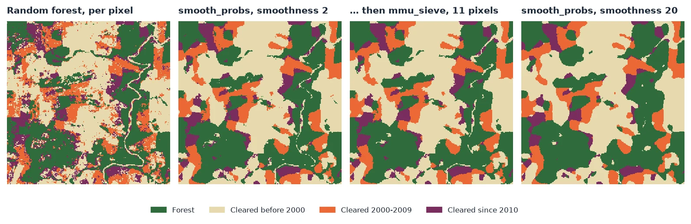
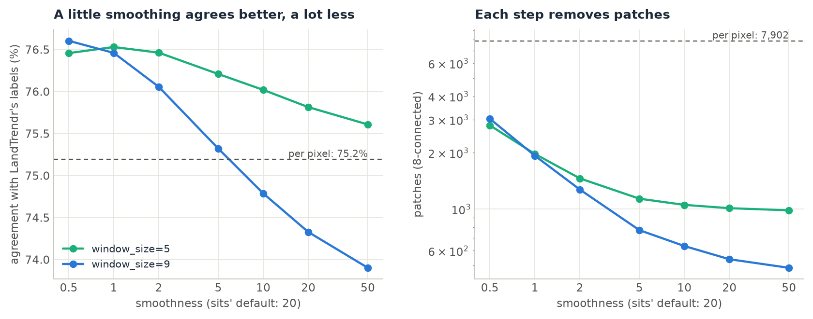
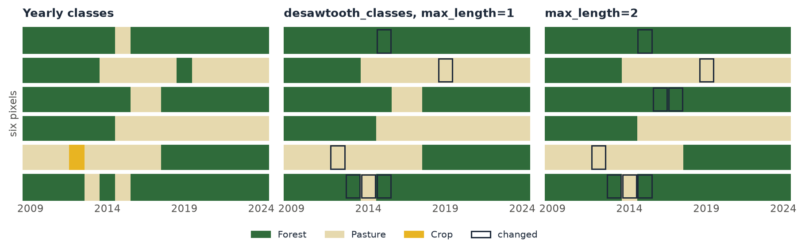
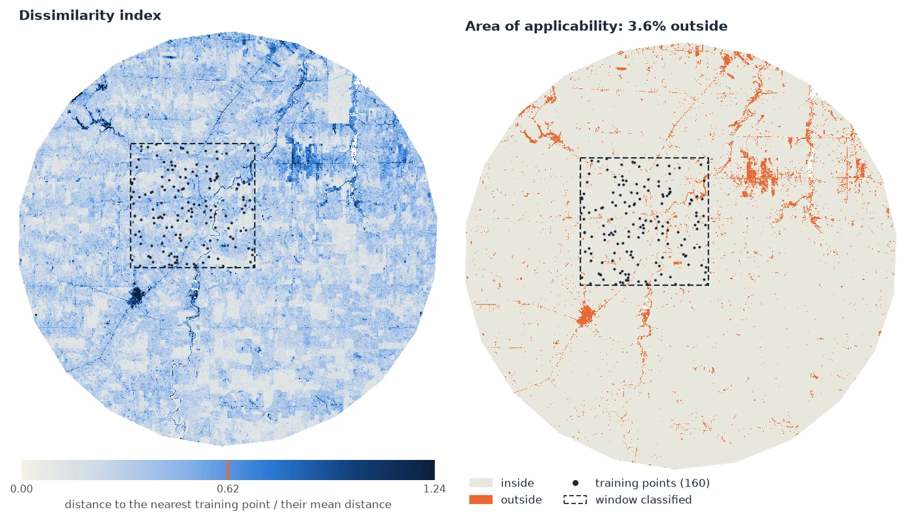

# Post-processing & Area of Applicability

<p class="lead">A classifier labels each pixel on its own. The map it gives is speckled with isolated pixels of the wrong class, its yearly maps flicker from one class to another and back, and it is applied to places unlike any it was trained on. Zeit cleans the map in space (Bayesian smoothing of the probabilities, a minimum mapping unit) and in time (removing one-year excursions), and maps where the model can be trusted at all: its area of applicability.</p>

<div class="glance" markdown>
<div><span class="k">Answers</span><span class="v">How do I clean a classified map, and where is it more than an extrapolation?</span></div>
<div><span class="k">Input</span><span class="v">Class probabilities <code>(class, y, x)</code> or a class map; yearly maps <code>(time, y, x)</code>; the model and its predictors</span></div>
<div><span class="k">Output</span><span class="v">A smoothed class map, patches above a minimum size, consistent series; the dissimilarity index and the area of applicability</span></div>
<div><span class="k">Reference</span><span class="v">Câmara et al., the <em>sits</em> book (Bayesian smoothing); Meyer &amp; Pebesma (2021), <em>Methods in Ecology and Evolution</em> 12</span></div>
</div>

## How it works

<div class="steps" markdown>

<div markdown>
**Classify with probabilities**

Keep each class's probability, not only the winner: the smoothing needs them.

`classify(..., probability=True)`
</div>

<div markdown>
**Smooth in space**

Each pixel's probabilities are pulled towards those of its neighbours, less where the model is sure.

`smooth_probs`
</div>

<div markdown>
**Set a minimum mapping unit**

Patches smaller than the unit are merged into their neighbours.

`mmu_sieve`
</div>

<div markdown>
**Smooth in time**

A year of one class between years of another takes their class.

`desawtooth_classes`
</div>

<div markdown>
**Check where it applies**

How unlike the training data each pixel is, and where it is too unlike.

`aoa`
</div>

</div>

**Bayesian smoothing.** The method of sits' `sits_smooth` (Câmara et al.). Each class's probability `p` becomes a logit, `x = log(p / (sum - p))`. In a window around the pixel, the highest half (`neigh_fraction`) of that class's logits gives a mean `m` and a variance `s²`. The pixel's logit moves towards `m` by a weight that depends on how the neighbourhood varies against a prior variance, `smoothness`:

```
w  = s² / (s² + smoothness)
x' = w · x + (1 − w) · m
```

Where the neighbourhood varies a lot (an edge between classes), `w` is near 1 and the pixel keeps its own value. Where it is uniform, the pixel takes its neighbours' value. A pixel with a confident model keeps its class against consistent neighbours; an uncertain pixel in a field of one class joins it. Unlike a majority filter, the decision weighs the model's confidence, not only the vote of the neighbours.

**Minimum mapping unit.** `mmu_sieve` finds the patches of each class (pixels connected 4- or 8-wise) and merges every patch smaller than `min_size` pixels, the smallest first, into the neighbour with which it shares the longest border. The map stays complete: small patches take a class, they are not emptied (as GDAL's sieve). `apply_majority_filter` is the simpler alternative: each pixel takes the most common class of its window.

**Temporal consistency.** In each pixel's series of yearly classes, a run of at most `max_length` years of one class between two runs of the same other class takes that class: forest, pasture, forest becomes forest, forest, forest. A real change (forest, then pasture for good) is not between two runs of the same class, so it stays.

**Area of applicability.** A model is validated on its training data, and its validation says nothing about places whose predictors are unlike them. Meyer & Pebesma (2021) measure that with a **dissimilarity index** (DI). The predictors are scaled by the training data's means and standard deviations and weighted by their importance in the model. A pixel's DI is its distance to the nearest training point, divided by the mean distance between training points. The **threshold** comes from the training data themselves: each training point's DI to the nearest point of *another* cross-validation fold, and the upper whisker of those (75% quantile + 1.5 IQR, at most their largest). Pixels at or below the threshold are inside the area of applicability (AOA); those above are extrapolations. `zeit.aoa` is CAST's `aoa` (R), with the same DI.

## Step by step

The figures of this page were made by [`docs/scripts/make_postprocessing_figures.py`](https://github.com/sacridini/zeit-cdts/blob/main/docs/scripts/make_postprocessing_figures.py) on the annual NDVI stack of Rondônia used across these tutorials (1985–2024, 30 m). A window of 500 × 500 pixels was labelled from its 40 years by [LandTrendr](landtrendr.md): forest, cleared before 2000, cleared in 2000–2009, cleared since 2010 (the year of the greatest loss). A random forest learns these four classes from 40 random points per class and the NDVI of eight years only. That is a hard task: the forest must tell the decade of clearing from eight snapshots, and its per-pixel map agrees with the LandTrendr labels on 75.2% of the pixels.

### 1. Classify with probabilities

```python
import zeit

# (time, y, x), NDVI x 10000, a date a year, 0 = no data
stack = zeit.load_raster("LT_Stack_NDVI_Rondonia.tif")
years = [1990, 1995, 2000, 2005, 2010, 2015, 2020, 2024]
eight = stack.sel(time=stack.time.dt.year.isin(years))
ndvi = (eight / 10000).where(eight != 0)

rf = zeit.train_classifier(ndvi, "samples.gpkg", label="class")   # a random forest
land_cover = zeit.classify(ndvi, rf, probability=True)            # label, probability
```

Any model that gives probabilities works the same way: a deep network's `ai.predict(model, cube, probability=True)` returns the same `probability (class, y, x)` (see [TempCNN](tempcnn.md#from-a-cube-to-a-map)).

### 2. Smooth the probabilities

```python
probs = zeit.smooth_probs(land_cover.probability, window_size=9,
                          smoothness=2)
label = probs.fillna(-1).argmax("class") + 1
label = label.where(land_cover.label > 0, 0)        # 0: no data, as classify's
```

The smoothed probabilities no longer sum to one (as sits'); the class of a pixel is their `argmax`. `label` uses `classify`'s numbering: `1` for the first class of `rf.classes_`, `0` where a predictor is missing. The `fillna(-1)` matters: a pixel with no data has NaN probabilities, and xarray's `argmax` refuses a pixel where all of them are NaN.

| Parameter | Default | Effect |
| :--- | :---: | :--- |
| `window_size` | 9 | The neighbourhood, odd. Larger: smoother maps, and narrow features (roads, rivers) lost. |
| `neigh_fraction` | 0.5 | The share of the window's highest logits that make its mean. |
| `smoothness` | 20 | The prior variance, one value or one per class. Higher smooths more. |
| `n_jobs` | -1 | Threads. |

<figure markdown>
  
  <figcaption>The same 7.5 × 7.5 km, four ways. Per pixel, the forest leaves 7,902 patches in the window (8-connected) and mixes the decades of clearing within fields. With <code>smoothness=2</code> the fields are whole (1,271 patches) and the river's gallery forest stays; <code>mmu_sieve</code> then removes what is left under 11 pixels (465 patches). With sits' default of 20, the map is smoother still (540 patches) but the river and the roads are gone.</figcaption>
</figure>

How much to smooth is a choice. On this window, a little smoothing removed most of the isolated pixels and agreed better with the LandTrendr labels than the raw map; much more smoothing removed more patches but also real features narrower than the window, and agreed less:

<figure markdown>
  
  <figcaption>Agreement with the LandTrendr labels (left) and patches (right, log scale) against <code>smoothness</code>, for windows of 5 and 9 pixels. The raw map agrees on 75.2% of the pixels. A window of 9 with <code>smoothness</code> of 1 or less agrees on 76.5–76.6%, and falls below the raw map between 5 and 10 (74.3% at 20). A window of 5 smooths less, so it stays above the raw map at every value tried.</figcaption>
</figure>

The reference here is itself a per-pixel product, with its own speckle, so the agreement favours light smoothing. With a reference of whole fields, or a validation sample, the best value can be higher. Judge it on a sample and by eye, as in [Accuracy & Area](accuracy.md), not on the number of patches alone.

### 3. Set a minimum mapping unit

```python
label = zeit.mmu_sieve(label, min_size=11, nodata=0)                   # no patch under ~1 ha
label = zeit.apply_majority_filter(label, size=3, nodata=0)            # or a 3 x 3 mode filter
```

| Parameter | Default | Effect |
| :--- | :---: | :--- |
| `min_size` | 11 | Patches with fewer pixels are merged (11 Landsat pixels ≈ 1 ha). |
| `connectivity` | 8 | `4` or `8`: whether diagonal pixels belong to the same patch. |
| `nodata` | `"auto"` | The map's NoData (NaN for floats), a number, or `None`. NoData stays, and a patch surrounded only by NoData is kept. |

On the raw map, a 3 × 3 majority filter alone takes the 7,902 patches to 2,304 (agreement 75.9%). Smoothing first and sieving after gives larger, cleaner patches. Use the sieve to meet a mapping standard (a minimum unit of 1 ha, of 6.25 ha) and the smoothing to correct the classes; the sieve does not look at the probabilities. For a map of change events (a year of loss), whose "no change" is NoData, [`apply_mmu_filter`](../api/post-processing.md#apply_mmu_filter) empties the small patches instead.

### 4. Make yearly maps consistent

A map per year from the same model flickers: a pixel of forest is called pasture one year, forest again the next. `desawtooth_classes` takes the yearly maps as one cube:

```python
import xarray as xr

yearly = xr.concat([label_2019, label_2020, label_2021, label_2022], dim="time")   # (time, y, x)
yearly = zeit.desawtooth_classes(yearly, max_length=1, nodata=0)
```

<figure markdown>
  
  <figcaption>Six pixels over 16 years. With <code>max_length=1</code>, a single year of pasture in the forest, of forest in the pasture or of crop in the pasture takes the class around it; the clearing in the fourth row and the regrowth in the fifth stay. <code>max_length=2</code> also removes the two years of pasture in the third row. The last row alternates (forest, pasture, forest, pasture, forest): every run is judged on the series given, so the flicker moves by a year instead of going; a second call removes it.</figcaption>
</figure>

| Parameter | Default | Effect |
| :--- | :---: | :--- |
| `max_length` | 1 | The longest excursion removed, in dates. A real change shorter than this between two runs of one class (a clearing that regrew within two years) is removed too. |
| `nodata` | `"auto"` | NoData dates stay, and do not break a run. |
| `n_jobs` | -1 | Threads. |

### 5. Map the area of applicability

```python
applicable = zeit.aoa(ndvi, model=rf)               # the forest's training data and importance
land_cover["label"] = land_cover.label.where(applicable.AOA == 1, 0)
zeit.save_raster(applicable, "results/aoa")          # DI.tif, AOA.tif
```

`train_classifier` keeps the features of its training points in the model (`rf.zeit_train_`), so `aoa` needs only the model and the data to which it is applied. The weights are the forest's `feature_importances_` unless `weights=` says otherwise.

<figure markdown>
  
  <figcaption>The forest trained in the dashed window, applied to the whole scene (2.2 million pixels). Left: the DI, with the threshold (0.62) marked on the scale. Right: the area of applicability. 3.6% of the scene is outside: river channels and floodplains, roads, a patch in the south-west whose NDVI has stayed near 0.3 since the 1990s (bare or built-up land, lower than any training point), and a block in the east whose series is unlike any training point's. Inside the window, 2.6% is outside, mostly the river.</figcaption>
</figure>

| Parameter | Default | Effect |
| :--- | :---: | :--- |
| `model` | `None` | A model from `train_classifier`: its training data and importance. |
| `train` | `None` | Otherwise the training data, a table of points × predictors, or a `train_di` result to reuse. |
| `weights` | `None` | The model's importance, else all 1; `"importance"`, a dict by name or a list. |
| `folds` | `None` | Each training point's cross-validation fold. Give clustered samples their clusters (see below). |
| `lpd` | `False` | Also the local point density: how many training points are within the threshold's DI. |
| `n_jobs` | -1 | Threads. |

**Folds.** The threshold measures each training point against the nearest point of another fold, the way the model's cross-validation saw it. Without folds, each point is measured against its nearest other point. When the samples come in clusters (sites, polygons of one field), that nearest point is usually in the same cluster, every training DI is small, and the threshold is too strict. In the script, 200 points drawn in 10 clusters gave a threshold of 0.516 and 5.0% of the scene outside; with the clusters as folds (`folds=samples["site"]`), 0.599 and 3.3%. Use the same folds as the model's spatial cross-validation.

**Several images.** `train_di` computes the training side once, to apply to other years or tiles:

```python
td = zeit.train_di(model=rf)                         # TrainDI(160 training points, 8 predictors, ...)
for name, tile in tiles.items():                     # the same predictors, other places
    zeit.save_raster(zeit.aoa(tile, train=td), f"results/aoa_{name}")
```

The predictors are matched by name: the features of a cube are its dates (`1990-01-01`…), so the composites of other years must be given the training's dates (or their features renamed) before `aoa` can compare them.

## Reading the results

`aoa` returns, for a map, an `xarray.Dataset` georeferenced as the data:

| Variable | Meaning |
| :--- | :--- |
| `DI (y, x)` | The dissimilarity index, float32. 0: a training point's predictors exactly; 1: as far from the nearest training point as training points are, on average, from each other. |
| `AOA (y, x)` | `1` inside, `0` outside, `255` where a predictor is missing. |
| `LPD (y, x)` | With `lpd=True`: how many training points are within the threshold. In the window above, a median of 33 of the 160. |
| `attrs["threshold"]`, `attrs["mean_distance"]` | The threshold of the DI (0.620 above) and the mean distance between training points in the scaled, weighted space (0.501). |

Outside the AOA, the model's predictions are not wrong, they are unknown: its validation does not cover them. Report the map's accuracy for the AOA only, mask the outside or label it as such, and, if the outside matters, add training points there. The DI is not a probability of error: a pixel just inside is no more likely right than one far inside. The LPD says how much support a pixel has: a pixel inside with an LPD of 1 rests on a single training point.

For a table of points (predictors in columns), `aoa` returns a `DataFrame` of `DI`, `AOA` and `LPD`, e.g. to check a validation sample against the training data.

## Pitfalls

!!! warning "Pitfalls"
    - **Smoothing erases what is narrower than its window.** Roads, rivers, hedges, and the edges of small clearings go first. Lower `smoothness` or `window_size` when they matter, or give a class its own `smoothness` (one value per class, in the order of the `class` dimension).
    - **The smoothed probabilities are not probabilities.** They do not sum to one; use them for the `argmax`, not as a measure of confidence.
    - **NaN probabilities.** A pixel with a missing predictor has no probabilities; `smooth_probs` keeps it missing (sits fills it with its neighbours' mean), and `argmax` needs `fillna(-1)`.
    - **The AOA is about the predictors, not the classes.** A pixel inside can be misclassified, and the AOA cannot see a class the samples never had if its predictors look like a sampled class.
    - **The weights matter.** With a model's importance, a predictor the model hardly uses hardly counts in the DI. Pass `weights=None` with `train=` (all 1) to measure dissimilarity in every predictor.
    - **Correlated predictors count twice in the Euclidean distance.** Eight years of NDVI count the same information several times; `distance="mahalanobis"` (CAST's `method = "MD"`) whitens them first. The weights then only choose the predictors, as the Mahalanobis distance does not change with their scale.

!!! tip "Checked against sits and CAST, and faster"
    `zeit.smooth_probs` gives sits 1.5.4's smoothing to 1e-15 (except that a missing pixel stays missing). On 1000 × 1000 pixels and 4 classes, sits takes 10.7 s; Zeit 1.1 s on one thread and 0.15 s on 19. `zeit.aoa` gives CAST 1.0.4's DI to 1e-13. With 2000 training points and 100,000 pixels, CAST takes 1.2 s with 8 predictors and 5.8 s with 64; Zeit 0.45 s and 1 s on one thread, 0.04 s and 0.3 s on 19. The nearest training points are found in a k-d tree up to 9 predictors and by a matrix product beyond, the distances exact either way. See [Against the Original Implementations](../benchmarks/vs-originals.md).

The full parameters are in the API reference: [`smooth_probs`](../api/post-processing.md#smooth_probs), [`mmu_sieve`](../api/post-processing.md#mmu_sieve), [`apply_majority_filter`](../api/post-processing.md#apply_majority_filter), [`desawtooth_classes`](../api/post-processing.md#desawtooth_classes), [`aoa`](../api/post-processing.md#aoa) and [`train_di`](../api/post-processing.md#train_di). To assess the cleaned map and estimate areas from it, see [Accuracy & Area](accuracy.md).

## References

- Câmara, G., Simoes, R., et al. *Satellite Image Time Series Analysis on Earth Observation Data Cubes* (the sits book), chapter on Bayesian smoothing. [e-sensing.github.io/sitsbook](https://e-sensing.github.io/sitsbook/)
- Meyer, H., & Pebesma, E. (2021). Predicting into unknown space? Estimating the area of applicability of spatial prediction models. *Methods in Ecology and Evolution*, 12(9), 1620–1633.
- Meyer, H., et al. CAST: Caret Applications for Spatial-Temporal Models. R package, version 1.0.4. [CRAN](https://CRAN.R-project.org/package=CAST)
