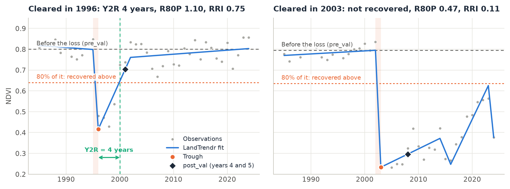
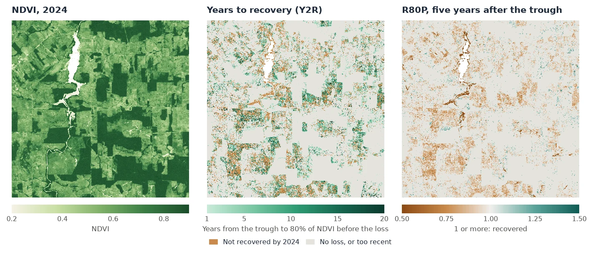

# Recovery after Disturbance

<p class="lead">Finding the year a forest was cleared or burned is half the work. The other half is what came after: did the vegetation come back, how fast, and how far? <code>zeit.recovery_metrics</code> measures this for every pixel with the spectral recovery metrics used in the forest literature: years to recovery (Y2R), R80P, RRI, ARI and YrYr.</p>

<div class="glance" markdown>
<div><span class="k">Answers</span><span class="v">After its disturbance, how fast and how far did each pixel recover?</span></div>
<div><span class="k">Input</span><span class="v">A LandTrendr result, or an annual series <code>(time, y, x)</code> with the disturbance years</span></div>
<div><span class="k">Output</span><span class="v">Maps of Y2R, R80P, RRI, ARI and YrYr, with the values before, at and after the disturbance</span></div>
<div><span class="k">Reference</span><span class="v">Kennedy et al. (2012); White et al. (2017); Frazier et al. (2018), all in <em>Remote Sensing of Environment</em></span></div>
</div>

<figure markdown>
  
  <figcaption><strong>What the metrics measure.</strong> Two real pixels of the annual NDVI stack used in the <a href="landtrendr.md">LandTrendr tutorial</a>. Grey dots are the yearly values and the blue line is the LandTrendr fit, on which the metrics are measured. The dashed line is the NDVI before the loss (<code>pre_val</code>), and the dotted line is 80% of it: the pixel counts as recovered once it is back above it. Left: cleared in 1996, back above the line 4 years after the trough. Right: cleared in 2003 and kept open; it never got back above the line.</figcaption>
</figure>

## How it works

For each pixel, a disturbance runs from its **start**, the last year before the loss (an event's `yod`), to its **trough**, the year the index bottoms out (`yod + duration`). Every metric is measured from these two years:

1. **Before.** `pre_val` is the mean of the `pre_years` (2) years up to the start.
2. **The loss.** `dist_val` is the value at the trough, and `magnitude` is `pre_val - dist_val`.
3. **After.** `post_val` is the best of the two years at the `horizon` (years 4 and 5 after the trough, as in Frazier et al. 2018), so that one noisy year does not decide.
4. **The metrics.** From these values:

| Metric | Definition | Reads as |
| :--- | :--- | :--- |
| `ari` | `post_val - dist_val` | Absolute recovery, in the units of the index. |
| `rri` | `ari / magnitude` | The share of the loss regained by the horizon (Kennedy et al. 2012). 1 = all of it. |
| `r80p` | `post_val / (0.8 * pre_val)` | 1 or more: recovered by the horizon (White et al. 2017). |
| `yryr` | `(value at t0 + 5 - dist_val) / 5` | The mean yearly regrowth over the first five years. |
| `y2r` | years from the trough until the value first reaches `0.8 * pre_val` | Years to recovery (White et al. 2017). NaN: not recovered by the last year. |

The 80% and the 5 years are the defaults of the literature; `target` and `horizon` change them.

## Step by step

The data are the same 40 years of annual Landsat NDVI over Rondônia, Brazil, as in the [LandTrendr tutorial](landtrendr.md): NDVI x 10000, one band per year from 1985 to 2024, 1671 x 1686 pixels.

### 1. Find the disturbances

Recovery is measured after an event, so first segment the stack and pick each pixel's greatest loss, as in the LandTrendr tutorial:

```python
import zeit

ndvi = zeit.load_raster("LT_Stack_NDVI_Rondonia.tif", validate="landtrendr")
years = ndvi.time.dt.year.values                   # 1985 ... 2024

lt = zeit.landtrendr(ndvi)                         # direction="loss": NDVI drops
loss = zeit.extract_events(lt, min_magnitude=2000) # the greatest drop of at least 0.2 NDVI

# no loss that starts in the first year, and a clear signal over the fit's noise
confident = (loss.yod > years[0]) & (loss.dsnr >= 3)
```

### 2. Measure the recovery

```python
rec = zeit.recovery_metrics(lt, loss.where(confident))

list(rec.data_vars)
# ['yod', 'trough', 'pre_val', 'dist_val', 'magnitude', 'post_val', 'ari', 'rri', 'r80p', 'yryr', 'y2r']
```

On a LandTrendr result the metrics are measured on the **fitted trajectory**, the line through the vertices, not on the yearly values. A pixel whose event was masked out (`yod` 0 or NaN) gets NaN metrics. Without `events`, `recovery_metrics(lt)` picks each pixel's greatest loss itself, with the same `sort_by`, `min_magnitude` and `min_duration` as `extract_events`.

The result is an `xarray.Dataset` of `(y, x)` maps on the grid and CRS of the stack. On the 2.8 million pixels of this scene, the three calls take about 2.5, 2 and 1.5 seconds.

### 3. Read the maps

<figure markdown>
  
  <figcaption><strong>Result of this tutorial</strong>, over an 18 x 18 km window of the scene. Left: NDVI in 2024. Middle: the years from the trough to 80% of the NDVI before the loss; brown pixels had not got there by 2024. Right: R80P five years after the trough, below 1 (brown) when not yet recovered. Only losses at least five years before 2024 are shown, so that the horizon is in the data.</figcaption>
</figure>

```python
seen = (rec.trough > 0) & (rec.trough <= years[-1] - 5)  # the horizon is in the data
recovered = seen & rec.y2r.notnull()
print(float(recovered.sum() / seen.sum()))       # 0.575
print(float(rec.y2r.where(recovered).median()))  # 6.0 years
print(float(rec.r80p.where(seen).median()))      # 0.90
```

Over the whole scene there are 501,265 losses at least five years old. 57.5% of them were back above 80% of their former NDVI by 2024, after a median of 6 years. Five years after the trough, the median R80P is 0.90, and only a quarter of these pixels (24.4%) are at 1 or more. The pixels below 1, in brown on the maps, include the clearings kept as pasture.

Some things to keep in mind when reading the maps:

- **NaN means two things for `y2r`.** It is NaN where there is no event, and also where the pixel has not recovered by the last year. Tell them apart with `rec.yod > 0`, as above.
- **Recent events.** `post_val`, `ari`, `rri`, `r80p` and `yryr` are NaN when the series ends before the horizon. A loss in 2021 has no R80P yet in a series that ends in 2024.
- **`y2r` = 0** means that the value never fell below the target: the loss was smaller than 20% of `pre_val`.
- **Spectral recovery is not forest recovery.** NDVI saturates early: young regrowth, a pasture in the wet season or a crop can reach 80% of a forest's NDVI. NBR or the tasseled cap wetness follow forest structure for longer, and White et al. (2017) recommend NBR.

Save the maps as GeoTIFFs:

```python
zeit.save_raster(rec[["y2r", "r80p", "rri"]], "results/recovery")   # y2r.tif, r80p.tif, rri.tif
```

### 4. Look at one pixel

`zeit.landtrendr` takes a single pixel's series, and `recovery_metrics` takes its result. This is the regrown pixel in the figure at the top:

```python
pixel = ndvi[:, 1006, 1065]
fit = zeit.landtrendr(pixel, fitted=True)
m = zeit.recovery_metrics(fit, min_magnitude=2000)

{k: round(float(v), 2) for k, v in m.data_vars.items()}
# {'yod': 1995.0, 'trough': 1996.0, 'pre_val': 7996.6, 'dist_val': 4159.17, 'magnitude': 3837.43,
#  'post_val': 7031.79, 'ari': 2872.62, 'rri': 0.75, 'r80p': 1.1, 'yryr': 574.52, 'y2r': 4.0}
```

The NDVI fell from 0.80 to 0.42 in 1996, and five years later 75% of that loss had come back (RRI 0.75), at a mean of 0.057 NDVI per year (YrYr). It crossed 80% of 0.80 in 2000, 4 years after the trough.

### 5. Other events and other indices

The events can come from any algorithm. With a series instead of a LandTrendr result, pass `events`: an `extract_events` result (its `yod` and `duration`), or a map of start years, whose trough is then the next year. The series must have one value per year: build annual composites first (`zeit.build_annual_composites`).

```python
# the yearly values themselves, after LandTrendr's events
raw = zeit.recovery_metrics(ndvi, loss.where(confident))

# breaks found by CCDC, measured on an annual series
ev = zeit.extract_events(zeit.ccdc(bands), band="nir", event_type="loss")
rec = zeit.recovery_metrics(annual_nbr, ev)
```

On the yearly values, one good year is enough to count as recovered. On this scene the median Y2R is 2 years on the values and 6 years on the LandTrendr fit, and the median R80P is 0.99 against 0.90. Use the fit when it is there.

For an index that **rises** with the disturbance (SWIR bands, brightness), use `event_type="gain"` with `basis="magnitude"`. The pixel then counts as recovered once `target` of the change has come back, and `r80p` is that share (`rri / target`). `basis="magnitude"` also works for an index that falls with the disturbance but can be negative.

```python
rec = zeit.recovery_metrics(annual_swir2, ev, event_type="gain", basis="magnitude")
```

## Parameters

| Parameter | Default | Effect |
| :--- | :---: | :--- |
| `events` | `None` | The disturbances: an `extract_events` result, or each pixel's start year (0 or NaN for none). LandTrendr results pick their own when `None`. |
| `target` | `0.8` | The fraction of `pre_val` that counts as recovered. |
| `horizon` | `5` | Years after the trough at which `post_val`, `ari`, `rri`, `r80p` and `yryr` are measured. |
| `pre_years` | `2` | Years averaged for `pre_val`. |
| `basis` | `"pre_value"` | `"pre_value"`: recovered at `target * pre_val`. `"magnitude"`: recovered once `target` of the loss came back, for any index. |
| `event_type` | LandTrendr's direction | `"loss"`, or `"gain"` for an index that rises with the disturbance (needs `basis="magnitude"`). |
| `sort_by`, `min_magnitude`, `min_duration` | as `extract_events` | LandTrendr without `events`: which event to measure. |

All parameters, and the inputs from disk with `chunks`, are in the [API reference](../api/change-detection.md#recovery_metrics). In Janus, the same metrics are the *Recovery (LandTrendr)* tool.

!!! note "About this implementation"
    The metrics follow their published definitions. RecoverMetricsR (R) computes RRI, R80P and YrYr in the same way; the two differ in where the recovery is looked for: RecoverMetricsR takes the best of the 5 years after the trough and counts the years to recovery from the year after it, while Zeit takes the best of years 4 and 5 (Frazier et al. 2018) and counts from the trough. On steadily regrowing series, where these choices give the same answer, the two agree to 6e-8 (float32 precision). On 1000 x 1000 pixels and 21 years, RecoverMetricsR takes 52 s and Zeit 0.1 s on one thread. See [Against the Original Implementations](../benchmarks/vs-originals.md).

## References

- Kennedy, R. E., Yang, Z., Cohen, W. B., Pfaff, E., Braaten, J., & Nelson, P. (2012). Spatial and temporal patterns of forest disturbance and regrowth within the area of the Northwest Forest Plan. *Remote Sensing of Environment*, 122, 117–133. [doi:10.1016/j.rse.2011.09.024](https://doi.org/10.1016/j.rse.2011.09.024)
- White, J. C., Wulder, M. A., Hermosilla, T., Coops, N. C., & Hobart, G. W. (2017). A nationwide annual characterization of 25 years of forest disturbance and recovery for Canada using Landsat time series. *Remote Sensing of Environment*, 194, 303–321. [doi:10.1016/j.rse.2017.03.035](https://doi.org/10.1016/j.rse.2017.03.035)
- Frazier, R. J., Coops, N. C., Wulder, M. A., Hermosilla, T., & White, J. C. (2018). Analyzing spatial and temporal variability in short-term rates of post-fire vegetation return from Landsat time series. *Remote Sensing of Environment*, 205, 32–45. [doi:10.1016/j.rse.2017.11.007](https://doi.org/10.1016/j.rse.2017.11.007)
