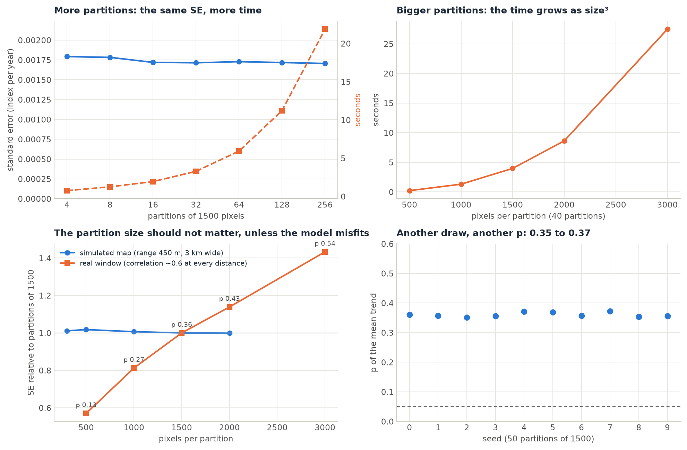

# Advanced topics

<p class="lead">Classes and covariates, large rasters, time and memory, coordinate systems, seeds, sensitivity checks, sub-annual data, and how Zeit compares with the R package remotePARTS.</p>

The snippets on this page run on the quick start's simulated cube (`make_cube` from [the quick start](index.md#quick-start-5-minutes)), here with a trend of 0.001 per year (`cube = make_cube(slope=0.001, seed=3)`). The outputs shown are from those runs. `landcover` is a layer of three vertical bands (classes 1, 2, 3) with a 10 × 10 hole of NaN. `elevation` rises from 0 to 500 from west to east.

```python
trend = zeit.ar_trend(cube)       # fit once, test many times
```

Fitting the per-pixel trends is often the slow part. Fit them once and pass them with `trend=` to every `parts` call.

## Classes

`classes=` takes a `(y, x)` layer on the cube's grid: integers, floats or strings. Each class gets its own mean trend, tested against 0, and the **chi-square test** says whether the classes' trends differ:

```python
res = zeit.parts(cube, trend=trend, classes=landcover, partsize=1000)
print(res)
```

```text
PARTS: 6300 pixels, 6 partitions of 1000
spatial correlation: {'function': 'exponential', 'range': 233.61755655314306}
nugget (mean of the partitions): 0.1945

               estimate          se       t           p
coefficient
class 1.0   0.000937162 0.000124039 7.55537  4.8037e-14
class 2.0   0.000903458  0.00011821 7.64285  2.4595e-14
class 3.0   0.000815076 0.000126075 6.46499 1.09311e-10

chi-square test against a single mean: F = 0.6217, df = (2, 998), p = 0.7148
```

All three classes trend up (the cube has the same +0.001 everywhere), and they do not differ (p = 0.71), which is the right answer for this cube.

- **Pixels without a class** (NaN, `None`) are left out of the test, like pixels without a trend.
- **Row names** are `class <value>`: `class 1.0` for a float layer, `class 1` for an integer layer. A layer of names gives readable rows:

    ```python
    names = {1: "forest", 2: "pasture", 3: "crops"}
    named = xr.DataArray(np.vectorize(names.get, otypes=[object])(landcover.fillna(0).astype(int).values),
                         dims=("y", "x"), coords=landcover.coords)
    zeit.parts(cube, trend=trend, classes=named, partsize=1000).table
    ```

    ```text
                   estimate        se         t             p
    coefficient
    class crops    0.000815  0.000126  6.464987  1.093110e-10
    class forest   0.000937  0.000124  7.555374  4.803704e-14
    class pasture  0.000903  0.000118  7.642851  2.459501e-14
    ```

- **Comparing two classes.** The chi-square test compares all the classes at once. To test one pair, keep only those two:

    ```python
    two = landcover.where(landcover.isin([1, 2]))
    zeit.parts(cube, trend=trend, classes=two, partsize=1000).p_chisqr      # 0.458
    ```

    Several pairwise tests are several tests: correct for multiple comparisons (for example, Bonferroni) or plan the comparisons before looking at the results.

- **Small classes.** A class contributes to each partition in proportion to its area. A class with only a few pixels in each partition gets an unstable GLS estimate. Janus leaves out the classes with fewer than 10 pixels per partition on average (`n_class < 10 × n / partsize`). That is a sensible rule here too: merge or drop such classes.
- **Do classes differ even when none trends?** This is common on real data, because the regional signal cancels in the comparison ([worked example](worked-example.md#6-the-whole-scene-zones-and-a-covariate)).

## Covariates

`covariates=` takes a dict of `(y, x)` layers. The design is then an intercept plus one column per covariate, and the chi-square test asks whether the covariates, together, explain the trends:

```python
res = zeit.parts(cube, trend=trend, covariates={"elevation": elevation}, partsize=1000)
print(res)
```

```text
PARTS: 6400 pixels, 6 partitions of 1000
spatial correlation: {'function': 'exponential', 'range': 233.71829816142463}
nugget (mean of the partitions): 0.2019

               estimate          se        t         p
coefficient
intercept    0.00112549 0.000181167  6.21248 5.566e-10
elevation   -9.9908e-07 5.87339e-07 -1.70103 0.0889893

chi-square test against a single mean: F = 2.836, df = (1, 999), p = 0.08649
```

- The `elevation` coefficient is the change in trend per unit of the covariate (per metre here). The `intercept` is the trend where the covariate is 0. Centre the covariate (subtract its mean) if you want the intercept to be the trend of an average pixel.
- Pixels where a covariate is NaN are left out.
- `classes=` and `covariates=` can be combined: one mean per class plus the covariates' slopes. Avoid covariates that nearly repeat the classes. In this cube, the classes are bands from west to east and elevation also grows from west to east, and the run reported `rank-deficient covariance, replaced as remotePARTS does` next to its chi-square p-value: a sign that the design is nearly collinear.
- A covariate tests a **linear** effect. In the [worked example](worked-example.md#6-the-whole-scene-zones-and-a-covariate), zones by distance to the sea differed (p = 0.028) while distance as a covariate had no linear effect (p = 0.46). Try both forms when the shape of the effect is unknown.

## A region of interest

`mask=` restricts the test to a region, for example a protected area, a basin, or the land without water:

```python
roi = elevation < 250                      # any (y, x) boolean layer on the cube's grid
zeit.parts(cube, trend=trend, mask=roi, partsize=1000)
```

To use a polygon, rasterise it on the cube's grid first (`rasterio.features.geometry_mask`, or `regionmask`). Combined with `classes=`, the mask keeps only the classes' pixels inside the region.

## Large rasters

`zeit.parts` loads the cube into memory, fits every pixel's trend, then uses `npart × partsize` pixels. On a large image:

- **Aggregate first.** A trend over decades rarely needs 30 m pixels to be tested regionally. The worked example reads a whole Landsat scene (55 million pixels) at 300 m with `resampling="average"`, about half a million pixels. It reads in under a minute and tests in about 10 seconds per question.
- **Or subsample.** `npart` partitions of `partsize` pixels only ever use `npart × partsize` pixels (150,000 with 100 partitions of 1500). Testing a regular subsample (`cube[:, ::k, ::k]`) gives nearly the same answer for less work. On the real window, the full grid gave p = 0.367 (range 23.0 km), one pixel in 2 × 2 gave 0.361 (23.5 km), and one in 3 × 3 gave 0.352 (23.3 km). Janus reads at most 500,000 pixels, one in `k × k` beyond that.
- **Fit the trends lazily.** `zeit.ar_trend(path, chunks="auto")` computes block by block for cubes larger than memory, and the per-pixel maps can then be saved with `zeit.save_raster`. The regional test then runs on a coarser or sampled cube with `trend=` from the same grid.

## Time and memory

All the timings below are from the real window of the worked example (482,234 pixels) on a 20-thread CPU.

<figure markdown>
  
  <figcaption><strong>Tuning.</strong> Top left: from 4 to 256 partitions of 1500, the SE barely moves (0.00179 to 0.00171), while the time grows from 0.8 s to 22 s. Top right: 40 partitions take 0.2 s at 500 pixels each, 4.0 s at 1500 and 27.5 s at 3000 (time grows as size³). Bottom left: the SE as the partition size changes. On a simulated map with an exponential correlation it is flat. On the real window, where the correlation is not exponential, it grows with the size. Bottom right: ten seeds give p between 0.35 and 0.37.</figcaption>
</figure>

- **Time** grows linearly with `npart` and as the **cube** of `partsize`: each partition needs a Cholesky factorisation of a `partsize × partsize` matrix.
- **Memory**: each thread holds two `partsize × partsize` matrices of 8-byte floats: 36 MB per thread at 1500 and 144 MB at 3000. With 20 threads at `partsize=3000`, that is close to 3 GB, on top of the cube. Lower `n_jobs` if memory is short.

### How many partitions?

Few. The SE combines the partitions' errors with the correlation between them ([step 4](how-it-works.md#step-4-combining-the-partitions)). When that correlation is high, as on most real maps, more partitions do not reduce the SE: 4 partitions gave 0.00179 and 256 gave 0.00171. A few dozen partitions are enough to estimate the mean and the cross-partition correlation stably. 100 (Janus's cap) is a comfortable default, and `npart=None` (all the pixels) mostly costs time.

### Partition size

On a map whose correlation the model describes well, the partition size does not change the answer (the simulated map in the figure: SE within 2% from 300 to 2000 pixels). On the real window, it did: p = 0.13, 0.27, 0.36, 0.43 and 0.54 at 500, 1000, 1500, 2000 and 3000 pixels. A correlation that stays high at every distance (a regional signal) is poorly described by an exponential, and larger partitions, which span longer distances, see more of it. Take a size dependence like this as a warning about the model, not as a choice to tune:

- keep the default 1500 (remotePARTS's authors use 1500 to 3000) rather than picking the size that gives the p you like;
- report the range of p over a few sizes, as in the [worked example](worked-example.md#4-check-the-answer);

## Coordinate systems

- **Zeit needs a projected CRS.** Distances are taken in the cube's units, and a cube in a geographic CRS is refused:

    ```text
    ValueError: zeit.parts measures distances in the cube's units: reproject a cube in geographic coordinates first (e.g. zeit.load_raster(..., crs='EPSG:...'))
    ```

    Use the UTM zone of the region, or an equal-area projection for a large region. `range` (given or fitted) is then in metres. A cube without a CRS is taken as it is (distances in its coordinates' units, or in pixels without coordinates).
- **`scaled=True`** divides each partition's distances by the largest of them, as remotePARTS's default `distm_scaled` does. The range is then a fraction of that largest distance (0.07 on the example cube), not metres. Use it only to match an R analysis.
- **Janus** accepts a geographic CRS: it projects the coordinates equirectangularly at the region's mean latitude and measures distances in km. Over a region of a few hundred km at low or middle latitudes, its distances are within a few percent of a proper projection's. Its ranges are therefore in km, and Zeit's in the CRS units.

## Seeds and reproducibility

`seed=` (default 0) draws both the pixels sampled to fit the correlation and the partitions. The same seed and inputs give **identical** results, on any number of threads. Another seed gives another draw, and so a slightly different answer: on the real window, seeds 0 to 9 gave p from 0.35 to 0.37 and ranges from 22.5 to 23.7 km. A conclusion that changes with the seed is a borderline one. Report the seed you used, or the range of p over a few seeds.

Zeit's partitions are drawn by its own generator (xoshiro256**), not by R's, so the same seed does not give the same partitions as remotePARTS. Janus uses `seed=1`.

## Sensitivity checks

The p-value of PARTS depends on the fitted correlation, so check how much it moves when that correlation changes. On the example cube:

```python
fitted = res.correlation["range"]             # 234 m on this cube
for r in (fitted, 2 * fitted, 4 * fitted):
    print(round(r), zeit.parts(cube, trend=trend, range=r, partsize=1000).table.loc["mean", "p"])
```

```text
234 2.9916553357856155e-16
467 0.00021874609782779472
935 0.09345842713018826
```

A longer range means more correlated pixels, so less information, a larger SE and a larger p. Since the fitted range tends to be too short ([Is it calibrated?](how-it-works.md#is-it-calibrated)), a result that survives a range 1.5 to 2 times the fitted one is a robust one. Other checks:

| Check | Call |
| :--- | :--- |
| Another shape of correlation | `correlation="exponential_power"` (fits `range` and `shape`; `res.correlation` shows them) |
| A known range (another study, a variogram) | `range=...` in the cube's units |
| A fixed nugget | `nugget=0.2` (a number instead of `"ml"`) |
| Another partition size | `partsize=1000`, `3000` |
| Other draws | `seed=1`, `2`, ... |
| The correlation plot | [below](#the-correlation-plot) |

### The correlation plot

The most useful single diagnostic is the one in [step 2](how-it-works.md#step-2-how-correlated-are-the-pixels): the correlation of the pixels' residual series against distance, with the fitted curve. This function draws it from the public API (for `time="step"` and no harmonics; the residuals are the series minus the fitted line):

```python
import matplotlib.pyplot as plt


def correlation_check(cube, trend, res, n=600, seed=0):
    """Mean correlation of the pixels' residual series against distance, with the fitted curve."""
    t = np.arange(1, cube.sizes["time"] + 1)                     # time="step"
    fitted = trend.intercept.values + trend.slope.values * t[:, None, None]
    resid = (cube.values - fitted).reshape(cube.sizes["time"], -1)
    xs, ys = np.meshgrid(cube.x.values, cube.y.values)
    ok = np.flatnonzero(np.isfinite(resid).all(axis=0))
    pick = np.random.default_rng(seed).choice(ok, size=min(n, ok.size), replace=False)
    r = np.corrcoef(resid[:, pick].T)
    x, y = xs.ravel()[pick], ys.ravel()[pick]
    d = np.hypot(x[:, None] - x, y[:, None] - y)
    iu = np.triu_indices(pick.size, 1)
    d, r = d[iu], r[iu]
    edges = np.linspace(0, d.max(), 30)
    which = np.digitize(d, edges)
    mid = [d[which == i].mean() for i in range(1, edges.size) if (which == i).sum() > 20]
    mean = [r[which == i].mean() for i in range(1, edges.size) if (which == i).sum() > 20]
    fig, ax = plt.subplots(figsize=(6, 4))
    ax.plot(mid, mean, "o", label="mean correlation of the pairs")
    dd = np.linspace(0, d.max(), 200)
    ax.plot(dd, np.exp(-dd / res.correlation["range"]), label="fitted exp(-d / range)")
    ax.axhline(0, color="grey", lw=0.8)
    ax.set_xlabel("distance (CRS units)")
    ax.set_ylabel("correlation of the residuals")
    ax.legend()
    return fig


correlation_check(cube, trend, res).savefig("correlation_check.png")
```

What to look for:

- **Dots that fall to 0 along the curve**, as in the simulated panel of [step 2](how-it-works.md#step-2-how-correlated-are-the-pixels): the model fits, and PARTS is close to calibrated.
- **Dots below the curve near 0, then on it**: a nugget. Expected, and handled in step 3.
- **Dots that stay high at every distance** (the real panel): a shared regional signal. Expect the answer to depend on the partition size, and run the sensitivity checks.
- **Dots that stay flat near 0, then drop quickly**: a smooth, Gaussian-like correlation, which the exponential describes badly. In a simulated check of this kind, 4 of 10 maps with no trend gave p < 0.01. Try `correlation="exponential_power"`, and be cautious with the result.

## Sub-annual data

With several observations a year, add harmonics for the seasons and give the slope per year:

```python
mt = zeit.ar_trend(monthly, time="year", harmonics=2)     # slope per year; cos1, sin1, cos2, sin2
res = zeit.parts(monthly, trend=mt, time="year", harmonics=2, partsize=500)   # a small test cube
```

On a simulated monthly cube (10 years, a trend of 0.003 per year and a seasonal cycle), the mean slope was 0.0031 per year and PARTS found 0.0032 ± 0.0003.

- Pass the **same** `time`, `harmonics` and `period` to `parts` as to `ar_trend`. `parts` uses them to compute the residual series for step 2, and with different harmonics the residuals would keep the seasons, which inflates the correlation.
- The AR(1) model describes month-to-month persistence. Strong seasonality of the noise (more variable in the wet season) is not modelled. For long series, annual composites (a yearly mean, median or maximum) are often the more robust input.

## Missing observations

- **`gaps="exact"`** (the default): a missing year counts, so two observations two years apart are correlated by $\rho^2$. **`gaps="ignore"`**: the valid observations are taken as consecutive, as remotePARTS does. With few gaps, the two give nearly the same answer (on the example cube with 30% of the values removed at random: 0.000875 against 0.000869).
- **`min_valid`**: `ar_trend` leaves a pixel NaN when it has fewer valid observations (at least the design's columns + 2). `parts` has no `min_valid` of its own, so fit the trends with it and pass them:

    ```python
    trend = zeit.ar_trend(cube, min_valid=20)
    res = zeit.parts(cube, trend=trend)
    ```

    Pixels without a trend (NaN) are left out of the test.
- **No data values**: `nodata="auto"` reads the files' nodata value. When the files have none and use a fill value (0 over the sea, as in the worked example), mask it (`cube.where(cube != 0)`) or give `nodata=0`.

## Parity with remotePARTS

Zeit implements the methods of the R package remotePARTS (Ives et al. 2021) in Rust, and its test suite compares it with results of remotePARTS 1.0.4 (`rust/zeit-core/tests/remoteparts.rs`). The GLS, each partition's fit and nugget, and the combined coefficients match to 1e-8. The AR(1) fits match `fitAR` to about 1e-6. The correlation's range matches `fitCor` to 1e-5, and the chi-square p-value matches to 1e-6 (the accuracy of the Imhof integration).

| remotePARTS (R) | Zeit (Python) |
| :--- | :--- |
| `fitAR`, `fitAR_map` | `zeit.ar_trend` |
| `fitCor` | inside `zeit.parts` (`range=None`, `fit_n`, `correlation`) |
| `covar_exp`, `covar_exppow` | `correlation="exponential"`, `"exponential_power"` |
| `distm_scaled` | `scaled=True` (`False`, distances in the CRS units, by default) |
| `sample_partitions` | inside `zeit.parts` (`partsize`, `npart`, `seed`) |
| `fitGLS_partition` | `zeit.parts` |
| `nugget = NA` (ML) | `nugget="ml"` |
| `ncross` | `ncross` |
| `part_ttest`, `part_chisqr` results | `res.table`, `res.p_chisqr` |

The known differences:

- **The random draws.** Zeit draws the partitions and the correlation sample with its own generator, so its partitions differ from R's even for the same seed. Expect differences of the size of another seed ([above](#seeds-and-reproducibility)).
- **The nugget of crossed partitions.** remotePARTS 1.0.4 computes the correlation between partitions after the first without their nugget. Zeit uses each partition's own nugget. With `nugget=` fixed, the two agree.
- **Defaults.** Zeit's `scaled=False` (remotePARTS: scaled distances) and `gaps="exact"` (remotePARTS: gaps ignored). For a like-for-like comparison, use `scaled=True, gaps="ignore", time="step"`.
- **The p floor.** As in remotePARTS, the chi-square p-value is reported as at least 1e-6.
