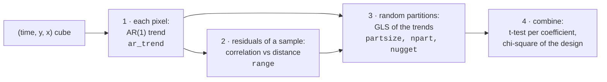
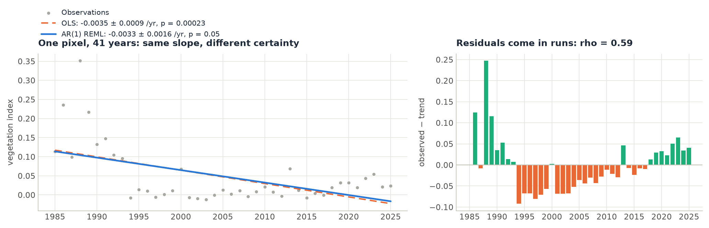
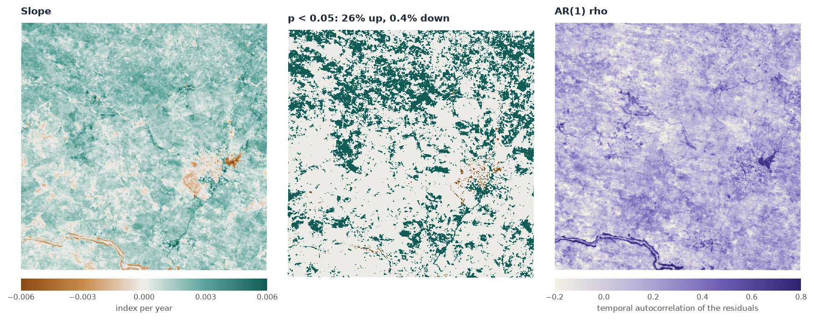
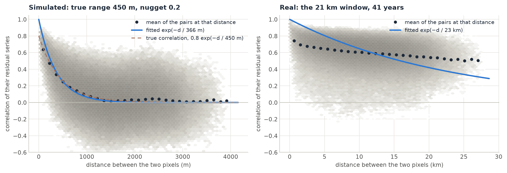
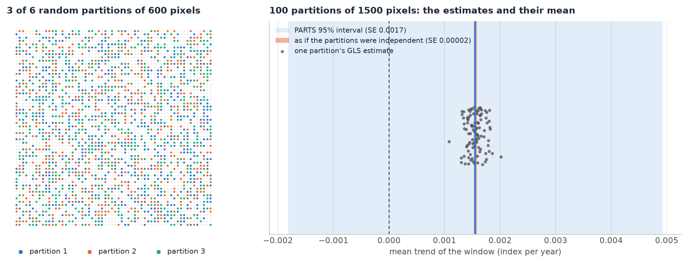
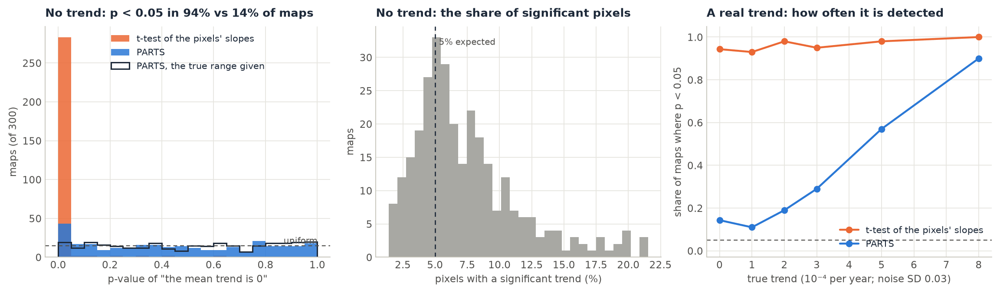

# How PARTS works

PARTS takes four steps. It fits each pixel's trend, measures how the pixels' noise is correlated at each distance, fits a regression of the trends that knows about that correlation in random partitions of the pixels, and combines the partitions into one test. This page goes through each step with figures from real runs and names the parameter that controls each choice.

The figures on this page come from `docs/scripts/make_parts_figures.py`. It runs `zeit.ar_trend` and `zeit.parts` on simulated maps whose true correlation is known, and on 41 annual Landsat composites (1985–2025) of north-eastern Brazil (see the [worked example](worked-example.md)).

## Step 1: each pixel's trend, with AR(1) errors

For each pixel, `zeit.ar_trend` fits a straight line through the series. Unlike ordinary least squares (OLS), it does not assume that the errors of successive years are independent:

$$
y_t = \beta_0 + \beta_1\, t + \varepsilon_t, \qquad \varepsilon_t = \rho\, \varepsilon_{t-1} + \delta_t
$$

$\beta_1$ is the trend (the slope). $\rho$ is the **AR(1) coefficient**: how much of one year's departure from the line carries over to the next year. $\delta_t$ is new, independent noise. $\rho$ is estimated together with the line by REML (restricted maximum likelihood), and the t-test of the slope uses it. Successive years that resemble each other carry less information than independent years, so the slope's standard error grows with $\rho$.

<figure markdown>
  
  <figcaption><strong>Same slope, different certainty.</strong> A real pixel, 41 annual values. OLS and the AR(1) fit give nearly the same slope (−0.0035 and −0.0033 per year). The residuals, however, come in runs of years above and below the line (ρ = 0.59). OLS ignores that and reports p = 0.00023. The AR(1) fit doubles the standard error (0.0016 against 0.0009) and reports p = 0.05.</figcaption>
</figure>

On a whole image, `ar_trend` gives a map of every coefficient with its standard error, t and p, plus `rho`:

<figure markdown>
  
  <figcaption><strong>A 21 × 21 km window at 30 m.</strong> Left: the slope of 481,547 pixels. Middle: the 26% with a significant positive slope and the 0.4% with a significant negative slope at p < 0.05. Right: ρ, the autocorrelation of the residuals (median 0.12; highest along the river and the reservoir).</figcaption>
</figure>

The middle map is where most studies stop. The rest of PARTS asks whether those 26% add up to a regional trend.

| Parameter of `ar_trend` / `parts` | Default | What it does |
| :--- | :--- | :--- |
| `time` | `"step"` | `"step"`: $t = 1, 2, \dots$ (remotePARTS's choice), so the slope is per time step, which is per year for annual data. `"year"`: decimal years of the dates, so the slope is per year whatever the cadence. |
| `harmonics` | `0` | Pairs of seasonal harmonics (cos, sin) added to the line, for sub-annual data. |
| `period` | `None` | Observations per seasonal cycle when `time="step"` (taken from the dates when not given). |
| `gaps` | `"exact"` | `"exact"`: two observations $k$ dates apart are correlated by $\rho^k$, so a missing year counts. `"ignore"`: the valid observations are taken as consecutive, as remotePARTS does. |
| `min_valid` (`ar_trend` only) | `0` | Pixels with fewer valid observations get NaN. At least the design's columns + 2 are always required. |

## Step 2: how correlated are the pixels?

A drought lowers the index of a whole landscape in the same year. A pixel's departures from its own trend (its **residuals**) are therefore correlated with those of its neighbours, more strongly the closer they are. PARTS measures that correlation:

1. It draws `fit_n` pixels (1000 by default) and takes the residual series of each (observed minus fitted line).
2. For every pair of them, it computes the correlation of their two residual series and the distance between them.
3. It fits a curve of correlation against distance through all those pairs. By default the curve is the exponential

$$
c(d) = e^{-d / r}
$$

where $r$ is the **range**. At a distance of one range, the correlation has fallen to 0.37. At three ranges, it has fallen to 0.05.

<figure markdown>
  
  <figcaption><strong>Correlation against distance.</strong> The grey cloud is every pair of 1000 sampled pixels; the dots are the mean correlation at each distance. Left: a simulated map whose true correlation is 0.8 e−d/450 m (the dashed line). The fitted curve (blue, range 366 m) follows the dots closely. Right: the real window. The correlation drops from 1 to about 0.75 between neighbours, then stays near 0.6 at every distance up to 28 km. The whole window shares one interannual signal (wet and dry years), and no exponential curve fits it well.</figcaption>
</figure>

Pixel-to-pixel correlation is rarely 1, even between neighbours. Part of each pixel's noise is its own: sensor noise, residual clouds, a field ploughed one year. That part, the **nugget** ($\nu$), is not correlated with anything. PARTS estimates the nugget in step 3, not here. As a consequence, a large nugget pulls the fitted curve down near zero distance, so **the fitted range tends to be too short**: 366 m instead of the true 450 m in the left panel. [Is it calibrated?](#is-it-calibrated) below shows what this does to the p-values.

| Parameter of `parts` | Default | What it does |
| :--- | :--- | :--- |
| `correlation` | `"exponential"` | The curve: `"exponential"`, $e^{-d/r}$, or `"exponential_power"`, $e^{-(d/r)^s}$, which also fits a shape $s$ (1 is exponential, 2 is Gaussian-like, smoother). |
| `range` | `None` | The range, in the cube's CRS units (metres for UTM), when you know it. `None` fits it to the sample. |
| `shape` | `None` | The shape $s$ of `"exponential_power"`, when known. |
| `fit_n` | `1000` | Pixels sampled to fit the curve (1000 pixels make about 500,000 pairs). |
| `scaled` | `False` | `True` divides the distances by the largest one in each matrix, as remotePARTS's default `distm_scaled` does. `range` is then a fraction of that largest distance, not metres. |

## Step 3: a regression of the trends, in partitions

With the correlation known, the right tool for "what is the mean of these slopes?" is a **GLS** (generalised least squares) regression. GLS weights the pixels by how much independent information they carry: ten pixels in a tight cluster count for much less than ten pixels far apart. For the slopes $y$ of $n$ pixels, the covariance assumed is

$$
\Sigma = \sigma^2 \left[ (1 - \nu)\, V + \nu\, I \right], \qquad V_{ij} = c(d_{ij})
$$

where $\nu$ is the nugget. The estimate is $\hat\beta = (X^\top \Sigma^{-1} X)^{-1} X^\top \Sigma^{-1} y$. $X$ is the **design**: a single column of ones for the regional mean, one column per class with `classes=`, or a column per covariate.

GLS on a whole image is impossible. For 500,000 pixels, $\Sigma$ has 2.5 × 10¹¹ entries (2 TB) and inverting it takes on the order of $n^3$ operations. PARTS therefore draws the pixels into random, non-overlapping **partitions** of `partsize` pixels (1500 by default) and fits a GLS in each. A matrix of 1500 × 1500 takes 18 MB and inverts in milliseconds. Each partition also gets its own maximum-likelihood nugget (`nugget="ml"`), searched between 0.001 and 0.999.

<figure markdown>
  
  <figcaption><strong>Partitions.</strong> Left: three of six random partitions of a simulated 60 × 60 map. Each one is spread over the whole map. Right: the GLS estimate of the mean trend in each of 100 partitions of 1500 pixels of the real window (dots), their mean (blue line), and two 95% intervals. Treating the partitions as independent gives a very narrow interval (SE 0.00002, orange). PARTS gives a much wider one (SE 0.0017, light blue), because the partitions are themselves correlated.</figcaption>
</figure>

| Parameter of `parts` | Default | What it does |
| :--- | :--- | :--- |
| `partsize` | `1500` | Pixels per partition. remotePARTS's authors use 1500 to 3000. Time grows as `partsize`³ and memory as `partsize`² (see [Advanced](advanced.md#time-and-memory)). |
| `npart` | `None` | How many partitions. `None` uses all the pixels (`n // partsize` partitions). A few dozen to a few hundred are usually enough (see below). At least 2. |
| `nugget` | `"ml"` | `"ml"`: each partition's maximum-likelihood nugget. A number fixes it for every partition. |
| `seed` | `0` | Seed of the pixel sample of step 2 and of the partitions. |
| `mask` | `None` | A `(y, x)` boolean layer: only these pixels are tested (an ROI, a land mask). |

## Step 4: combining the partitions

The partitions are random samples of the same correlated map, so they are not independent: a pixel in partition 1 has neighbours in partition 2. PARTS therefore cannot treat 100 partition estimates as 100 independent measurements. It combines them in three steps.

- **The estimate** of each coefficient is the mean of its partition estimates, $\bar\beta = \frac1P \sum_p \hat\beta_p$.
- **The correlation between partitions**, $\bar r$, is computed from the fitted covariance (not from the data) for every pair among the first `ncross` partitions (6 by default, so 15 pairs) and averaged.
- **The standard error** combines the partitions' own standard errors $s_p$ with that correlation:

$$
\mathrm{SE}(\bar\beta) = \frac{1}{P} \sqrt{(1 - \bar r) \sum_p s_p^2 + \bar r \Big( \sum_p s_p \Big)^2 }
$$

With $\bar r = 0$, this is the usual standard error of a mean of independent estimates, which shrinks as $1/\sqrt{P}$. With $\bar r$ close to 1, it stays close to a single partition's standard error however many partitions are added. Real maps fall in between, usually closer to 1. That is why more partitions barely change the answer ([Advanced](advanced.md#how-many-partitions)).

`t = estimate / SE` is then compared with a t distribution, giving the **t-test of each coefficient**: is the regional mean, or this class's mean, different from 0?

With classes or covariates there is a second test, the **chi-square test of the design**: does the design explain the trends better than a single mean? With classes, that means "do the classes' trends differ?". With covariates, it means "do the covariates have an effect?". Each partition gives an F statistic of its GLS against a single mean. The mean F over the partitions, times `npart × df1`, is compared with a sum of correlated chi-squares (Imhof's method) whose correlation comes from the same cross-partition step. Like remotePARTS, Zeit reports p-values below 10⁻⁶ as 10⁻⁶.

| Parameter / output | Default | What it does |
| :--- | :--- | :--- |
| `ncross` | `6` | Partitions crossed to estimate $\bar r$ (all pairs among them). |
| `res.table` | | `estimate`, `se`, `t`, `p` per coefficient (`mean`, `class …`, or `intercept` and each covariate). |
| `res.p_chisqr`, `res.f`, `res.df1`, `res.df2` | | The chi-square test of the design (`None` without classes or covariates), the mean F, and its degrees of freedom. |
| `res.correlation`, `res.nuggets` | | The function and range used, and each partition's nugget. |
| `res.partitions` | | Each partition's coefficients and nugget, one row per partition. |
| `res.npart`, `res.partsize`, `res.n_pixels` | | What was actually run. |

## Is it calibrated?

A test is **calibrated** if, when there is no trend, it gives p < 0.05 in 5% of the cases. To check this, the figure script simulated 300 maps of 60 × 60 pixels and 30 years with no trend: a noise correlated over 450 m (range), a nugget of 0.2 and an AR(1) of 0.3 in time. It ran both tests on each map, then repeated with real trends of increasing size.

<figure markdown>
  
  <figcaption><strong>300 maps with no trend, then 100 maps per trend.</strong> Left: the t-test of the pixels' slopes as if independent gives p < 0.05 on 94% of the maps. PARTS gives p < 0.05 on 14% of the maps (6.3% at p < 0.01), and on 6.3% when the true range is given instead of fitted (black outline). Middle: the share of significant pixels on maps with no trend averages 7.5%, exceeds 16% on 5% of the maps and reaches 21.5%. Right: how often each test detects a real trend. The naive test is "significant" whatever the trend; PARTS detects 57% of trends of 0.0005 per year and 90% of trends of 0.0008 per year (the noise SD is 0.03).</figcaption>
</figure>

What this means in practice:

- **PARTS fixes most of the problem.** The naive test rejected a true null on 94% of these maps. PARTS rejected it on 14%.
- **With a fitted range, PARTS is somewhat anti-conservative.** Its p-values are a little too small. The cause is the short range of step 2: the median fitted range was 365 m against the true 450 m. With the true range given, the false-alarm rate fell to 6.3%. The fit of the correlation is the same as in remotePARTS (Zeit matches its `fitCor`), so this is a property of the method, not of this implementation.
- **The model of the correlation matters.** When the correlation is not exponential, PARTS can be far off. In a check with noise smoothed by a Gaussian filter (a correlation that is flat near zero, then falls fast), 4 of 10 null maps gave p < 0.01. `correlation="exponential_power"` found a shape near 2, but it did not fully repair the test. **Always look at the correlation plot** (step 2) before trusting a p-value.

The practical recommendations that follow (a stricter level, sensitivity checks, giving `range=` when it is known) are in [Interpreting, FAQ and pitfalls](faq.md#how-much-to-trust-a-p-value).
