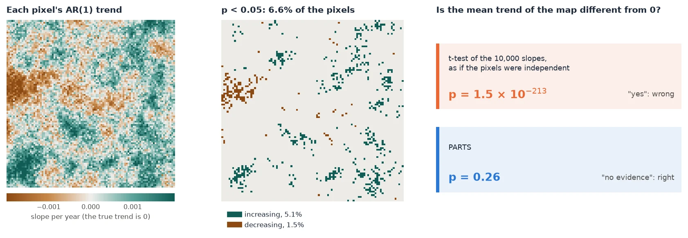

# Regional Trends (PARTS)

<p class="lead">Is this region getting greener? Do forests and pastures trend differently? Counting the pixels with a significant trend cannot answer these questions. PARTS can: it tests the trend of a whole region, or of classes, with p-values that take into account that neighbouring pixels move together.</p>

<div class="glance" markdown>
<div><span class="k">Answers</span><span class="v">Does the mean trend of a region differ from 0? Do classes differ? Does a covariate matter?</span></div>
<div><span class="k">Input</span><span class="v">A <code>(time, y, x)</code> cube in a projected CRS; optionally a classes layer or covariates</span></div>
<div><span class="k">Output</span><span class="v">Each pixel's AR(1) trend (<code>zeit.ar_trend</code>) and a regional test (<code>zeit.parts</code>)</span></div>
<div><span class="k">Reference</span><span class="v">Ives et al. (2021), <em>Remote Sensing of Environment</em> 266, 112678; the R package remotePARTS</span></div>
</div>

<figure markdown>
  
  <figcaption><strong>The problem in one figure.</strong> A simulated map of 10,000 pixels with <em>no trend at all</em>, only year-to-year noise that neighbouring pixels share. Each pixel's own test still finds 6.6% of them "significant", in patches. A t-test of the 10,000 slopes as if they were independent gives p = 1.5 × 10⁻²¹³, a confident and wrong "yes". PARTS gives p = 0.26: no evidence of a trend, which is the right answer. Made by <code>docs/scripts/make_parts_figures.py</code>.</figcaption>
</figure>

## Why counting pixels is wrong

Most trend studies run a test on every pixel and report the share of pixels with a significant trend, or average the slopes of a region and run an ordinary regression or t-test on them. There are two problems with that.

1. **Thousands of tests.** At a 5% level, 5% of the pixels of a region with no trend at all come out "significant". So "8% of the pixels are significant" can be noise. You cannot tell how much of it is noise without more work.
2. **Neighbours are not independent.** A drought or a wet year affects a whole landscape at once, so nearby pixels go up and down together. 10,000 pixels then carry far less information than 10,000 independent measurements. A t-test or OLS over all pixels treats them as independent, so its standard error is far too small and its p-value far too small. In the figure above it is off by more than 200 orders of magnitude.

The second problem also inflates the first one. Correlated noise makes the significant pixels come in patches, and the share of significant pixels varies a lot from one map to the next. Over 300 simulated maps with no trend, it was 7.5% on average, and above 16% on one map in twenty ([details](how-it-works.md#is-it-calibrated)).

PARTS (*Partitioned Autoregressive Time Series*, Ives et al. 2021) handles both problems. It asks one question of the whole region, so it runs one test instead of thousands. It also measures how strongly pixels are correlated at each distance and builds that into the test.

## When to use it

| Your question | Use |
| :--- | :--- |
| Where are the pixels with a trend, and how steep is it? | A per-pixel test: [`ar_trend`](../../api/time-series.md#ar_trend) or [Mann-Kendall](../mann_kendall.md) |
| Is *this region* (a park, a municipality, a basin) greening or browning overall? | **PARTS** (`zeit.parts(cube, mask=region)`) |
| Do forest, pasture and cropland trend differently? Is each one's trend different from 0? | **PARTS** with `classes=` |
| Does the trend depend on distance to a road, rainfall, elevation? | **PARTS** with `covariates=` |
| *When* did the pixels change, and how abruptly? | [LandTrendr](../landtrendr.md), [BFAST](../bfast.md), [CCDC](../ccdc.md) |

Per-pixel maps and PARTS go together: the maps show *where* the trends are, and PARTS says whether a regional statement is supported by the data.

!!! info "Mann-Kendall or the AR(1) trend for pixels?"
    Both test one pixel's series. Mann-Kendall with Sen's slope is non-parametric and robust to outliers. [`ar_trend`](../../api/time-series.md#ar_trend) fits a straight line whose errors follow an AR(1) process (this year's error carries over into the next). It is the per-pixel step of PARTS, and its residuals are what PARTS uses to measure the spatial correlation. To test a region, use PARTS, whichever per-pixel map you show.

## Quick start (5 minutes)

The example builds two small cubes of 30 annual images. One has no trend, the other a trend of +0.002 per year. Both have year-to-year noise that neighbouring pixels share. It needs only `zeit` and its dependencies, and runs in under 10 seconds.

```python
import numpy as np
import pandas as pd
import xarray as xr
import rioxarray  # noqa: F401  (adds .rio to xarray)
import zeit


def correlated_noise(rng, n, range_px):
    """An n x n Gaussian field whose correlation decays as exp(-distance / range_px)."""
    m = 2 * n
    i = np.minimum(np.arange(m), m - np.arange(m))
    cov = np.exp(-np.hypot(i[:, None], i[None, :]) / range_px)
    amplitude = np.sqrt(np.clip(np.fft.fft2(cov).real, 0, None) / m**2)
    z = rng.standard_normal((m, m)) + 1j * rng.standard_normal((m, m))
    return np.fft.fft2(amplitude * z).real[:n, :n]


def make_cube(slope, seed=0, years=30, n=80):
    """`years` annual images of n x n pixels of 30 m: a trend of `slope` per year
    everywhere, plus year-to-year noise that neighbouring pixels share."""
    rng = np.random.default_rng(seed)
    noise = np.stack([np.sqrt(0.8) * correlated_noise(rng, n, range_px=10)   # shared by neighbours
                      + np.sqrt(0.2) * rng.standard_normal((n, n))            # each pixel's own
                      for _ in range(years)])
    values = 0.5 + slope * np.arange(years)[:, None, None] + 0.03 * noise
    cube = xr.DataArray(
        values, dims=("time", "y", "x"),
        coords={"time": pd.date_range("1995-01-01", periods=years, freq="YS"),
                "y": 9_000_000.0 - 30.0 * np.arange(n),
                "x": 500_000.0 + 30.0 * np.arange(n)})
    return cube.rio.write_crs("EPSG:32724")   # a projected CRS: distances in metres


flat = make_cube(slope=0.0)          # no trend anywhere
trend = zeit.ar_trend(flat)          # step 1: each pixel's trend and its p-value
share = float((trend.slope_p < 0.05).mean())
print(f"{share:.1%} of the pixels have p < 0.05")

res = zeit.parts(flat, trend=trend, partsize=1000)   # step 2: the region's test
print(res)
```

```text
7.5% of the pixels have p < 0.05
PARTS: 6400 pixels, 6 partitions of 1000
spatial correlation: {'function': 'exponential', 'range': 278.47413345311355}
nugget (mean of the partitions): 0.1753

                estimate          se         t        p
coefficient
mean        -8.66074e-05 0.000134584 -0.643521 0.519911
```

7.5% of the pixels are "significant" although nothing is trending. PARTS reads the cube's correlation (it decays over about 280 m, and 17.5% of the variation is each pixel's own) and finds no evidence of a regional trend: p = 0.52. Now the cube with a real trend:

```python
greening = make_cube(slope=0.002)    # +0.002 per year everywhere
res = zeit.parts(greening, partsize=1000)
print(res.table)
```

```text
             estimate        se          t             p
coefficient
mean         0.001913  0.000135  14.217136  3.854575e-45
```

The estimate (0.0019 ± 0.00014 per year) contains the true 0.002, and the test is clearly significant. Without `trend=`, `parts` fits each pixel's AR(1) trend itself.

`res.table` is a `DataFrame` with one row per coefficient (here only the regional `mean`) and columns `estimate`, `se`, `t` and `p`.

## The guide

<div class="grid cards" markdown>

- **[How it works](how-it-works.md)**: the four steps with figures. Each pixel's AR(1) trend, the spatial correlation, GLS on random partitions, and the combined tests. Every parameter, with its default. How well it is calibrated.
- **[Worked example](worked-example.md)**: 41 years of Landsat over north-eastern Brazil. A window where 26% of the pixels are "significant" but the regional trend is not, then a whole scene with zones by distance to the sea and a covariate.
- **[Advanced topics](advanced.md)**: classes and covariates, large rasters, time and memory, CRS, seeds, sensitivity checks, sub-annual data, and parity with remotePARTS.
- **[Interpreting, FAQ and pitfalls](faq.md)**: reading the output, a template for reporting, common mistakes, and references.

</div>

!!! tip "No code?"
    [Janus](https://sacridini.github.io/janus/trend-test.html), the desktop viewer built on Zeit, runs the same test on an ROI, the visible area, or the classes of a layer, from **View → Analysis → Trend test**.

## Reference

Ives, A. R., Zhu, L., Wang, F., Zhu, J., Morrow, C. J., & Radeloff, V. C. (2021). Statistical inference for trends in spatiotemporal data. *Remote Sensing of Environment*, 266, 112678. [doi:10.1016/j.rse.2021.112678](https://doi.org/10.1016/j.rse.2021.112678)
