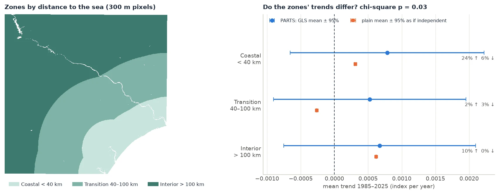

# Worked example: 41 years of Landsat

<p class="lead">A full analysis on real data, from loading the rasters to a sentence you could put in a paper. In a 21 km window of north-eastern Brazil, a quarter of the pixels have a significant greening trend, yet the region as a whole does not. Over the whole scene, zones at different distances from the sea differ in their trends, although none of them differs from 0. Every number below is the output of the code shown.</p>

## The data

41 annual Landsat medoid composites of a vegetation index, 1985 to 2025, over the Sergipe and Alagoas coast (Landsat path/row 215/067, around the lower São Francisco river). One GeoTIFF per year (`landsat_medoid_1985.tif` … `landsat_medoid_2025.tif`), in EPSG:4326 (longitude/latitude) at about 30 m, 7478 × 7319 pixels. The sea and the area outside the scene are 0, with no nodata value declared.

To follow along with your own data, you need a folder of annual rasters of one index. Every step below applies unchanged.

## 1. Load a window, in a projected CRS

PARTS measures distances between pixels, so it needs a **projected CRS**. In degrees, a step east and a step north are different distances. `zeit.parts` refuses a cube in a geographic CRS. Read the window in the files' own CRS first, then reproject it to UTM zone 24S (SIRGAS 2000, EPSG:31984) at 30 m:

```python
import numpy as np
import xarray as xr
import zeit

folder = "215_067"                       # the 41 annual GeoTIFFs
west, south, east, north = -38.147498, -9.460877, -37.958851, -9.272231

geo = zeit.load_raster(folder, clip=(west, south, east, north))   # lon/lat, as stored
win = zeit.load_raster(geo, crs="EPSG:31984", res=30)            # SIRGAS 2000 / UTM 24S, 30 m
print(dict(win.sizes))
```

```text
{'time': 41, 'y': 698, 'x': 694}
```

!!! warning "Clip first, then reproject"
    `zeit.load_raster(folder, clip=..., crs=...)` applies the clip *after* reprojecting, so the bounds must then be in the target CRS. Giving lon/lat bounds together with `crs=` fails with "no data in bounds". The two calls above avoid the question.

## 2. Each pixel's trend

```python
ar = zeit.ar_trend(win)                  # annual data: the slope is per year
valid = ar.slope.notnull()
sig = ar.slope_p < 0.05
print(f"pixels with a trend: {int(valid.sum())}")
print(f"significant up:   {float((sig & (ar.slope > 0)).sum() / valid.sum()):.1%}")
print(f"significant down: {float((sig & (ar.slope < 0)).sum() / valid.sum()):.1%}")
print(f"mean slope: {float(ar.slope.mean()):.5f} per year, median rho: {float(ar.rho.median()):.2f}")
```

```text
pixels with a trend: 482234
significant up:   25.9%
significant down: 0.4%
mean slope: 0.00128 per year, median rho: 0.12
```

<figure markdown>
  
  <figcaption>The maps of <code>ar.slope</code>, of <code>ar.slope_p &lt; 0.05</code> by sign, and of <code>ar.rho</code>. The figures on these pages were made by <code>docs/scripts/make_parts_figures.py</code> on the window's exact pixel bounds, one column narrower than the rounded bounds above (481,547 pixels), so their numbers can differ from those printed here in the third digit.</figcaption>
</figure>

A quarter of the pixels are significantly greening. The usual next sentence would be "the region is greening". PARTS tests whether the data support that sentence.

### One pixel, up close

Why use an AR(1) trend rather than plain OLS? Take a single pixel:

```python
from scipy import stats

series = win.sel(x=606198.55, y=8954073.29, method="nearest").values
ols = stats.linregress(np.arange(series.size), series)
print(f"OLS:   {ols.slope:.5f} +/- {ols.stderr:.5f}, p = {ols.pvalue:.2g}")
one = zeit.ar_trend(series)
print(f"AR(1): {float(one.slope):.5f} +/- {float(one.slope_se):.5f}, p = {float(one.slope_p):.3f}, "
      f"rho = {float(one.rho):.2f}")
```

```text
OLS:   -0.00350 +/- 0.00086, p = 0.00023
AR(1): -0.00326 +/- 0.00163, p = 0.053, rho = 0.59
```

The two slopes are nearly the same. With ρ = 0.59, however, the 41 years carry much less independent information than OLS assumes, and the AR(1) standard error is twice as large. `zeit.ar_trend` also accepts a single series (a list, an array, a `pd.Series`) and returns a `Dataset` of scalars.

## 3. The regional test

```python
res = zeit.parts(win, trend=ar, npart=100)
print(res)
```

```text
PARTS: 482234 pixels, 100 partitions of 1500
spatial correlation: {'function': 'exponential', 'range': 23039.803728581348}
nugget (mean of the partitions): 0.08176

              estimate         se        t        p
coefficient
mean        0.00151307 0.00170745 0.886154 0.375536
```

It took 9 seconds on a 20-thread CPU. Reading the output line by line:

- **482,234 pixels, 100 partitions of 1500.** 150,000 pixels were used. The region holds enough for 321 partitions, but 100 give the same answer ([Advanced](advanced.md#how-many-partitions)).
- **Range 23 km.** The residuals are correlated over distances comparable to the window itself (21 km across).
- **Nugget 0.08.** Only 8% of a pixel's year-to-year variation is its own. The rest is shared with its neighbours.
- **mean: 0.0015 ± 0.0017 per year, p = 0.38.** The regional mean trend is positive, but its standard error is as large as the estimate. **There is no evidence of a regional trend.**

How can 26% of the pixels be significant while the region is not? Because the pixels are not 482,234 independent witnesses. The whole window rises and falls together with wet and dry years, so it behaves almost like **one** very long-lived pixel observed 41 times. A rising mean over 41 years with large shared interannual swings is not strong evidence of a trend.

## 4. Check the answer

A p-value is only as good as the model behind it. Three checks take a minute.

**The spread of the partitions.** If the estimate varies a lot from one partition to the next, the regional mean is not well defined:

```python
print(f"spread of the partitions' estimates: {res.partitions['mean'].std():.5f}")
```

```text
spread of the partitions' estimates: 0.00014
```

The partition estimates agree with each other (0.00014). The large SE (0.0017) does not come from disagreement between partitions. It comes from what every partition shares: the correlated signal.

**The mean series.** A simple sanity check is to average the window into one series and test that series' trend. The pixels' correlation then plays no role at all:

```python
mean_series = win.mean(("y", "x")).values
m = zeit.ar_trend(mean_series)
print(f"mean series: {float(m.slope):.5f} +/- {float(m.slope_se):.5f}, p = {float(m.slope_p):.3f}, "
      f"rho = {float(m.rho):.2f}")
```

```text
mean series: 0.00129 +/- 0.00075, p = 0.094, rho = 0.15
```

It agrees with PARTS: the same positive trend, not significant. When the whole region shares one signal, as here, this check is close to what PARTS does. When the correlation is short compared with the region, PARTS has much more power than the mean series.

**The correlation plot, and sensitivity to the partition size.** The [correlation plot](how-it-works.md#step-2-how-correlated-are-the-pixels) of this window shows a correlation near 0.6 at every distance, which no exponential curve fits well. When the model misfits like that, the answer depends on the partition size, because a larger partition spans longer distances and sees more of the shared signal:

```python
for size in (500, 1500, 3000):
    r = zeit.parts(win, trend=ar, partsize=size, npart=40)
    print(size, r.table.loc["mean", ["se", "p"]].round(4).to_dict())
```

```text
500 {'se': 0.001, 'p': 0.1332}
1500 {'se': 0.0018, 'p': 0.3831}
3000 {'se': 0.0025, 'p': 0.5535}
```

p goes from 0.13 to 0.55, and every one of these values gives the same conclusion. On a simulated map whose correlation *is* exponential, the partition size does not matter ([Advanced](advanced.md#partition-size)). Report a sensitivity check like this one when your correlation plot looks like this.

## 5. Save the maps

```python
zeit.save_raster(ar[["slope", "slope_p", "rho"]], "results/ar")   # slope.tif, slope_p.tif, rho.tif
```

## 6. The whole scene: zones and a covariate

Next, a question that needs classes: **do the trends differ with distance to the sea?** The whole scene is read at 300 m (an average of 10 × 10 pixels), which keeps it to about half a million pixels:

```python
scene = zeit.load_raster(folder, crs="EPSG:31984", res=300, resampling="average")
scene = scene.where(scene != 0)          # 0 is the sea and outside the scene
print(dict(scene.sizes))
```

```text
{'time': 41, 'y': 731, 'x': 740}
```

The zones come from the distance of each land pixel to the sea: coastal (under 40 km), transition (40–100 km) and interior (over 100 km). Building them is ordinary raster work, unrelated to PARTS:

??? example "Building the land mask, the zones and the distance to the sea"
    ```python
    from scipy import ndimage

    # the source's footprint on the UTM grid (a coarse grid of ones, in lon/lat, reprojected)
    lon0, lat0, step, nx, ny = -38.416992, -9.137483, 0.000269494585, 7478, 7319
    fp = xr.DataArray(np.ones((ny // 10, nx // 10), "float32"), dims=("y", "x"), coords={
        "y": lat0 - step * ny * (np.arange(ny // 10) + 0.5) / (ny // 10),
        "x": lon0 + step * nx * (np.arange(nx // 10) + 0.5) / (nx // 10)})
    fp = fp.rio.write_crs("EPSG:4326").rio.write_nodata(np.nan)
    inside = fp.rio.reproject_match(scene.isel(time=0)).notnull().values

    # water: dark on average, or mostly missing; the sea is the water body in the south-east corner
    water = inside & ((scene.mean("time") < 0.05) | (scene.notnull().sum("time") < 30)).values
    labels, _ = ndimage.label(water)
    rows, cols = np.nonzero(water)
    k = np.argmax(rows + cols)
    sea = labels == labels[rows[k], cols[k]]
    coast_km = ndimage.distance_transform_edt(~sea, sampling=300.0) / 1000.0
    land = inside & ~water

    like = dict(dims=("y", "x"), coords={"y": scene.y, "x": scene.x})
    zones = xr.DataArray(np.where(land, np.digitize(coast_km, [40, 100]) + 1, np.nan), **like)
    land = xr.DataArray(land, **like)
    coast_km = xr.DataArray(np.where(land, coast_km, np.nan), **like)
    ```

The scene has gaps (clouds, water), so pixels need at least 30 valid years. `parts` does not take `min_valid`, so the trends are fitted first and passed with `trend=`:

```python
ar_s = zeit.ar_trend(scene, min_valid=30)

res_mean = zeit.parts(scene, trend=ar_s, mask=land, npart=100)              # the whole land
res_cls = zeit.parts(scene, trend=ar_s, classes=zones, npart=100)           # the three zones
res_cov = zeit.parts(scene, trend=ar_s, mask=land, covariates={"coast_km": coast_km}, npart=100)
print(res_mean, res_cls, res_cov, sep="\n\n")
```

```text
PARTS: 493932 pixels, 100 partitions of 1500
spatial correlation: {'function': 'exponential', 'range': 117690.30429186746}
nugget (mean of the partitions): 0.3157

               estimate          se        t        p
coefficient
mean        0.000681751 0.000741318 0.919647 0.357759

PARTS: 493932 pixels, 100 partitions of 1500
spatial correlation: {'function': 'exponential', 'range': 117690.30429186746}
nugget (mean of the partitions): 0.3268

               estimate          se        t        p
coefficient
class 1.0   0.000783492 0.000734098  1.06729 0.285845
class 2.0   0.000522905 0.000728719 0.717568 0.473025
class 3.0     0.0006726 0.000726753 0.925486 0.354714

chi-square test against a single mean: F = 2.002, df = (2, 1498), p = 0.02751

PARTS: 493932 pixels, 100 partitions of 1500
spatial correlation: {'function': 'exponential', 'range': 117690.30429186746}
nugget (mean of the partitions): 0.3194

               estimate         se        t        p
coefficient
intercept   0.000146828 0.00104186 0.140929 0.887926
coast_km    4.34878e-06 5.9285e-06 0.733538 0.463232

chi-square test against a single mean: F = 0.6135, df = (1, 1499), p = 0.4435
```

The three runs took 30 seconds together.

<figure markdown>
  
  <figcaption><strong>Zones by distance to the sea.</strong> Left: coastal (68,696 pixels of 300 m), transition (151,311) and interior (273,925). Right: each zone's GLS mean trend from PARTS with its 95% interval (blue), next to the plain mean of the pixels' slopes with the interval it would have if the pixels were independent (orange, too narrow to see). The arrows give the share of pixels with a significant positive or negative trend in each zone.</figcaption>
</figure>

Reading the three results:

- **The land as a whole:** +0.00068 ± 0.00074 per year, p = 0.36. No evidence of a regional trend, as in the window. Over the whole scene, the correlation reaches much farther (range 118 km) and a third of the variation is each pixel's own (nugget 0.32).
- **Each zone against 0:** none of them differs from 0 (p = 0.29, 0.47 and 0.35).
- **The zones against each other:** chi-square p = 0.028. **The zones' trends differ.** The coast trends up more than the transition zone.

How can the zones differ when none of them differs from 0? The regional signal (droughts, wet years) is shared by all three zones. It makes each zone's mean uncertain, but it cancels when the zones are compared. Differences between classes are often much easier to detect than the classes' own trends.

- **Distance to the sea as a covariate:** +4.3 × 10⁻⁶ per year per km, p = 0.46. No evidence of a *linear* effect. The zones differ, but not along a straight line with distance: the transition zone trends lower than both the coast and the interior. The zones capture a non-linear pattern that a single slope misses.

The plain means of the zones (orange in the figure) are quite different from the GLS means (blue), and one of them is even negative (transition, −0.00026). GLS gives less weight to pixels that are redundant with their neighbours, so where big clusters of similar pixels sit matters less. Report the GLS means.

!!! note "Class names"
    The zones layer is a float layer (NaN where there is no class), so the rows are `class 1.0`, `class 2.0`, `class 3.0`. An integer layer gives `class 1`. A layer of strings gives `class forest`. Select a row with `res_cls.table.loc["class 1.0"]`.

## 7. Report it

> Trends of the annual vegetation index (1985–2025) were fitted per pixel with an AR(1) model by REML and tested regionally with PARTS (Ives et al. 2021), as implemented in Zeit (`zeit.parts`: exponential spatial correlation fitted to the residuals of 1000 pixels, range 118 km; 100 random partitions of 1500 pixels; maximum-likelihood nugget). The mean trend of the land area was not significantly different from 0 (+0.00068 ± 0.00074 yr⁻¹, t = 0.92, p = 0.36), although 12% of the pixels had a significant trend individually. Trends differed among the three zones of distance to the sea (correlated chi-square test, F = 2.00, df = 2 and 1498, p = 0.028), with no zone differing from 0 on its own (p ≥ 0.29).

The 12% comes from the per-pixel map:

```python
sig, slope = ar_s.slope_p < 0.05, ar_s.slope
for k, name in [(1, "coastal"), (2, "transition"), (3, "interior")]:
    z = (zones == k) & slope.notnull()
    print(f"{name:10s} up {float((z & sig & (slope > 0)).sum() / z.sum()):.1%}, "
          f"down {float((z & sig & (slope < 0)).sum() / z.sum()):.1%}")
on_land = land & slope.notnull()
print(f"all land   up {float((on_land & sig & (slope > 0)).sum() / on_land.sum()):.1%}, "
      f"down {float((on_land & sig & (slope < 0)).sum() / on_land.sum()):.1%}")
```

```text
coastal    up 24.4%, down 6.0%
transition up 2.3%, down 3.5%
interior   up 10.3%, down 0.4%
all land   up 9.8%, down 2.1%
```

[Interpreting, FAQ and pitfalls](faq.md) has a general template for reporting.

## The whole script

The code on this page, run top to bottom, took 3 minutes on a 20-thread machine, most of it spent reading the rasters. The figures are made by `docs/scripts/make_parts_figures.py` in the repository (`ZEIT_DOCS_PARTS=<folder> python docs/scripts/make_parts_figures.py`).
