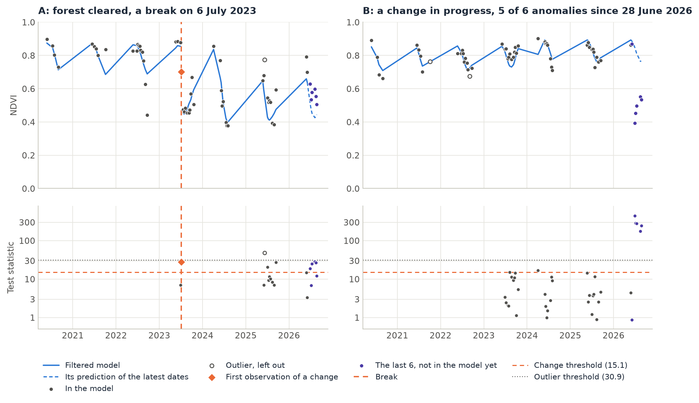
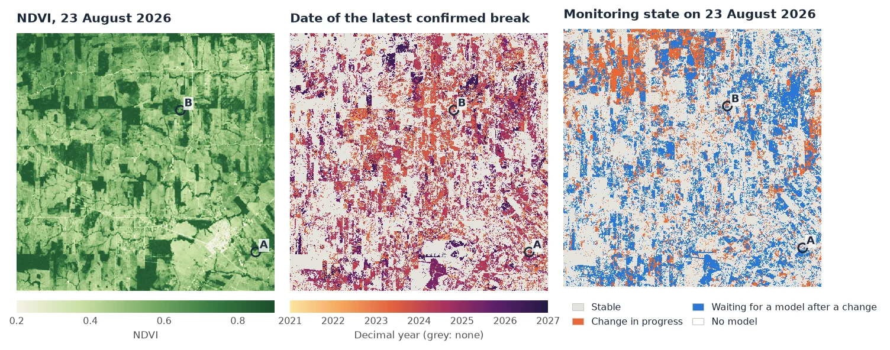
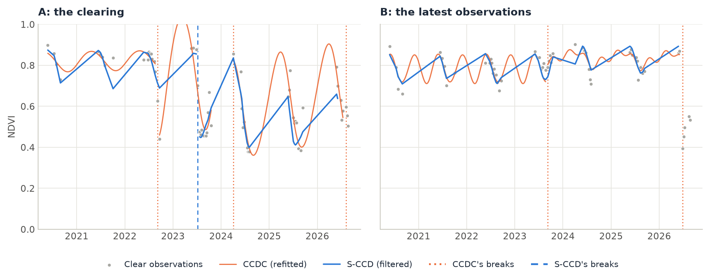

# S-CCD (Stochastic CCDC)

<p class="lead">S-CCD is CCDC made for monitoring. It starts the same harmonic model of every band on a pixel's first stable observations, but then it does not refit the model at each new image: a Kalman filter updates it, a little, with every observation that fits. The model follows slow changes, a new image costs one update per pixel, and at any date S-CCD can say which pixels are departing from their model right now, before enough observations have come in to confirm a change.</p>

<div class="glance" markdown>
<div><span class="k">Answers</span><span class="v">Did this pixel change, and when? Which pixels are changing now, and since when?</span></div>
<div><span class="k">Input</span><span class="v">Every clear observation, six reflectance bands (× 10,000) plus Fmask QA codes, as CCDC</span></div>
<div><span class="k">Output</span><span class="v">CCDC's segments and breaks; the monitoring state of every pixel at the last date; for one pixel, what became of each observation</span></div>
<div><span class="k">Reference</span><span class="v">Ye, Rogan, Zhu &amp; Eastman (2021), <em>Remote Sensing of Environment</em> 252; written from the paper</span></div>
</div>

<figure markdown>
  
  <figcaption><strong>What S-CCD produces.</strong> Two real pixels of a Landsat 8 and 9 series of Rondônia, Brazil, 2020 to 2026, about nine clear observations a year. Top: the NDVI of each clear observation, coloured by what S-CCD made of it, and the filtered model (blue), which moves a little with each observation it takes in. Bottom: each tested observation's statistic, its departure from the model over five bands, against the change threshold. A: a forest cleared in July 2023; the first observation beyond the threshold opens a break and a new model starts after it. B: a forest whose last five observations, since 28 June 2026, are far beyond the threshold. Five of the six needed: a change in progress, not yet confirmed.</figcaption>
</figure>

## How it works

S-CCD keeps CCDC's model and its test, and changes how the model is kept up to date.

1. **Start a model, as CCDC.** The first clear observations of a pixel are screened for clouds with Tmask, and a model is started once 18 of them, over at least a year, fit a stable line (COLD's stability test). The model of each band is CCDC's harmonic with two cycles a year:

    $$
    \hat{\rho}(t) = a_0 + c_1 t + a_1 \cos\omega t + b_1 \sin\omega t + a_2 \cos 2\omega t + b_2 \sin 2\omega t, \qquad \omega = \tfrac{2\pi}{365.25}
    $$

2. **Carry it forward with a Kalman filter.** The six coefficients become the state of a state-space model, and each coefficient may drift a little from one observation to the next. How much is the process noise, which S-CCD estimates for each pixel from its own first observations (the paper's Eq. 9). Each new observation that fits the model updates it once: the trend and the seasons follow slow changes, such as a forest that grows or a pasture whose season shifts, without a refit.
3. **Test each new observation.** Its departure from the model's prediction, standardized by each band's RMSE, is summed over the five detection bands (green to SWIR2). Above `chi2inv(0.99, 5)` = 15.1, it is an anomaly.
4. **Confirm a change.** A change is `conse` (6) anomalies in a row that point the same way: the mean angle of their departures to the median one must be below `max_angle` (30°), so that noise in all directions is not taken for a change. The break is dated on the first of them, and a new model starts after it. A single observation beyond `chi2inv(0.99999, 5)` = 30.9 that is not followed by others is an outlier, left out of the model.
5. **Report the state now.** At the last date, the latest observations that are anomalies, fewer than `conse`, are a change in progress: `n_anomalies` says how many, `anomaly_start` since when.

The difference with [CCDC](ccdc.md) is in step 2. CCDC refits a lasso on all the observations of the segment each time it grows, so its model is the best fit of the whole segment, and a new image means a new fit. S-CCD's model is a running estimate, where each new image costs one small update; on long series that makes it about ten times faster. Its model also follows what happened lately rather than the segment's average. The near-real-time state of step 5 is the other addition: CCDC does not say that a pixel has started to change, only that it changed.

## Step by step

The data are 125 Landsat 8 and 9 Collection 2 Level-2 dates over central Rondônia, Brazil, from February 2020 to August 2026: one GeoTIFF of 1690 × 1675 pixels whose 875 bands are, for each date, Blue, Green, Red, NIR, SWIR1 and SWIR2 as digital numbers, then `QA_PIXEL`, with its dates in a CSV file. It is the stack of the S-CCD tests and benchmarks, and of the [CCDC guide in Janus](https://sacridini.github.io/janus/ccdc.html). The tutorial reads a 16 × 16 km window of it, 596 × 596 pixels.

### 1. Load the stack and build the QA codes

```python
import numpy as np
import pandas as pd
import xarray as xr
import zeit

dates = pd.to_datetime(pd.read_csv("CCDC_Stack_Rondonia_Dates.csv").Date).to_numpy()
stack = zeit.load_raster("CCDC_Stack_Rondonia.tif", clip=(-63.4269, -10.2965, -63.2667, -10.1362))
stack.shape                     # (875, 596, 596): 125 dates x 7 bands, no data as NaN
layers = stack.values.reshape(len(dates), 7, stack.sizes["y"], stack.sizes["x"])
```

S-CCD takes CCDC's Fmask codes (0 clear land, 1 water, 2 cloud shadow, 3 snow, 4 cloud, 255 no observation; see [CCDC](ccdc.md#2-build-the-qa-codes)). Decode them from the `QA_PIXEL` bits, cirrus and dilated clouds included:

```python
qa_pixel = layers[:, 6]
q = np.nan_to_num(qa_pixel).astype(np.int64)
cloud = (q & 0b1110) != 0                                  # dilated cloud, cirrus, cloud
qa = np.full(q.shape, 4, dtype=np.uint8)                   # a cloud, unless QA_PIXEL says otherwise
qa[(q & (1 << 6)) != 0] = 0                                # clear
qa[((q & (1 << 7)) != 0) & ~cloud] = 1                     # water
qa[(q & (1 << 5)) != 0] = 3                                # snow
qa[(q & (1 << 4)) != 0] = 2                                # cloud shadow
qa[cloud] = 4
qa[np.isnan(qa_pixel) | ((q & 1) != 0)] = 255              # no data, fill
```

The stack interleaves two Landsat paths, and this window lies on one of them: keep its 61 dates. Then make the cube, with reflectance × 10,000 from the digital numbers (`0.275 * DN - 2000`):

```python
keep = (qa != 255).any(axis=(1, 2))                        # the 61 dates of this path
cube = xr.DataArray(
    layers[keep, :6] * 0.275 - 2000,
    dims=("time", "band", "y", "x"),
    coords={"time": dates[keep], "band": ["blue", "green", "red", "nir", "swir1", "swir2"],
            "y": stack.y, "x": stack.x},
).rio.write_crs(stack.rio.crs)
qa = qa[keep]
```

A pixel has a median of 57 clear observations, nearly all from May to October, the dry season: about nine a year.

### 2. Run S-CCD

```python
seg = zeit.sccd(cube, qa=qa)

list(seg.data_vars)
# ['t_start', 't_end', 't_break', 'change_prob', 'num_obs', 'rmse', 'magnitude', 'coefs',
#  'n_segments', 'n_breaks', 'nrt_mode', 'n_anomalies', 'anomaly_start', 'anomaly_statistic',
#  'anomaly_magnitude', 'last_statistic', 'last_observation', 'n_queue']
```

The 355,216 pixels take 14 s on 19 threads. The segments are those of [`ccdc`](ccdc.md#5-read-the-output), with six coefficients per band instead of eight, the change probability and the magnitude of each break; [`predict_synthetic_image`](../api/change-detection.md#predict_synthetic_image) evaluates them on any date, as CCDC's. The other variables are the monitoring state (step 4).

### 3. Look at one pixel

Pass one pixel's `(time, band)` series and its QA codes. The result then also has, for every date, what became of the observation (`status`), its test statistic, and the model's prediction filtered up to that date: the chart at the top.

```python
px = zeit.sccd(cube.isel(y=178, x=378), qa=qa[:, 178, 378])    # pixel B
int(px.n_breaks), int(px.n_anomalies), px.anomaly_start.values    # (0, 5, '2026-06-28')

names = np.array(["unused", "model", "outlier", "break", "peek", "queue"])
pd.DataFrame({"status": names[px.status.values], "statistic": px.statistic.values,
              "nir": cube.isel(y=178, x=378).sel(band="nir").values,
              "nir_model": px.predicted.sel(band="nir").values}, index=px.time.values)
```

```text
           status  statistic     nir  nir_model
2025-09-13  model        4.6  2999.0     3328.0
2026-05-27  model        4.4  3242.0     3371.0
2026-06-04   peek        0.9  3143.0     3257.0
2026-06-28   peek      444.2  1970.0     2991.0      <- first anomaly
2026-07-06   peek      283.5  1991.0     2925.0
2026-07-14   peek      280.9  1893.0     2880.0
2026-08-15   peek      173.9  2411.0     2949.0
2026-08-23   peek      243.7  2501.0     3025.0      <- the last image: 5 anomalies of 6
```

| `status` | The observation |
| :--- | :--- |
| `0` unused | Not clear (QA), screened by Tmask, or no observation. |
| `1` model | Fitted in the model of a segment, or used to start one. |
| `2` outlier | A single observation beyond the outlier threshold, left out. |
| `3` break | The first observation of a confirmed change. |
| `4` peek | Among the last `conse` observations, which the model has not taken in yet. |
| `5` queue | Waiting for enough observations to start a model. |

From 28 June 2026 the NIR of pixel B drops by a third and its SWIR1 rises by 1077: `anomaly_magnitude`, the median departure of the anomalies, reads as a forest being cleared. One more observation like these will confirm it. Pixel A shows the other end of the story: its anomaly of 6 July 2023 (statistic 28) was followed by others, so it opened a break, and the second segment, the pasture, begins with the observation of 22 July:

```python
pa = zeit.sccd(cube.isel(y=506, x=552), qa=qa[:, 506, 552])     # pixel A
pa[["t_start", "t_end", "t_break", "change_prob", "num_obs"]].to_dataframe().dropna(subset=["t_start"])
```

```text
           t_start      t_end    t_break  change_prob  num_obs
segment
1       2020-05-26 2023-06-28 2023-07-06          1.0       22
2       2023-07-22 2026-08-23        NaT          0.0       28
```

Its NIR fell by 449 and its SWIR1 rose by 1345 at the break (`magnitude`). Anomalies only count in a row up to the last image, and pixel A's latest observation fits its model: `n_anomalies` is 0, and pixel A is stable now.

### 4. Map the breaks and the monitoring state

<figure markdown>
  
  <figcaption><strong>Result of this tutorial</strong>, over the 16 × 16 km window. Left: the NDVI of the last image. Middle: the date of each pixel's latest confirmed break. Right: the state on the last date, as Janus maps it: stable, a change in progress (at least one anomaly among the latest observations), waiting for a new model after a break, or no model. A and B are the pixels above.</figcaption>
</figure>

The state at the last date is in `nrt_mode` and `n_anomalies`:

| Variable | Meaning |
| :--- | :--- |
| `nrt_mode` | `1` monitoring: a model is running; `2` waiting for enough observations to start one (at the start, or after a break); `0` no model. |
| `n_anomalies` | The latest consecutive anomalies (`conse` of them make a change), with `anomaly_start` the date of the first, `anomaly_statistic` the smallest of their statistics and `anomaly_magnitude (band, y, x)` their median departure. |
| `last_statistic`, `last_observation` | The latest clear observation's statistic and date. |
| `n_queue` | Observations waiting for a model (`nrt_mode` 2). |

```python
alerts = (seg.nrt_mode == 1) & (seg.n_anomalies >= 3)       # 3 or more of the 6 anomalies needed
float(alerts.mean())                                          # 0.082
alerts_since = seg.anomaly_start.where(alerts)               # 2026-06-28 ... 2026-08-07

zeit.save_raster(seg[["n_breaks", "nrt_mode", "n_anomalies", "anomaly_start"]], "results/sccd")
```

Over the window, 41% of the pixels have at least one confirmed break (36.5% one, 4.5% two). On 23 August 2026, 58% are stable, 13% have a change in progress, 27% are waiting for a new model after a break and 1% have no model.

- **Waiting after a break is long with dry-season data.** A new model needs 18 observations over at least a year. With nine clear observations a year, that is two dry seasons, so every pixel that broke in 2025 or 2026 is still waiting. Until it has a model again, a pixel cannot signal a new change.
- **Not every change in progress is a clearing.** 29,058 pixels (8%) have three or more anomalies. Their first anomalies gather on a few dates (14 July and 7 August 2026 for three quarters of them), which points to the landscape as a whole: pastures drying out faster than in their models' years, or smoke from the season's fires. Pixel B's departure is that of a clearing (NIR down, SWIR up, far beyond the threshold); filter on `anomaly_magnitude` and `anomaly_statistic` to keep such pixels, or wait for the next images.
- **The same holds for breaks.** Breaks gather on a few dates too, the same in S-CCD and CCDC: 23 August and 8 September 2023, with 4 to 5% of the pixels each, likely the drought of 2023 on the pastures, or its fires. The test sees any lasting departure from a pixel's own seasons, not only a change of land cover; [CCDC's classification of segments](ccdc.md#7-classify-the-segments) or a look at the magnitudes tells them apart.

### 5. Compared with CCDC

The same cube goes to [`zeit.ccdc`](ccdc.md) unchanged:

```python
cc = zeit.ccdc(cube, qa=qa)          # 20 s, against 14 s for zeit.sccd
```

<figure markdown>
  
  <figcaption><strong>The same two pixels, by CCDC and by S-CCD.</strong> CCDC's model (orange) is a curve fitted to all the observations of each segment, with three harmonics; S-CCD's (blue) is its filtered prediction at each observation, joined by straight lines across the rainy seasons, when there are no clear images. A: CCDC breaks in September 2022 (the dip of the 2022 dry season), in April 2024 (the first rainy-season image of the pasture) and on 7 August 2026; S-CCD only at the clearing, in July 2023, which CCDC takes into a segment of its own. B: CCDC breaks in September 2023 and on 28 June 2026, the date S-CCD gives as the start of the change in progress.</figcaption>
</figure>

On this window S-CCD finds fewer breaks: 41% of the pixels have one, against 54% with CCDC, and 66% of the pixels have as many breaks with both. Two things explain most of the difference:

- **The end of the series.** At the last date, CCDC dates a change that is not complete as a break of its last segment, with a change probability below 1, as the original MATLAB code does; `zeit.ccdc` returns that `t_break` but not the probability. 14% of the pixels have a CCDC break among the last six dates, and S-CCD keeps 43% of them as a change in progress, the others in their model. With S-CCD, a break is always confirmed by `conse` anomalies, and what is not confirmed yet is in `n_anomalies`.
- **A filtered model takes in more.** S-CCD's model follows the latest observations, so a dip or a season unlike the others is often absorbed instead of opening a new segment, as in 2022 and 2024 in pixel A. Of CCDC's breaks before the last six dates, 45% have an S-CCD break within one clear observation. Neither is wrong: S-CCD trades some of CCDC's breaks for a model that keeps up with a pixel's drift.

S-CCD is faster, and more so as the series grows. On these 61 dates the difference is small (14 s against 20 s), because most of the work is starting each model, which both do the same way. On 1000 synthetic pixels of 35 years observed every 8 days, CCDC takes 12.1 s on one thread and S-CCD 1.16 s, ten times faster, more than the paper's three to five times ([Against the Original Implementations](../benchmarks/vs-originals.md#s-ccd-vs-pyxccd)).

### Other inputs

The same function takes CCDC's inputs: a raster on disk, a numpy array, one pixel as a `pandas.DataFrame`, and a dask cube, read and computed block by block ([all inputs](../api/change-detection.md#sccd)):

```python
# a stack whose bands are date_band, with a band of Fmask codes, block by block
seg = zeit.sccd("landsat_dense_stack.tif", qa="fmask", chunks="auto")
zeit.save_raster(seg[["n_breaks", "nrt_mode", "n_anomalies", "anomaly_start"]], "results/sccd")

# one pixel: a DataFrame indexed by date, one column per band
px = zeit.sccd(df, qa=fmask_codes)

# a cloud-free image of any date from the segments, as CCDC's
january = zeit.predict_synthetic_image(seg, "2025-01-15")
```

## Parameters

| Parameter | Default | Effect |
| :--- | :---: | :--- |
| `conse` | `6` | Anomalies in a row that confirm a change. Fewer: earlier and more breaks; more: fewer false breaks, later. It also sets how long a change stays "in progress". |
| `prob_threshold` | `0.99` | Probability of the chi-square change threshold over the detection bands: 15.1 with five bands. Lower is more sensitive. |
| `outlier_prob` | `0.99999` | A single observation beyond this threshold (30.9) is an outlier, left out. |
| `max_angle` | `30.0` | Largest mean angle (degrees) of the anomalies to their median departure. A wider angle accepts departures in several directions as a change. |
| `max_segments` | `6` | Segments kept per pixel. |
| `detection_bands` | Green to SWIR2 | Bands of the test. |
| `tmask_bands` | Green, SWIR1 | Bands of the Tmask cloud screen at the start of a model. |
| `valid_range` | `(0, 10000)` | Values outside it are not observations. |

All parameters, and the inputs from disk with `chunks`, are in the [API reference](../api/change-detection.md#sccd). In Janus, the same algorithm is the *S-CCD (stochastic CCDC)* tool, with its maps of breaks and of the monitoring state.

## Good practice

- **Mask clouds, and look at the outliers.** The QA band of this stack misses clouds in images of February 2020 and February 2023. S-CCD leaves most such observations out as outliers, but where a real change follows, the break is dated on the cloud. Check the dates where breaks or outliers gather.
- **Think in observations, not days.** `conse` counts clear observations: with Landsat 8 and 9 every 8 days in the dry season, six of them are six weeks; across a rainy season they can be eight months.
- **Read the monitoring state with its magnitude.** A change in progress is a departure, not yet a change of land cover. Its `anomaly_magnitude` (per band) and `anomaly_statistic` say how large it is and in which direction.
- **Give it time to start.** S-CCD monitors a pixel only once it has a model: 18 clear observations over at least a year, at the start of the series and after every break.

!!! note "About this implementation"
    Zeit's S-CCD is written from the paper (Ye et al. 2021 and its preprint): pyxccd, the authors' package, is Apache-2.0, which GPL-2.0-only Zeit cannot take code from, so pyxccd is only run as a black box on the same data. On series with clear changes the two find as many breaks in every pixel (1000 synthetic pixels of 35 years). On 4096 pixels of this Rondônia stack, 85% of the pixels have as many breaks in both, and three quarters of pyxccd's breaks have one of Zeit's within one observation; the magnitudes of the breaks both find correlate at 0.99, and the near-real-time mode is the same in 89% of the pixels. The paper leaves parts of the filter open, and the differences come from there: pyxccd's states adapt faster on irregular dates than the paper's estimate of the process noise, which Zeit follows, and Zeit's RMSE, that of the filter's one-step predictions, is about 15% smaller than pyxccd's. Zeit finds about 20% more breaks, near the threshold. On the 4096 pixels, pyxccd takes 10.1 s and Zeit 1.1 s on one thread (0.2 s on 19). See [Algorithm Fidelity](../benchmarks/fidelity.md#9-newer-ports-against-their-originals) and [Against the Original Implementations](../benchmarks/vs-originals.md#s-ccd-vs-pyxccd).

For CCDC itself, its synthetic images and the classification of its segments, see [CCDC](ccdc.md). For alerts from a regular series of one index, see [BFAST Monitor](bfast_monitor.md); for control charts on every observation of one index, [EWMACD](ewmacd.md).

## References

- Ye, S., Rogan, J., Zhu, Z., & Eastman, J. R. (2021). A near-real-time approach for monitoring forest disturbance using Landsat time series: stochastic continuous change detection. *Remote Sensing of Environment*, 252, 112167. [doi:10.1016/j.rse.2020.112167](https://doi.org/10.1016/j.rse.2020.112167)
- Zhu, Z., & Woodcock, C. E. (2014). Continuous change detection and classification of land cover using all available Landsat data. *Remote Sensing of Environment*, 144, 152–171. [doi:10.1016/j.rse.2014.01.011](https://doi.org/10.1016/j.rse.2014.01.011)
- Zhu, Z., Zhang, J., Yang, Z., Aljaddani, A. H., Cohen, W. B., Qiu, S., & Zhou, C. (2020). Continuous monitoring of land disturbance based on Landsat time series. *Remote Sensing of Environment*, 238, 111116. [doi:10.1016/j.rse.2019.03.009](https://doi.org/10.1016/j.rse.2019.03.009)
- pyxccd, the authors' Python package of COLD and S-CCD: [github.com/Remote-Sensing-of-Land-Resource-Lab/pyxccd](https://github.com/Remote-Sensing-of-Land-Resource-Lab/pyxccd)
