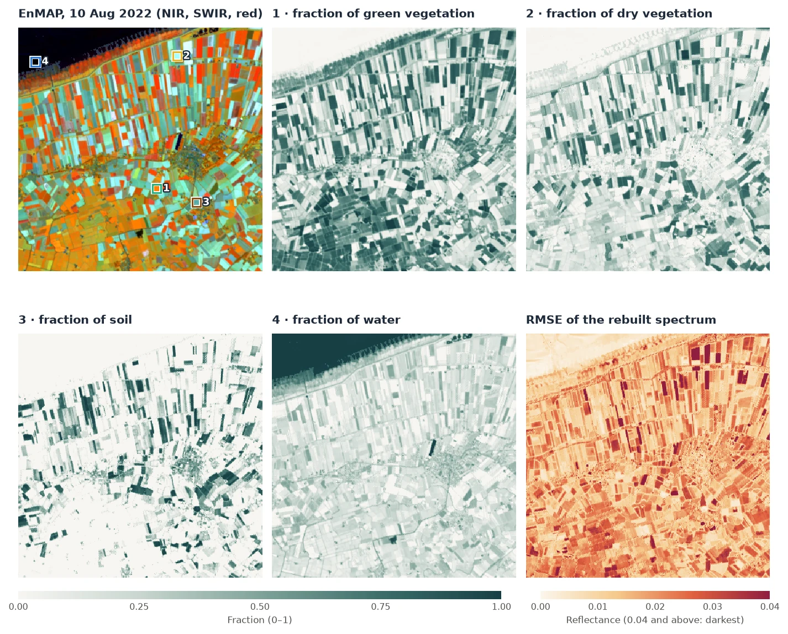
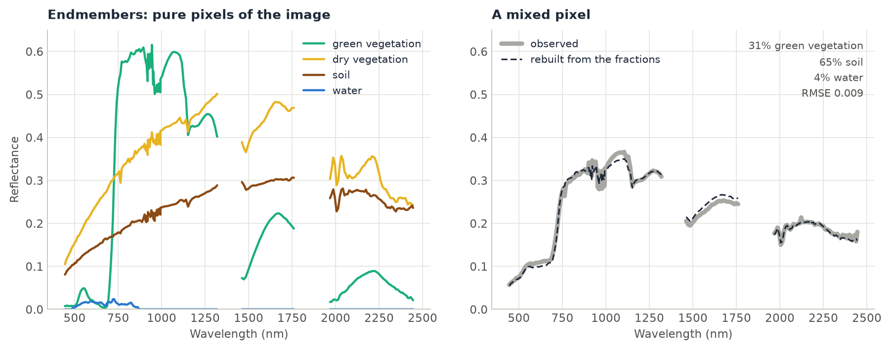

# Spectral Unmixing

<p class="lead">A 30 m pixel is rarely one material. A field can be half crop and half bare soil; a pixel of forest after selective logging is part canopy, part dead wood and part soil. Unmixing estimates the fraction of each material in every pixel from its spectrum, given the spectrum of each pure material (the endmembers). It works on one image or a time series, with a few bands or hundreds.</p>

<div class="glance" markdown>
<div><span class="k">Answers</span><span class="v">What fraction of each pixel is vegetation, soil, water…?</span></div>
<div><span class="k">Input</span><span class="v">Reflectance with a band dimension: <code>(band, y, x)</code> or <code>(time, band, y, x)</code>; one spectrum per material</span></div>
<div><span class="k">Output</span><span class="v">A fraction map per material, and the RMSE of the spectrum rebuilt from the fractions</span></div>
<div><span class="k">Reference</span><span class="v">Adams et al. (1986); Heinz &amp; Chang (2001), fully constrained least squares; Souza et al. (2005)</span></div>
</div>

<figure markdown>
  
  <figcaption><strong>Result of this tutorial.</strong> A 10.5 km window of an EnMAP hyperspectral image (210 bands from 444 to 2446 nm, 30 m) over farmland on the coast north of Groningen, the Netherlands, on 10 August 2022. Top left: the image in near infrared, shortwave infrared and red; crops are orange and red, harvested and bare fields cyan, the Wadden Sea black. The numbered squares are the pure pixels whose spectra are the endmembers. The other panels are the fraction of each endmember and the RMSE of the rebuilt spectrum. The 122,500 pixels of 210 bands were unmixed in 0.33 s. <em>Data: contains modified EnMAP data © DLR 2022.</em></figcaption>
</figure>

## How it works

1. **Linear mixing.** The spectrum of a pixel is taken as the sum of the endmember spectra, each weighted by its fraction of the pixel's area, plus an error. A pixel that is 60% crop and 40% soil reflects like 0.6 × the crop's spectrum + 0.4 × the soil's.
2. **The fractions that fit best.** For each pixel, `zeit.unmix` finds the fractions that rebuild its spectrum with the smallest squared error. By default they must be non-negative and add up to one (fully constrained least squares; Heinz & Chang 2001). Each pixel is solved exactly with an active set, in Rust, all pixels and dates in parallel.
3. **The RMSE.** The difference between the observed spectrum and the rebuilt one, per band, as a root mean square. It is large where the pixel contains a material that no endmember describes, or where an endmember does not match the material in the image.
4. **Dark endmembers.** A material that is almost black (water beyond 700 nm, or a "shade" endmember of zeros) takes up differences in brightness. A field slightly darker than its endmember gets a small fraction of the dark one.

<figure markdown>
  
  <figcaption>Left: the endmembers, the median spectrum of 3 × 3 pure pixels each. Green vegetation is dark in the red and bright in the near infrared. Dry vegetation (straw and stubble) is bright in the shortwave infrared and has the cellulose absorption near 2100 nm. Soil rises smoothly; water is almost black. The gaps are bands left out (water vapour absorption, noise). Right: a mixed pixel and its spectrum rebuilt from 31% green vegetation, 65% soil and 4% water.</figcaption>
</figure>

## Step by step

### 1. Read the image and keep the good bands

```python
import pandas as pd
import zeit

cube = zeit.load_raster("EnMAP_L2A_Groningen_20220810.tif", chunks="auto")
cube = cube.isel(y=slice(560, 910), x=slice(740, 1090)).load()   # (band, y, x): 224 x 350 x 350
refl = cube.where(cube != -32768) / 10000                          # reflectance 0-1, NaN = no data
```

A pixel with a missing value in any band gets no fractions, so bands without data must go. EnMAP's L2A leaves the bands at 1331–1391 nm empty (they are in a water vapour absorption), and a few bands below 440 nm and near 1950 nm are noisy, with negative reflectance:

```python
empty = refl.isnull().all(["y", "x"])
noisy = (refl < 0).mean(["y", "x"]) > 0.001                        # negative in more than 0.1% of pixels
spectra = refl.sel(band=~(empty | noisy))                          # 210 of the 224 bands
```

The bands are named like `'Band 45 (647.214 nm)'`. Naming them by their wavelength instead is shorter, and endmember tables from a spectral library usually use wavelengths too:

```python
wavelength = [float(b.split("(")[1].split()[0]) for b in spectra.band.values]
spectra = spectra.assign_coords(band=wavelength)                   # 444.5, 449.3, ... 2445.5 (nm)
```

### 2. Take the endmembers from the image

Endmembers can come from a spectral library or from the image itself. The image's own pure pixels have the same sensor, atmosphere and date as the pixels to unmix. Here each is the median spectrum of the 3 × 3 pixels around a point chosen in the image: the middle of a green crop, of a harvested field, of a ploughed field, and the open sea.

```python
def spectrum(x, y):
    """The median spectrum of the 3 x 3 pixels around a point (UTM 32N, metres)."""
    return spectra.sel(x=slice(x - 45, x + 45), y=slice(y + 45, y - 45)).median(["x", "y"]).to_series()

endmembers = pd.DataFrame({
    "green vegetation": spectrum(343860, 5918790),     # a green crop
    "dry vegetation": spectrum(344730, 5924490),       # a harvested field: stubble and straw
    "soil": spectrum(345570, 5918190),                 # a ploughed field
    "water": spectrum(338640, 5924250),                # the Wadden Sea
}).T                                                    # rows: endmembers; columns: wavelengths
```

The table's columns must be bands of the cube: names, or numbers such as wavelengths. A table in reflectance × 10000 is read as such, like the data (`scale="auto"`).

### 3. Unmix

```python
fractions = zeit.unmix(spectra, endmembers)
list(fractions.data_vars)
# ['green vegetation', 'dry vegetation', 'soil', 'water', 'rmse']

zeit.save_raster(fractions, "results/fractions")      # one GeoTIFF per variable
```

The result is an `xarray.Dataset` with one `(y, x)` map per endmember and the RMSE, on the grid and CRS of the image. On a `(time, band, y, x)` cube each map is `(time, y, x)`, and a dask cube gives a lazy result.

### 4. Read the fractions and the RMSE

Over the window, the mean fractions are 0.38 green vegetation, 0.23 dry vegetation, 0.14 soil and 0.24 water. The sea is close to 1 water. On land, water is 0.1 to 0.3: it is playing the part of shade, taking up the difference between darker fields and their brighter endmembers. Read it on land as darkness, not as water.

The median RMSE is 0.015 in reflectance (0.031 at the 95th percentile). The darkest fields in the RMSE map are crops and soils that none of the four spectra describes well. Leaving one material out shows what the RMSE is for. Without the dry vegetation endmember, the median RMSE rises to 0.019 and the 95th percentile to 0.070, and the harvested fields light up in the RMSE map: where dry vegetation is more than 40% of the pixel, the median RMSE goes from 0.020 to 0.049. When a type of surface stands out in the RMSE, add an endmember for it.

## Constraints

| `sum_to_one` | `nonneg` | Median RMSE | Sum of the fractions (5th–95th percentile) | Smallest fraction |
| :---: | :---: | ---: | :--- | ---: |
| `True` | `True` | 0.0149 | 1 | 0 |
| `False` | `True` | 0.0133 | 0.62 to 2.63 | 0 |
| `False` | `False` | 0.0103 | −2.37 to 3.45 | −22.5 |

Fewer constraints always fit the spectrum better, and the fractions mean less. Without them, a near-black endmember like water can take any value: multiplying it by 20 changes the rebuilt spectrum very little. Keep the default unless you have a reason. Non-negative fractions free to sum to anything are what RStoolbox's `mesma` solves (its `sum_to_one` only rescales them afterwards). They can be useful when brightness varies a lot and there is no dark endmember.

```python
zeit.unmix(spectra, endmembers, sum_to_one=False)                 # non-negative only
zeit.unmix(spectra, endmembers, sum_to_one=False, nonneg=False)   # ordinary least squares
```

## On a multispectral time series

The same call unmixes every date of a `(time, band, y, x)` cube. With Landsat or Sentinel-2, the endmembers are a table (or a dict) with the cube's band names as columns; `bands=` maps them when the names differ:

```python
endmembers = {
    "vegetation": {"blue": 0.03, "green": 0.06, "red": 0.04, "nir": 0.40, "swir1": 0.20, "swir2": 0.09},
    "soil":       {"blue": 0.10, "green": 0.14, "red": 0.18, "nir": 0.26, "swir1": 0.34, "swir2": 0.30},
    "water":      {"blue": 0.06, "green": 0.05, "red": 0.03, "nir": 0.02, "swir1": 0.01, "swir2": 0.005},
}
fractions = zeit.unmix(landsat, endmembers)                        # (time, y, x) per endmember

fractions = zeit.unmix(landsat)    # endmembers="souza2005": gv, npv, soil, shade, cloud, and the NDFI
```

The built-in `"souza2005"` endmembers (green vegetation, non-photosynthetic vegetation, soil, shade and cloud for Landsat surface reflectance) are the ones [CODED](coded.md) uses to map forest degradation in the Amazon. With them, `unmix` also returns the NDFI, and `cloud_threshold` masks the observations with clouds that the QA band missed.

**Do you need hyperspectral data?** The same image reduced to Landsat 8's six bands, with the same pure pixels as endmembers, gives the same green vegetation: the median difference from the 210-band fractions is 0.013, and 0.035 at the 90th percentile. Dry vegetation and soil differ much more, by 0.19 and 0.25 at the 90th percentile. Their spectra differ mainly in narrow features, like the cellulose absorption near 2100 nm, which Landsat's SWIR2 band averages away. With six bands, two endmembers this similar trade fractions between them.

The [example 26](https://github.com/sacridini/zeit-cdts/blob/main/examples/example_26_unmixing.py) builds a synthetic Landsat series from known fractions (a pasture ploughed in 2021, a reservoir filling from 2022), unmixes it with endmembers of its own, compares the fractions with the truth, and tries the three sets of constraints and the Souza endmembers.

## Parameters

| Parameter | Default | Effect |
| :--- | :---: | :--- |
| `endmembers` | `"souza2005"` | A `DataFrame` (rows endmembers, columns bands of the cube), a dict, or `"souza2005"`. |
| `bands` | `None` | The cube's band for each column of the endmembers, when the names differ. |
| `sum_to_one` | `True` | Fractions add up to one. |
| `nonneg` | `True` | Fractions are non-negative. |
| `scale` | `"auto"` | What the data's reflectance is multiplied by: 10000 for integers or values above 2, else 1. |
| `ndfi` | `True` | Also the NDFI, when the endmembers are named `gv`, `npv`, `soil` and `shade`. |
| `cloud_threshold` | `None` | Mask observations whose `cloud` fraction is above this. |

All parameters are in the [API reference](../api/preprocessing.md#unmix).

## Speed

On 1000 × 1000 pixels of 6 bands and 4 endmembers, RStoolbox's `mesma` (R) takes 22 s. Zeit takes 1.2 s on one thread and 0.13 s on 19, solving the same non-negative problem. mesma's NNLS stops at a tolerance, while Zeit solves each pixel exactly, so Zeit's residual is never larger. See [Benchmarks against the originals](../benchmarks/vs-originals.md#spectral-unmixing-vs-rstoolbox). The EnMAP window above, 122,500 pixels of 210 bands, takes 0.33 s on all cores and 1.9 s on one.

## Good practice

- **One spectrum per material, as few materials as the scene needs.** Two similar endmembers make their fractions unstable. A material that is present but missing from the endmembers shows up in the RMSE.
- **Endmembers in the same units and conditions as the data.** Pure pixels of the image itself are the simplest way. With a library, use spectra resampled to your sensor's bands, and surface reflectance on both sides.
- **The same endmembers for every date** of a time series, so that a change of fraction is a change on the ground.
- **Check the RMSE map** before reading the fractions.
- **Drop the bands with no data**: a missing value in any band leaves the pixel without fractions.

## References

- Adams, J. B., Smith, M. O., & Johnson, P. E. (1986). Spectral mixture modeling: a new analysis of rock and soil types at the Viking Lander 1 site. *Journal of Geophysical Research*, 91(B8), 8098–8112. [doi:10.1029/JB091iB08p08098](https://doi.org/10.1029/JB091iB08p08098)
- Heinz, D. C., & Chang, C.-I. (2001). Fully constrained least squares linear spectral mixture analysis method for material quantification in hyperspectral imagery. *IEEE Transactions on Geoscience and Remote Sensing*, 39(3), 529–545. [doi:10.1109/36.911111](https://doi.org/10.1109/36.911111)
- Souza, C. M., Roberts, D. A., & Cochrane, M. A. (2005). Combining spectral and spatial information to map canopy damage from selective logging and forest fires. *Remote Sensing of Environment*, 98(2–3), 329–343. [doi:10.1016/j.rse.2005.07.013](https://doi.org/10.1016/j.rse.2005.07.013)
- Guanter, L., et al. (2015). The EnMAP spaceborne imaging spectroscopy mission for earth observation. *Remote Sensing*, 7(7), 8830–8857. [doi:10.3390/rs70708830](https://doi.org/10.3390/rs70708830)
